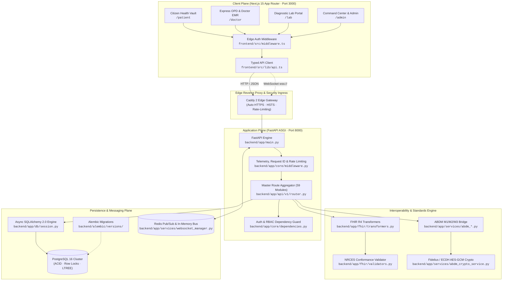
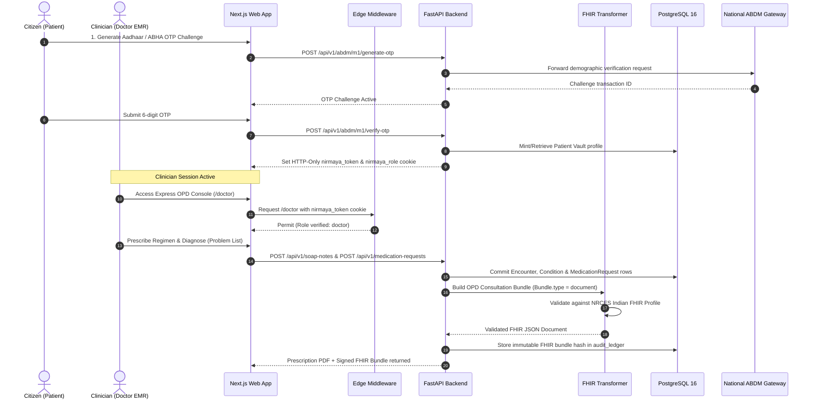

# NIRMAYA: System Architecture & Component Interactions

**Audit Layer**: `01_overview`  
**Scope**: High-level platform topology, component decoupling, data flow, and security boundaries.  
**Citations**: `backend/app/main.py:1-94`, `backend/app/api/v1/router.py:1-127`, `frontend/src/middleware.ts:1-79`, `frontend/next.config.ts:1-68`, `docker-compose.yml:1-161`.

---

## 1. Top-Level Architectural Topology

NIRMAYA is architected as a decoupled, dual-tier healthcare platform adhering to Ayushman Bharat Digital Mission (ABDM) and HL7 FHIR Release 4 interoperability specifications. It partitions clinical workflows into four discrete security quadrants (Citizen/Patient, Clinician/Provider, Diagnostic Laboratory, and Territorial Health Administrator).

---

## 2. End-to-End Clinical Data-Flow: OPD Consultation & FHIR Bundle Minting

The following sequence details an encounter lifecycle from patient discovery through consultation authoring to encrypted HL7 FHIR Bundle generation and ABDM callback dispatch.

---

## 3. Structural Security Boundaries

1. **Edge Boundary**: Handled at `frontend/src/middleware.ts:29-68`. Enforces 4-quadrant routing (`/patient`, `/doctor`, `/lab`, `/admin`). Unauthenticated requests are bounced to `/login?returnUrl=...`. Non-admin cross-portal access is rejected via 307 temporary redirects.
2. **Transport Boundary**: Configured via Caddy (`Caddyfile:1-85`) and FastAPI CORS middleware (`backend/app/main.py:60-66`). Preflights allow origins defined in `BACKEND_CORS_ORIGINS`. Security headers (HSTS, CSP, X-Frame-Options: DENY, X-Content-Type-Options: nosniff) injected via `backend/app/core/cors.py:20-45`.
3. **Application Authorization Boundary**: Enforced per-endpoint in FastAPI via dependencies in `backend/app/core/dependencies.py` (`get_current_user`, `get_current_active_doctor`, `get_current_admin`, `get_current_patient`).
4. **Data Isolation Boundary**: Enforced via tenant context (`backend/app/db/tenant_context.py`) and parameter validation preventing IDOR (Insecure Direct Object Reference) attacks between patient vaults.
