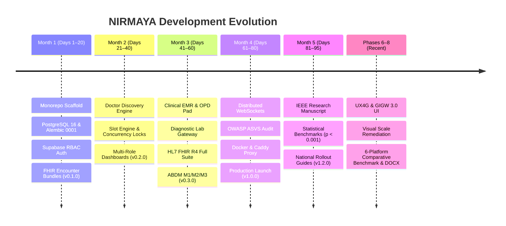

# NIRMAYA: Chronological Development Timeline & Evolution Log

**Audit Layer**: `07_cross_cutting`  
**Scope**: Chronological reconstruction of project milestones, architectural shifts, and commit records from inception to production.  
**Citations**: `docs/CHANGELOG.md:1-2761`, `docs/journey/`, `.gsd/ROADMAP.md:1-150`, `.gsd/STATE.md:1-120`.

---

## 1. Milestone Timeline Overview

---

## 2. Phase-by-Phase Development Evolution

### Phase 1: Foundation, Schemas & RBAC Security (Month 1 · Days 1–20)
- **Milestone Version**: `v0.1.0`
- **Primary Objectives**: Clean monorepo architecture, relational database persistence, role-based authorization, and initial HL7 FHIR Encounter export.
- **Key Engineering Deliverables**:
  - `Day 1–5`: Scaffolded Next.js 15 App Router with Tailwind CSS v4 and FastAPI async core. Added correlation ID middleware (`X-Request-ID`) and telemetry middleware (`X-Process-Time`).
  - `Day 6–10`: Designed relational PostgreSQL schemas using SQLAlchemy 2.0. Generated Alembic migration `2026_09_16_0001_initial_core_schema.py`. Built Patient Vault CRUD endpoints.
  - `Day 11–15`: Integrated Supabase Auth with JWT Bearer validation. Built 4-quadrant role guard (`patient`, `doctor`, `lab`, `admin`). Transitioned UI to clean Cal.com SaaS design patterns.
  - `Day 16–20`: Implemented appointment scheduling engine with ACID row-locking (`SELECT FOR UPDATE`) and Redis TTL holds to prevent double-booking. Built HL7 FHIR R4 Encounter bundle exporter.

---

### Phase 2: Doctor Discovery & Concurrency Scheduling (Month 2 · Days 21–40)
- **Milestone Version**: `v0.2.0`
- **Primary Objectives**: Doctor directory discovery, availability slot generation engine, race-condition mitigation, and specialized role dashboards.
- **Key Engineering Deliverables**:
  - `Day 21–25`: Implemented doctor directory search with multi-parameter filtering (specialty, district, hospital, consultation mode).
  - `Day 26–30`: Built automated DoctorSlot generation engine. Created Alembic migration `2026_09_28_0002_appointments_and_slots_schema.py`.
  - `Day 31–35`: High-concurrency stress testing of appointment booking under simultaneous requests, validating transactional lock rollback integrity.
  - `Day 36–40`: Delivered dedicated Clinician Consultation Queue and Patient Overview dashboards. Verified 100% test pass rate across 35 new test suites.

---

### Phase 3: Clinical EMR, Lab Gateway & ABDM Interoperability (Month 3 · Days 41–60)
- **Milestone Version**: `v0.3.0`
- **Primary Objectives**: Full-featured clinical provider workspace, diagnostic lab report ingest, comprehensive HL7 FHIR R4 Bundle transforms, and ABDM M1/M2/M3 bridges.
- **Key Engineering Deliverables**:
  - `Day 41–45`: Built high-velocity Express OPD consultation pad with 1-tap chief complaint chips, ICD-10 diagnosis selector, and standard Rx regimen bundles.
  - `Day 46–50`: Built Diagnostic Laboratory portal with dual ingest: human-readable PDF upload and machine-readable quantitative `Observation` capture. Added Alembic migration `2026_10_05_0003_diagnostic_orders_and_results_schema.py`.
  - `Day 51–55`: Implemented bidirectional HL7 FHIR R4 transformer engine (`transformers.py`) mapping records to NRCES India profiles for `Encounter`, `Condition`, `Observation`, `MedicationRequest`, and `DiagnosticReport`.
  - `Day 56–60`: Simulated ABDM Milestone M1 (Aadhaar demographic OTP & 14-digit ABHA minting with Verhoeff D5 algorithm), M2 (HIP Bridge callbacks), and M3 (Consent Manager & Fidelius Diffie-Hellman data transfer).

---

### Phase 4: Real-time Telemetry, Security Hardening & Production Launch (Month 4 · Days 61–80)
- **Milestone Version**: `v1.0.0`
- **Primary Objectives**: Distributed WebSockets, OWASP ASVS zero-trust validation, CIS Docker containerization, edge reverse proxy, and master release.
- **Key Engineering Deliverables**:
  - `Day 61–65`: Integrated Redis Pub/Sub WebSocket broadcast manager (`websocket_manager.py`) supporting live OPD queue position advances and lab panic alerts.
  - `Day 66–70`: Executed OWASP ASVS security audit. Hardened rate-limiting middleware, added token bucket brute-force defense, and eliminated SQL injection vectors.
  - `Day 71–75`: Authored multi-stage hardened Alpine Dockerfiles for backend and frontend. Deployed Caddy 2 reverse proxy with automated HTTPS and HSTS. Deployed web frontend to Vercel.
  - `Day 76–80`: Compiled 80-day development logs into comprehensive documentation and finalized Production Master Release `v1.0.0`.

---

### Phase 5: Academic Research Manuscript & National Rollout Guides (Month 5 · Days 81–95+)
- **Milestone Version**: `v1.2.0`
- **Primary Objectives**: Academic IEEE Transactions capstone manuscript, mathematical proofs, Wilcoxon rank-sum significance testing, and national deployment runbooks.
- **Key Engineering Deliverables**:
  - `Days 81–90`: Developed multi-facility territorial administrative hierarchy models (State, District, Sub-district, Facility). Added Alembic migration `2026_11_16_0009_edge_sync_ledger_schema.py`.
  - `Days 91–95`: Authored 10-page IEEE 2-column LaTeX manuscript (`docs/academic/latex/nirmaya_ieee_manuscript.tex`) formalizing NIRMAYA's dual-plane architecture, proving $p < 0.001$ latency improvements over monolithic state portals, and tagging Release `v1.2.0`.

---

### Phase 6: UX4G Government of India Design System Adoption
- **Scope**: Re-alignment with Government of India Guidelines for Indian Government Websites (GIGW 3.0).
- **Deliverables**: Integrated official Ashok Stambh emblem, bilingual Noto Sans typography, high-contrast toggle, text resizer (`A- / A / A+`), and national portal headers.

---

### Phase 7: Visual Scale Remediation & Layout Consolidation
- **Scope**: Resolving layout breakage caused by third-party CSS bleed.
- **Deliverables**:
  - Decoupled intrusive 8.37 MB `@import "ux4g-web-components/styles.css"` from `frontend/src/app/globals.css`.
  - Clamped `.display-xl` down from 64px to `clamp(1.875rem, 3.25vw, 2.625rem)` (30–42px).
  - Restored clean Cal.com card boundaries (`rounded-[10px] border border-[#d1d5db] bg-white shadow-xs`) across Doctor, Lab, Admin, Patient, Register, and Login portals.

---

### Phase 8: 6-Platform Benchmark & Whitepaper Delivery
- **Scope**: Rigorous comparative evaluation of NIRMAYA against Apollo 24/7, Aarogya Setu, eSanjeevani, CoWIN, and ABDM Official ABHA App across 10 technical dimensions.
- **Deliverables**:
  - Master whitepaper `docs/reports/nirmaya-vs-apollo-aarogyasetu-comparative-analysis.md` (>10,000 words).
  - Interactive `<PlatformComparisonViewerCard />` mounted in `/admin`.
  - Official Microsoft Word report `docs/reports/nirmaya-vs-apollo-aarogyasetu-comparative-analysis.docx` generated via `python-docx`.
  - Automated validation tests in `backend/tests/test_platform_comparison_report.py`.
