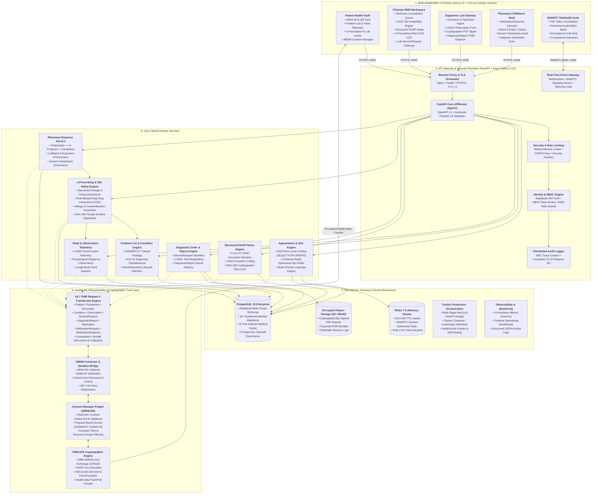
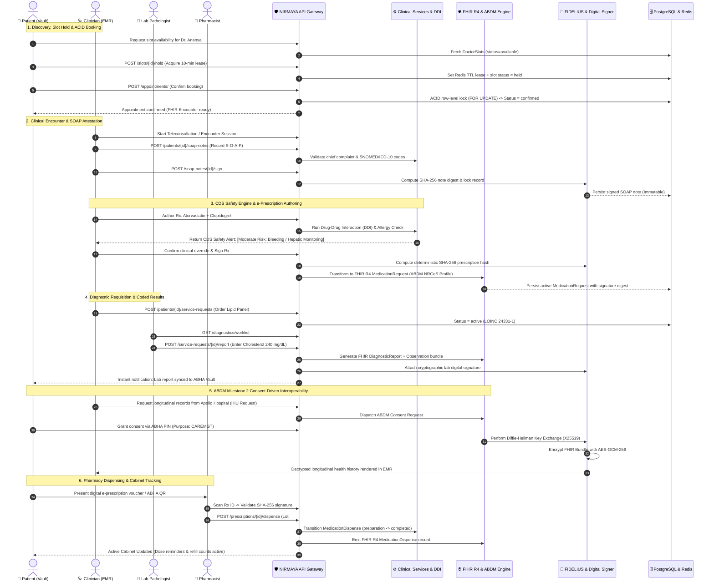
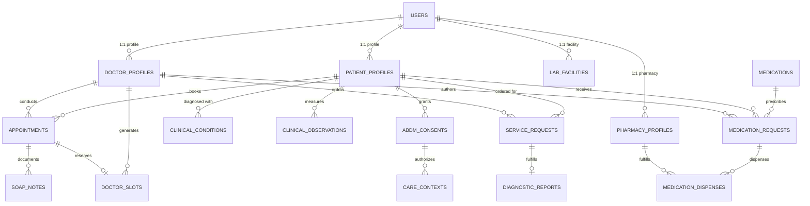

# Project NIRMAYA: Finalized System Architecture & Ecosystem Specification

**Release Version:** `v1.0.0` (Production Master Plan)  
**Standard Compliance:** HL7 FHIR Release 4 & Ayushman Bharat Digital Mission (ABDM M1 / M2 / M3)  
**Author:** Suryansh Swarn (`suryanshswarn@gmail.com`)

---

## 1. Executive Visual Architecture (Mermaid C4 System Diagram)

---

## 2. End-to-End Clinical Data Flow (Closed-Loop Lifecycle)

The diagram below maps the complete clinical journey across all 3 pillars of NIRMAYA: from slot reservation to consultation, AI-backed e-prescribing, diagnostic ordering, ABDM consent exchange, and pharmacy dispensing.

---

## 3. Core Architectural Modules & Deliverables (Full Scope)

| Architectural Pillar | Core Components | Interoperability & Security Standard |
|---|---|---|
| **1. Identity & Portals** | Patient Vault, Doctor EMR, Diagnostic Lab Gateway, Pharmacy Console, Admin Dashboard | Supabase Auth, ABHA M1 Token Broker, Cal.com Pure Modern SaaS Aesthetic |
| **2. Clinical Core** | Problem Lists, Vitals Telemetry, SOAP Encounter Documentation, Diagnostic Orders | SNOMED-CT, ICD-10, LOINC (70+ validated terms), SHA-256 note locking |
| **3. Pharmacotherapy** | Formulary Catalog (30+ drugs), e-Prescriptions, DDI Clinical Decision Support, Dispense Engine | RxNorm, WHO-ATC, FDA/CDSCO DDI rules, Lot/Batch tracking |
| **4. Interoperability** | FHIR Transformer Engine, CareContext Discovery, ABDM Consent Manager | HL7 FHIR Release 4 (NRCeS India Profiles), ABDM Milestone 1 & 2 |
| **5. Cryptography** | Tamper-evident digital signatures, Encrypted data transfer protocols | SHA-256 Hashing, FIDELIUS E2E Encryption (X25519 + AES-GCM-256) |
| **6. Real-time & Media** | Telehealth Video consultation, in-call chat, slot countdown timers | WebRTC Mesh, WebSockets, Redis TTL Ephemeral Store |
| **7. Production Infra** | Containerized micro-services, distributed telemetry, database migrations | Docker Compose, PostgreSQL 16 (15+ Alembic Revisions), Prometheus/Grafana |

---

## 4. Database Schema Entity-Relationship Map (Finalized 15+ Entities)

