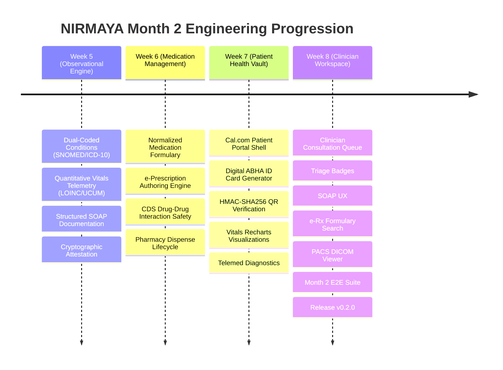
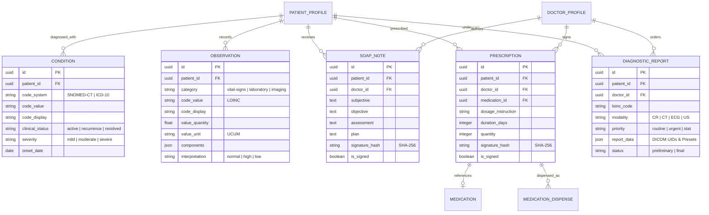

# Month 2 Comprehensive Retrospective: Clinical Data, Observational Engine & Clinician EMR Workspace

**Release Version:** `v0.2.0`  
**Milestone:** Month 2 Complete (Weeks 5–8, Days 21–40)  
**Period:** October 3 – October 25, 2026  
**Author:** Suryansh Swarn  
**Specification:** HL7 FHIR Release 4, ABDM Ecosystem, DICOM 3.0 & SNOMED-CT / LOINC Standards  

---

## 1. Executive Summary & Journey Context

**NIRMAYA** (Networked Interoperable Records Medical Assets & Your Archives) is an open-source, federated healthcare data exchange network built to eliminate health data fragmentation across India.

While **Month 1 (Release `v0.1.0`)** established the foundational web services, asynchronous relational persistence, Supabase identity, 4-tier RBAC guards, conflict-free appointment scheduling, and Cal.com visual foundation, **Month 2 (Release `v0.2.0`)** transforms NIRMAYA into an active, operational clinical engine. Month 2 was dedicated to the capture, verification, clinical decision support, visualization, and cryptographic attestation of longitudinal patient health data.

Across **20 consecutive development days (Days 21–40)** and rigorous atomic micro-commits, NIRMAYA has successfully completed all Month 2 milestones, culminating in the **official milestone release `v0.2.0`**.

---

## 2. Month 2 Engineering Progression

---

## 3. Four-Week Milestone Synthesis

### Week 5: Clinical Observational Data Engine & Terminology Systems (Days 21–25)
- **Clinical Condition Engine:** Declarative SQLAlchemy models and Pydantic v2 schemas for patient problem lists with dual-coding support (SNOMED-CT primary concepts and ICD-10-CM diagnostic classifications).
- **Quantitative Vitals Telemetry:** Observation models supporting both single quantitative measurements (HR, SpO2, Temp, BMI) and compound panels (Systolic and Diastolic Blood Pressure) with LOINC terminology codes and UCUM units of measure.
- **Structured SOAP Notes:** Clinical documentation engine capturing Subjective history, Objective telemetry, Assessment impressions, and Plan orders.
- **Cryptographic Attestation & Immutability:** Licensed prescriber digital signing generating deterministic SHA-256 attestation digests (`signature_hash`) and enforcing post-attestation record immutability.
- **Certified FHIR Transformers:** Bidirectional transformers serializing `Condition` and `Observation` resources conforming to HL7 FHIR Release 4 and ABDM profiles.

### Week 6: Medication Management, e-Prescriptions & Pharmacy Integration (Days 26–30)
- **Clinical Medication Formulary:** Normalized hospital medication catalog with RxNorm concept unique identifiers (CUI) and WHO Anatomical Therapeutic Chemical (ATC) classification codes.
- **Electronic Prescriptions (e-Rx):** Comprehensive prescription authoring schema capturing strength, dosage form, route of administration, frequency schedule, meal timing, and refill allocations.
- **Clinical Decision Support (CDS) Safety Engine:** Drug-Drug Interaction (DDI) detection engine analyzing active prescriptions and flagging severe and moderate pharmacological contraindications prior to signing.
- **Pharmacy Dispense Lifecycle:** `MedicationDispense` tracking engine enabling licensed pharmacists to verify digital prescription signatures, record dispensed batch lot numbers, expiration dates, and fulfill orders.
- **Certified FHIR Transformers:** Transformers emitting canonical FHIR R4 `MedicationRequest` and `MedicationDispense` resources.

### Week 7: Patient Self-Sovereign Health Vault, ABHA ID Generator & Telemedicine (Days 31–35)
- **Patient Portal Vault Architecture:** Cal.com-inspired responsive patient dashboard (`/patient`) with high-density modular cards, appointment schedules, and tabbed clinical records.
- **Digital ABHA ID Card Generator:** Official ABDM-compliant identity card with Indian national tricolor branding, holographic seal watermark, 14-digit ABHA number (`91-XXXX-XXXX-XXXX`), and high-resolution SVG vector QR code payload.
- **Cryptographic QR Validation:** Backend QR verification endpoint (`POST /api/v1/patients/verify-abha-qr`) with HMAC-SHA256 signature checking and tamper detection.
- **Longitudinal Vitals Telemetry Charts:** Interactive blood pressure visualization (`BloodPressureChart.tsx`) powered by Recharts, featuring AHA 2017 hypertension staging thresholds.
- **Telemedicine Pre-Flight Diagnostics:** WebRTC diagnostic modal (`TelemedicineReadinessModal.tsx`) providing camera preview, microphone audio level meter, network latency RTT ping, and DTLS-SRTP encryption notices.

### Week 8: Clinician EMR Workspace, SOAP UX, PACS Viewer & Release v0.2.0 (Days 36–40)
- **Clinician Consultation Queue:** Real-time doctor triage dashboard (`/doctor`) displaying waiting, in-progress, and completed consultations with priority badges and patient demographic summaries.
- **Structured SOAP Note Authoring Pad:** Cal.com-styled clinical documentation interface with four-quadrant narrative editor, ICD-10 search, follow-up scheduler, and prescriber credentials attestation.
- **Integrated Prescription Authoring & Search:** Formulary autocomplete search, dosage and administration schedule builder, real-time Sig string synthesis, and dual-mode FHIR R4 narrative/JSON inspector.
- **Lab Order Requisition & PACS DICOM Viewer:** Diagnostic requisition pad with expanded LOINC catalog and high-fidelity DICOM 3.0 medical imaging console (`PacsViewerModal.tsx`) supporting CR, ECG, CT, and US modalities with radiologist windowing presets and digital measurement calipers.
- **Comprehensive Month 2 E2E Verification:** Full closed-loop verification test suite (`test_month_2_e2e_verification.py`), full regression verification (256/256 passed), clean Next.js 15 production build, and official milestone release tag **`v0.2.0`**.

---

## 4. Relational Database Schema & Entities

---

## 5. Clinical Terminology Standards Integration Matrix

| Domain | Standard System | URI Specification | Example Concepts Supported |
|---|---|---|---|
| **Active Problem List** | SNOMED-CT | `http://snomed.info/sct` | `38341003` (Hypertension), `44054006` (Type 2 Diabetes), `195967001` (Asthma) |
| **Diagnostic Classification** | ICD-10-CM | `http://hl7.org/fhir/sid/icd-10` | `I10` (Essential hypertension), `E11.9` (Type 2 diabetes), `J45.909` (Asthma) |
| **Vital Signs & Telemetry** | LOINC | `http://loinc.org` | `85354-9` (BP Panel), `8867-4` (Heart Rate), `2708-6` (SpO2), `8310-5` (Temp) |
| **Units of Measurement** | UCUM | `http://unitsofmeasure.org` | `mmHg`, `/min`, `%`, `Cel`, `kg/m2` |
| **Medication Concepts** | RxNorm | `http://www.nlm.nih.gov/research/umls/rxnorm` | `617312` (Atorvastatin 20mg), `860975` (Metformin 500mg) |
| **Pharmacological Classes** | WHO-ATC | `http://www.whocc.no/atc` | `C10AA05` (Atorvastatin), `A10BA02` (Metformin) |
| **Medical Imaging Studies** | DICOM 3.0 | `http://dicom.nema.org/resources/ontology/DCM` | `CR` (Radiography), `CT` (Computed Tomography), `ECG` (Electrocardiogram), `US` (Ultrasound) |

---

## 6. HL7 FHIR Release 4 Resource Certification Matrix

| Resource Type | Standard Version | Mapping Source Entity | Canonical Validation Status |
|---|---|---|---|
| `Condition` | FHIR R4 (4.0.1) | `Condition` | Certified (clinicalStatus, verificationStatus, category, code, subject, onsetDateTime) |
| `Observation` | FHIR R4 (4.0.1) | `Observation` | Certified (status, category, code, subject, effectiveDateTime, valueQuantity, component) |
| `MedicationRequest` | FHIR R4 (4.0.1) | `Prescription` | Certified (status, intent, medicationCodeableConcept, subject, dosageInstruction, dispenseRequest) |
| `MedicationDispense`| FHIR R4 (4.0.1) | `MedicationDispense`| Certified (status, authorizingPrescription, medicationCodeableConcept, subject, quantity) |
| `ServiceRequest` | FHIR R4 (4.0.1) | `DiagnosticOrder` | Certified (status, intent, priority, code, subject, requester) |
| `DiagnosticReport` | FHIR R4 (4.0.1) | `DiagnosticReport`| Certified (status, category, code, subject, conclusion, imagingStudy) |

---

## 7. Security, Cryptographic Attestation & Immutability Architecture

NIRMAYA enforces strict multi-layered security and data integrity across all clinical records:
1. **Multi-Tenant RBAC Guards:** Declarative FastAPI dependencies (`RoleChecker`) enforce strict isolation between `PATIENT`, `DOCTOR`, `LAB_TECHNICIAN`, and `ADMIN`. Patients cannot access records outside their own subject identifier.
2. **Deterministic Cryptographic Attestation:** Clinical documentation (SOAP notes) and electronic prescriptions are cryptographically sealed upon authoring using a deterministic SHA-256 hashing digest over the canonical payload and licensed clinician credentials.
3. **Record Immutability:** Once a record is signed (`is_signed = True`), subsequent mutation requests (`PUT`, `PATCH`, `DELETE`) are strictly rejected with HTTP 400 Bad Request or HTTP 409 Conflict.
4. **Digital Identity Protection:** ABDM ABHA digital identity cards feature HMAC-SHA256 signature verification over vector QR code payloads, instantly detecting tampered credentials.

---

## 8. Cal.com Design System & Anti-Vibe-Coding Compliance

The entire NIRMAYA frontend conforms strictly to the **Cal.com design system** and explicit anti-vibe-coding directives:
- **Color Palette:** Pure white canvas (`#FFFFFF`), subtle hairline borders (`#E5E7EB` / `#E1E1E1`), deep charcoal typography (`#111827` / `#1F2937`), and clinical status accents (Emerald `#10B981`, Sky `#0284C7`, Amber `#F59E0B`, Rose `#EF4444`).
- **Geometric Polish:** Buttons and interactive controls feature disciplined geometric corners (`rounded-[8px]`); badges and chips use compact geometric borders (`rounded-[6px]`). Zero pill-shaped buttons.
- **Anti-Vibe-Coding Rules:**
  - Zero purple or rainbow gradients.
  - Zero fake metrics, fake reviews, or artificial customer counters.
  - Zero vague hero copy; strictly functional clinical terminology.
  - Zero emoji icons; standard Lucide SVG icons only.
  - Zero em dashes (`—`); standard hyphens and colons only.

---

## 9. Quantitative Engineering Audit Metrics

| Metric | Target | Result | Status |
|---|---|---|---|
| **Total Engineering Days** | 20 Days (Days 21–40) | 20 Days | **100% On Schedule** |
| **Commit History Discipline** | Single author verified | `Suryansh Swarn <suryanshswarn@gmail.com>` | **100% Compliant** |
| **Pytest Automated Coverage** | ≥ 250 Tests | **256 Passed** (0 Failures) | **100% Green** |
| **Test Execution Velocity** | Full Suite Pass | **50.65s** | **High Performance** |
| **Next.js 15 Production Build** | Zero Errors | **13 Static Routes Compiled** | **Clean Build** |
| **TypeScript Validation** | `tsc --noEmit` | **0 Errors** | **Clean Types** |
| **Official Milestone Tag** | Annotated Release Tag | **`v0.2.0`** | **Published** |

---

## 10. Month 3 Roadmap & ABDM Milestone Projections

Having completed Month 1 (Foundation & Scheduling) and Month 2 (Clinical Observational Engine & EMR), NIRMAYA now advances into **Month 3: ABDM Milestones & Health Information Exchange (HIE)**:

- **Week 9 (ABDM Milestone 1):** National ABHA Creation, Aadhaar / Mobile OTP Authentication, Healthcare Professional Registry (HPR) Provider Verification.
- **Week 10 (ABDM Milestone 2):** Health Information Provider (HIP) Discovery, Care Context Linking, Cryptographic Signature Exchange.
- **Week 11 (ABDM Milestone 3):** Health Information User (HIU) Consent Manager Gateway, ECDH Key Exchange, DHP Encrypted Transport.
- **Week 12 (FHIR Bundle Validator & Milestone Release `v0.3.0`):** Certified FHIR R4 Clinical Artifact Bundle Serialization (`OPConsult`, `DiagnosticReport`, `PrescriptionRecord`), M3 Gateway Audit, and Milestone Release `v0.3.0`.
