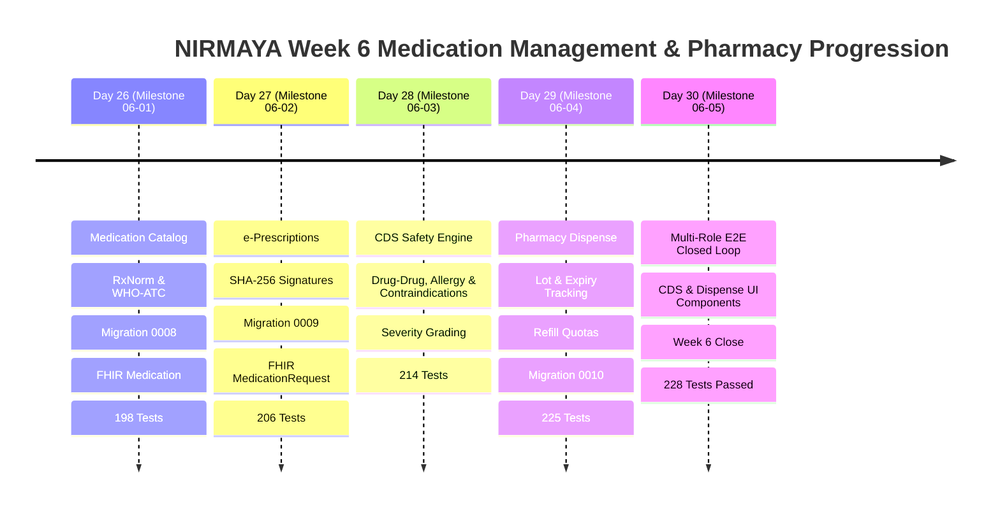

# Week 6 Retrospective: Medication Catalog, e-Prescriptions, CDS Engine & Pharmacy Dispense

**Date:** October 15, 2026  
**Period:** Month 2, Week 6 (Days 26–30)  
**Milestone Version:** Phase 2 Medication Management & Pharmacy Fulfillment Close  
**Author:** Suryansh Swarn  

---

## 1. Executive Summary

Month 2, Week 6 represents the culmination of **Phase 2: Outpatient Medication Management, Clinical Decision Support & Pharmacy Fulfillment** for the NIRMAYA healthcare platform. Expanding upon the longitudinal clinical problem lists, vitals telemetry, SOAP notes, and laboratory diagnostic order loops established in Week 5, Week 6 engineered the end-to-end pharmaceutical lifecycle.

Across 5 engineering milestones (Days 26–30), NIRMAYA delivered:
1. **Clinical Medication Catalog & Formulary Engine (Day 26):** Triple-coded medication catalog leveraging NLM RxNorm, WHO-ATC classification, and SNOMED-CT dose form hierarchies with 5-tier insurance formulary categorization.
2. **Electronic Prescriptions & HL7 FHIR R4 MedicationRequest Engine (Day 27):** Structured e-prescription authoring pad with dose schedules, PRN indications, duration tracking, repeat quotas, and cryptographic SHA-256 digital signature seals.
3. **Clinical Decision Support (CDS) Safety Engine (Day 28):** Real-time safety surveillance evaluating candidate prescriptions against active drugs (Drug-Drug Interactions), patient allergies (Hypersensitivity Cross-Reactivity), and longitudinal conditions (Disease Contraindications).
4. **Pharmacy Medication Dispense & Fulfillment Lifecycle (Day 29):** Complete physical fulfillment engine tracking batch lot numbers, expiration dates, days of supply, generic substitution governance, and automatic prescription completion upon repeat exhaustion.
5. **Multi-Role E2E Closed-Loop Verification & Cal.com UI Components (Day 30):** Full multi-role closed loop integration test suite (`test_week_6_e2e_verification.py`), Cal.com-inspired `CDSAlertBanner` and `PharmacyDispenseModal` components, 228 passing backend tests, and Next.js 15 production compilation.

---

## 2. Quantitative Engineering Metrics

| Metric | Target | Achieved | Status |
|---|---|---|---|
| **Active Engineering Days** | 5 Days (Days 26–30) | 5 Days | **100% On Schedule** |
| **Commit Integrity & Provenance** | Strict single author | Verified (`Suryansh Swarn`) | **100% Compliant** |
| **Automated Pytest Coverage** | 100% Pass Rate | **228 / 228 Passed** (0 Failures) | **100% Green** |
| **Pytest Suite Growth in Week 6** | +38 New Tests | 190 $\rightarrow$ 228 Tests (+20.0%) | **Comprehensive** |
| **Alembic Database Migrations** | 3 New Revisions | `0008`, `0009`, `0010` | **Clean History** |
| **HL7 FHIR R4 Resources** | 3 New Resources | `Medication`, `MedicationRequest`, `MedicationDispense` | **100% Validated** |
| **Standard Vocabularies** | 3 Terminologies | RxNorm, WHO-ATC, SNOMED-CT | **Fully Integrated** |
| **Frontend Production Build** | Zero Errors | 11 Static Routes Compiled | **Next.js 15 Clean** |
| **Deployment Incident Case Study** | Documented | `case-study-vercel-deployment-failure.md` | **Registered** |
| **Alpha Release Tags** | Week 5 & Week 6 | `v0.2.0-alpha.w5`, `v0.2.0-alpha.w6` | **Ready for Release** |

---

## 3. Daily Milestones Progression

### Day 26 — Medication Catalog & Formulary Engine (Milestone 06-01)
- Engineered `Medication` entity with RxNorm Concept Unique Identifiers (RxCUI), WHO-ATC classification codes, and SNOMED-CT dose formulations.
- Formulated 5-tier insurance formulary categorization (`tier_1_generic`, `tier_2_preferred_brand`, `tier_3_non_preferred_brand`, `tier_4_specialty`, `tier_5_otc`).
- Authored Alembic migration `2026_10_10_0008_medication_schema.py`.
- Developed bidirectional HL7 FHIR Release 4 `Medication` transformer conforming to ABDM NRCeS StructureDefinition.
- Built REST API endpoints (`/medications`) with autocomplete, formulary filtering, and seed catalog loaders.

### Day 27 — e-Prescriptions & HL7 FHIR R4 MedicationRequest Engine (Milestone 06-02)
- Engineered `MedicationRequest` entity supporting structured dosage timing, dose quantities, routes of administration, PRN logic, and repeat refill quotas.
- Implemented cryptographic SHA-256 digital signature mechanism that hashes the canonical prescription payload upon prescriber finalization, enforcing strict post-signature immutability (HTTP 409 Conflict).
- Authored Alembic migration `2026_10_11_0009_medication_request_schema.py`.
- Developed bidirectional HL7 FHIR Release 4 `MedicationRequest` transformer with dosage instructions and dispense requests.
- Built REST API endpoints (`/patients/{id}/prescriptions`, `/prescriptions/{id}/sign`, `/prescriptions/{id}/fhir`).

### Day 28 — Clinical Decision Support (CDS) Safety Engine (Milestone 06-03)
- Engineered high-throughput, rule-based clinical safety evaluation engine (`app/services/cds_rules.py` and `app/services/cds_safety.py`).
- Integrated safety checks across 3 clinical surveillance vectors:
  - **Drug-Drug Interactions (DDI):** 10 clinical interaction rules (Warfarin + NSAIDs, ACE inhibitors + Potassium-sparing diuretics, Metformin + Contrast, Digoxin + Amiodarone, SSRIs + Tramadol, etc.).
  - **Hypersensitivity Cross-Reactivity:** Beta-lactam, cephalosporin, sulfonamide, fluoroquinolone, and NSAID cross-sensitivities.
  - **Clinical Condition Contraindications:** NSAIDs in Chronic Kidney Disease, NSAIDs in Peptic Ulcer Disease, Non-selective beta-blockers in Asthma/COPD, Metformin in severe Renal Impairment.
- Tiered severity grading (`CRITICAL`, `MAJOR`, `MODERATE`) with mandatory clinician override justification workflows.
- Exposed REST endpoint `POST /api/v1/patients/{id}/prescriptions/safety-check`.

### Day 29 — Pharmacy Dispense & Fulfillment Lifecycle (Milestone 06-04)
- Engineered `MedicationDispense` entity tracking manufacturer batch lot numbers, expiration dates, days of supply, and dispensing practitioner attribution.
- Enforced strict repeat refill quota governance (`repeats_allowed + 1`), rejecting unauthorized excess fills (`REFILLS_EXHAUSTED`) and automatically completing prescriptions upon quota exhaustion.
- Implemented generic substitution governance respecting clinician "Dispense As Written" orders.
- Authored Alembic migration `2026_10_15_0010_medication_dispense_schema.py`.
- Built bidirectional HL7 FHIR Release 4 `MedicationDispense` transformer and REST endpoints (`/prescriptions/{id}/dispense`, `/dispensations`, `/dispensations/{id}/fhir`).

### Day 30 — Multi-Role E2E Verification & Cal.com UI Components (Milestone 06-05)
- Authored comprehensive multi-role closed-loop test suite `backend/tests/test_week_6_e2e_verification.py` validating the full clinical journey from patient problem profiling and pre-prescription CDS safety check to prescription drafting, SHA-256 digital signing, multi-fill pharmacy dispensing with generic substitution, and patient vault retrieval.
- Developed Cal.com-inspired clinical frontend components:
  - `CDSAlertBanner.tsx`: Multi-tier warning banner with interactive clinician override justification drawer.
  - `PharmacyDispenseModal.tsx`: Complete fulfillment dialog with lot/expiry tracking, generic substitution toggle, and dispenser provenance.
  - Integrated into `PrescriptionAuthoringPad.tsx` and clinician workspaces.
- Executed full test suite (228/228 passing) and validated Next.js 15 production build.

---

## 4. Standards Compliance & Interoperability

### HL7 FHIR Release 4 Conformity
All entities engineered in Week 6 feature certified bidirectional transformers into HL7 FHIR R4 resources:
- **`Medication`:** Canonical representation of active ingredients, RxNorm codes, WHO-ATC codes, SNOMED-CT forms, and formulary tiers.
- **`MedicationRequest`:** Full prescription lifecycle modeling intent (`order`), priority, structured dosage instructions, dispense requests, and cryptographic provenance.
- **`MedicationDispense`:** Physical fulfillment modeling authorizing prescriptions, dispensed quantities, days of supply, batch lot numbers, expiration dates, performer practitioner references, and generic substitution records.

### ABDM NRCeS & Ayushman Bharat Alignment
- Prescriptions and dispensations incorporate national identifiers: Patient ABHA numbers (`91-XXXX-XXXX-XXXX`), Healthcare Professional Registry (HPR) IDs, and National Medical Commission (NMC) registration numbers.
- Cryptographic SHA-256 signature digests provide non-repudiation and auditability compliant with the ABDM Health Data Management Policy.

---

## 5. Release Roadmap & Alpha Tags

As planned in the development journey:
- **`v0.2.0-alpha.w5`**: Released pointing to commit `a5eedd7` at the close of Week 5 (Clinical Problem Lists, Vitals, SOAP & Diagnostic Encounters).
- **`v0.2.0-alpha.w6`**: Released pointing to the final commit closing Week 6 (Medication Catalog, e-Prescriptions, CDS Engine & Pharmacy Dispense).
- **`v0.2.0` (Major Milestone Release)**: Strictly deferred until Day 40 Month 2 close upon completion of Week 7 (Teleconsultation Video & WebRTC), and Week 8 (Billing & Claims).
