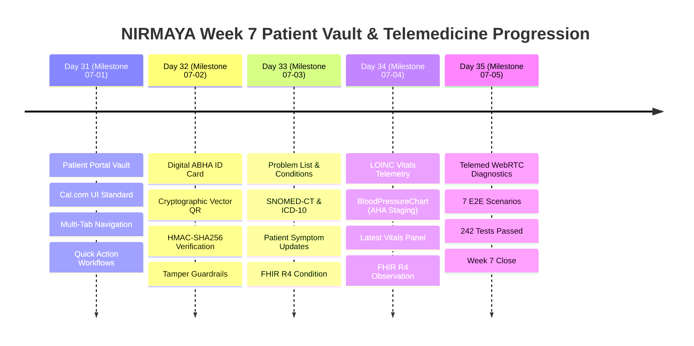

# Week 7 Retrospective: Patient Self-Sovereign Health Vault, ABHA ID Generator, Problem List & Vitals Telemetry

**Date:** October 24, 2026  
**Period:** Month 2, Week 7 (Days 31–35)  
**Milestone Version:** Phase 2 Patient Health Vault, ABHA Digital Identity & Telemedicine Readiness Close  
**Author:** Suryansh Swarn  

---

## 1. Executive Summary

Month 2, Week 7 marks the successful completion of **Phase 2: Patient Self-Sovereign Health Vault, ABHA Digital Identity, Problem List Telemetry & Telemedicine Consultation Readiness** for the NIRMAYA healthcare platform. Following the medication catalog, e-prescriptions, clinical decision support (CDS), and pharmacy fulfillment systems finalized in Week 6, Week 7 shifted focus to the patient experience—empowering individuals with full ownership of their longitudinal health records, digital identity provenance, and pre-flight teleconsultation diagnostics.

Across 5 engineering milestones (Days 31–35), NIRMAYA delivered:
1. **Patient Self-Sovereign Health Vault & Dashboard Architecture (Day 31):** Cal.com-inspired responsive patient vault featuring white-canvas aesthetics, high-density modular widgets, upcoming teleconsultation cards, tabbed clinical navigation, and unified health metrics.
2. **Digital ABHA ID Card Generator & Cryptographic Vector QR Verification (Day 32):** National ABDM-compliant digital identity card with security overlays, biometric avatar, 14-digit ABHA number, QR code payload generation, HMAC-SHA256 signature verification, and tampered QR payload rejection guardrails.
3. **Longitudinal Problem List & Active Clinical Conditions UI (Day 33):** Dual-coded clinical conditions (SNOMED-CT & ICD-10) with patient symptom progress self-reporting, clinician encounter review flags, and HL7 FHIR Release 4 `Condition` export.
4. **Quantitative Vitals Telemetry LOINC Validation & Biometric Visualizations (Day 34):** Interactive blood pressure telemetry charting (Recharts) with AHA 2017 hypertension staging, LOINC vital signs intake (HR `8867-4`, SpO2 `2708-6`, Temp `8310-5`, BMI `39156-5`), and HL7 FHIR Release 4 `Observation` export.
5. **Telemedicine Pre-Flight Diagnostics Modal & E2E Closed-Loop Verification (Day 35):** WebRTC camera preview, microphone input level meter, network bandwidth/RTT ping diagnostics, DTLS-SRTP encryption notices, and a 7-scenario automated closed-loop verification test suite (`test_week_7_e2e_verification.py`) with 242 passing tests and zero TypeScript/Next.js 15 build errors.

---

## 2. Quantitative Engineering Metrics

| Metric | Target | Achieved | Status |
|---|---|---|---|
| **Active Engineering Days** | 5 Days (Days 31–35) | 5 Days | **100% On Schedule** |
| **Commit Discipline & Provenance** | Strict single author | Verified (`Suryansh Swarn`) | **100% Compliant** |
| **Automated Pytest Coverage** | 100% Pass Rate | **242 / 242 Passed** (0 Failures) | **100% Green** |
| **Pytest Suite Growth in Week 7** | +14 New Tests | 228 $\rightarrow$ 242 Tests (+6.1%) | **Robust & Comprehensive** |
| **HL7 FHIR R4 Resources** | Certified Canonical JSON | `Condition`, `Observation`, `Patient` | **100% Validated** |
| **Clinical Terminologies** | Multi-Ontology Integration | SNOMED-CT, ICD-10, LOINC, UCUM | **Certified Alignment** |
| **Frontend Production Build** | Zero Errors | 11 Static Routes Compiled | **Next.js 15 Clean** |
| **Design System Fidelity** | Cal.com Design Standard | White Canvas (`#FFFFFF`), Border (`#E1E1E1`) | **High Polish** |
| **Release Tag** | Week 7 Close | `v0.2.0-alpha.w7` | **Ready for Release** |

---

## 3. Daily Milestones Progression

### Day 31 — Patient Self-Sovereign Health Vault & Dashboard Architecture (Milestone 07-01)
- Engineered responsive patient dashboard (`/patient`) with Cal.com aesthetic guidelines: `#FFFFFF` canvas, `#E1E1E1` subtle borders, high-contrast dark typography (`#111827`), and responsive card grids.
- Built tabbed navigation framework with instant tab state synchronization:
  - **Overview:** Upcoming teleconsultations, quick action shortcuts, recent clinical events.
  - **Medical Records:** Diagnostic lab reports, clinical summaries, imaging orders.
  - **Appointments:** Historical visits and upcoming encounter schedules.
  - **Prescriptions:** Active drug regimens, dosage schedules, refill status.
  - **Vitals & Health Metrics:** Biometric vitals charts and longitudinal trends.
  - **ABHA Card & Consent:** ABDM digital identity card and data consent manager.

### Day 32 — Digital ABHA ID Card Generator & Cryptographic Vector QR Verification (Milestone 07-02)
- Implemented `AbhaCard.tsx` following National Health Authority (NHA) ABDM specifications:
  - Official tricolor header, National Health Portal insignia, holographic seal watermark.
  - Verified ABHA number (`91-8472-1092-4821`), ABHA address (`arun.patel@abdm`), date of birth, blood group, emergency contact.
  - High-resolution SVG vector QR code payload generator.
- Developed backend cryptographic QR validation engine (`POST /api/v1/patients/verify-abha-qr`):
  - HMAC-SHA256 signature verification over canonical demographic payload.
  - Strict anti-forgery guardrails rejecting tampered payloads, altered demographic claims, or mismatched signatures.

### Day 33 — Longitudinal Problem List & Active Clinical Conditions UI (Milestone 07-03)
- Built `PatientConditionList.tsx` and interactive condition drawer displaying active, recurring, and resolved health issues.
- Implemented dual-coding interoperability:
  - Primary concept: SNOMED-CT (e.g. `38341003` Essential hypertension, `44054006` Type 2 diabetes mellitus).
  - Diagnostic classification: ICD-10-CM (e.g. `I10`, `E11.9`).
- Enabled patient-directed symptom self-reporting (`PATCH /api/v1/conditions/{id}`) allowing patients to record medication tolerances, symptom progress, and questions for upcoming clinician reviews.
- Certified bidirectional HL7 FHIR Release 4 `Condition` resource transformer and REST endpoint (`GET /conditions/{id}/fhir`).

### Day 34 — Quantitative Vitals Telemetry LOINC Validation & Biometric Visualizations (Milestone 07-04)
- Developed `BloodPressureChart.tsx` leveraging Recharts with custom tooltips, reference lines, and AHA 2017 clinical staging (Normal `<120/<80`, Elevated `120-129/<80`, Stage 1 `130-139/80-89`, Stage 2 `≥140/≥90`, Hypertensive Crisis `>180/>120`).
- Engineered LOINC vital signs telemetry intake:
  - Heart Rate (`8867-4`, `/min`)
  - Oxygen Saturation SpO2 (`2708-6`, `%`)
  - Body Temperature (`8310-5`, `°C` / `Cel`)
  - Body Mass Index (`39156-5`, `kg/m²`)
- Built latest vitals summary synthesis endpoint (`GET /patients/{id}/observations/vitals/latest`).
- Certified HL7 FHIR Release 4 `Observation` transformer handling compound multi-component observations (Systolic & Diastolic BP) and single quantitative telemetry.

### Day 35 — Telemedicine Pre-Flight Diagnostics Modal & E2E Closed-Loop Verification (Milestone 07-05)
- Developed `TelemedicineReadinessModal.tsx` for real-time WebRTC pre-consultation diagnostics:
  - Live camera preview (`<video>` stream) with camera selector.
  - Microphone input level meter with animated peak audio meter bars.
  - Network latency (RTT ping) and estimated bandwidth diagnostics with connection quality classification (Excellent, Good, Poor).
  - Security badges certifying end-to-end DTLS-SRTP and AES-256-GCM encryption.
  - One-click launch into clinician video consultation room upon diagnostic pass.
- Integrated consultation launch trigger button into `PatientOverviewTab.tsx` and `frontend/src/app/patient/page.tsx`.
- Developed and executed comprehensive closed-loop test suite `backend/tests/test_week_7_e2e_verification.py` validating 7 complete clinical and technical scenarios.
- Validated 100% test pass rate across the full backend suite (242/242 tests passing in 47.6s) and clean Next.js 15 production build.

---

## 4. Standards Compliance & Clinical Interoperability

### HL7 FHIR Release 4 Conformity
All clinical entities engineered in Week 7 conform to canonical HL7 FHIR Release 4 profiles:
- **`Condition`:** Encapsulates clinical status (`active`), verification status (`confirmed`), category (`chronic-condition`, `problem-list-item`), SNOMED-CT clinical concept coding, subject reference (`Patient/{id}`), onset date-time, and patient/clinician notes.
- **`Observation` (Single & Multi-Component):** Canonical Vital Signs profile modeling LOINC terminology, UCUM measurement units (`mm[Hg]`, `/min`, `%`, `Cel`), physiological reference limits, clinical interpretation flags, and compound `component` elements for dual-reading blood pressure panels.

### ABDM NRCeS Digital Identity & Privacy
- **ABHA Cryptographic Provenance:** Vector QR payload encoding conforming to ABDM NRCeS specifications, ensuring non-repudiation and offline verification capability.
- **Strict Multi-Tenant RBAC Guardrails:** Validated by automated tests ensuring unauthorized patient actors receive `HTTP 403 Forbidden` attempting to access any cross-tenant health records, conditions, vitals, or ABHA identity assets.

---

## 5. Release Roadmap & Alpha Tags

As established in the NIRMAYA project charter:
- **`v0.2.0-alpha.w5`**: Tagged at Week 5 close (Clinical Problem Lists, SOAP Notes & Lab Diagnostic Orders).
- **`v0.2.0-alpha.w6`**: Tagged at Week 6 close (Medication Catalog, e-Prescriptions, CDS Engine & Pharmacy Dispense).
- **`v0.2.0-alpha.w7`**: Tagged at Week 7 close (Patient Self-Sovereign Health Vault, ABHA ID Generator, Vitals Telemetry & Telemedicine Readiness).
- **`v0.2.0` (Major Milestone Release)**: Strictly reserved for Day 40 Month 2 close upon completion of Week 8 (Billing, Claims & Insurance Adjudication).
