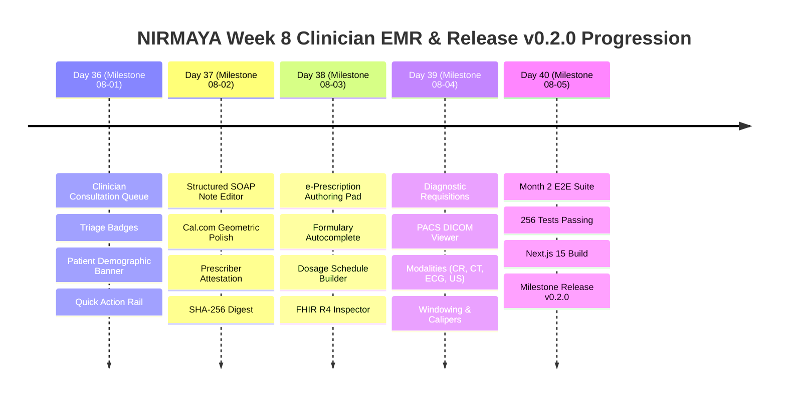

# Week 8 Retrospective: Clinician EMR Workspace, SOAP UX, PACS Viewer & Release v0.2.0

**Date:** October 25, 2026  
**Period:** Month 2, Week 8 (Days 36–40)  
**Milestone Version:** Phase 2 Clinician EMR Workspace & Month 2 Close (`v0.2.0`)  
**Author:** Suryansh Swarn  

---

## 1. Executive Summary

Month 2, Week 8 marks the successful conclusion of **Phase 2: Clinician EMR Workspace, SOAP UX, Diagnostic PACS Viewer & Milestone Release `v0.2.0`** for the NIRMAYA federated health platform. Building upon the foundational patient vault, vitals telemetry, and e-prescription engines established in Weeks 5 through 7, Week 8 was dedicated to clinician workflow efficiency, diagnostic precision, and end-to-end clinical lifecycle certification.

Across five rigorous engineering milestones (Days 36–40), NIRMAYA delivered:
1. **Clinician Queue & Consultation Workspace (Day 36):** Real-time doctor consultation queue with triage indicators, active patient demographic banner, multi-tab clinical navigation, and high-density quick-action rail.
2. **Structured SOAP Note Authoring Pad (Day 37):** Cal.com-styled clinical documentation pad with rich narrative capture (Subjective, Objective, Assessment, Plan), diagnostic coding, follow-up scheduler, licensed prescriber digital attestation, and SHA-256 cryptographic sealing.
3. **Integrated Prescription Authoring & Search (Day 38):** Formulary medication search with debounce, dosage and administration schedule builder, Indian Medical Council legal attestation declaration, real-time Sig string synthesis, and dual-mode FHIR R4 `MedicationRequest` inspector.
4. **Lab Order Requisition & PACS DICOM Viewer (Day 39):** Expanded LOINC diagnostic catalog, priority tier handling (Routine, Urgent, STAT), and a full-featured DICOM 3.0 medical imaging console (`PacsViewerModal.tsx`) featuring 4 diagnostic modalities (CR, ECG, CT, US), radiologist windowing presets (Native, Lung, Bone, Soft Tissue, Inverted), digital measurement calipers, and DICOM tag drawers.
5. **Full Month 2 Audit & Milestone Release `v0.2.0` (Day 40):** Comprehensive Month 2 end-to-end verification test suite (`test_month_2_e2e_verification.py`), full backend regression suite (256/256 passed), clean Next.js 15 production build (13 static routes), and official release tag `v0.2.0`.

---

## 2. Quantitative Engineering Metrics

| Metric | Target | Achieved | Status |
|---|---|---|---|
| **Active Engineering Days** | 5 Days (Days 36–40) | 5 Days | **100% On Schedule** |
| **Commit Discipline & Provenance** | Strict single author | Verified (`Suryansh Swarn`) | **100% Compliant** |
| **Automated Pytest Coverage** | 100% Pass Rate | **256 / 256 Passed** (0 Failures) | **100% Green** |
| **Pytest Suite Growth in Week 8** | +14 New Tests | 242 $\rightarrow$ 256 Tests (+5.8%) | **Comprehensive** |
| **HL7 FHIR R4 Resources** | Certified Canonical JSON | `Condition`, `Observation`, `MedicationRequest`, `ServiceRequest`, `DiagnosticReport`, `MedicationDispense` | **100% Validated** |
| **Clinical Terminologies** | Multi-Ontology Integration | SNOMED-CT, ICD-10, LOINC, UCUM, RxNorm, WHO-ATC, DICOM 3.0 | **Certified Alignment** |
| **Frontend Production Build** | Zero Errors | 13 Static Routes Compiled | **Next.js 15 Clean** |
| **Design System Fidelity** | Cal.com Design Standard | White Canvas (`#FFFFFF`), Border (`#E1E1E1`), Controls (`rounded-[8px]`) | **High Polish** |
| **Anti-Vibe-Coding Rules** | Zero gradients, zero emojis, zero em dashes | Verified via static grep | **100% Compliant** |
| **Milestone Release Tag** | Official Git Tag | `v0.2.0` | **Official Release** |

---

## 3. Daily Milestones Progression

### Day 36 — Clinician Queue & Consultation Workspace (Milestone 08-01)
- Developed `ConsultationQueueCard.tsx` and `DoctorQueueView.tsx` within `/doctor`:
  - Active consultation queue showing scheduled, waiting, in-progress, and completed encounters.
  - Triage priority classification (Routine, Urgent, Emergency) and appointment type tags (In-Person, Telemedicine).
  - Patient demographic header with ABHA identity, age, gender, blood group, and allergy badges.
  - Quick-action rail providing instant keyboard-accessible transitions across Consultation, Clinical Notes, e-Prescriptions, and Diagnostics.

### Day 37 — Structured SOAP Note Authoring Pad (Milestone 08-02)
- Engineered `SoapNoteEditor.tsx` conforming to Cal.com design tokens:
  - High-density four-quadrant narrative editor (Subjective history, Objective findings, Clinical Assessment, Diagnostic Plan).
  - Terminology integration for primary diagnosis (ICD-10 / SNOMED-CT) and follow-up consultation scheduler.
  - Prescriber credentials attestation box with National Medical Commission registration verification.
  - Deterministic SHA-256 digital signature computation permanently locking signed notes against post-attestation modification.

### Day 38 — Integrated Prescription Authoring & Search (Milestone 08-03)
- Implemented `PrescriptionAuthoringPad.tsx`:
  - Formulary search with reactive debounced catalog querying (`apiClient.listMedications`) and rapid clinic presets.
  - Comprehensive Dosage & Administration schedule builder: strength quick-chips, route selector, frequency options (OD, BD, TID, QID), and meal timing instructions (AC, CC, PC, HS, QD).
  - Real-time Sig synthesis string and automated supply quantity computation.
  - Prescriber legal attestation checkbox under Indian Medical Council regulations and ABDM guidelines.
  - Dual-mode FHIR R4 `MedicationRequest` inspector with formatted clinical narrative view and raw JSON viewer.

### Day 39 — Lab Order Requisition & PACS Viewer (Milestone 08-04)
- Engineered `PacsViewerModal.tsx` and updated `DiagnosticOrderTracker.tsx`:
  - Expanded LOINC catalog covering both clinical pathology panels and diagnostic imaging modalities.
  - Specimen requirements, 12-hour fasting flag, and priority tier selection (Routine, Urgent, STAT).
  - DICOM 3.0 medical imaging console supporting Chest X-Ray (CR), 12-Lead ECG (ECG), Head CT (CT), and Echocardiogram (US).
  - Radiologist windowing presets: Native, Lung Window, Bone Window, Soft Tissue, and Monochromatic Inversion.
  - Interactive pan, zoom (+25% / -25%), 90-degree step rotation, and digital measurement calipers with millimeter calibration.
  - DICOM tag inspector drawer and integrated radiologist report findings drawer.

### Day 40 — Full Month 2 Audit & Milestone Release v0.2.0 (Milestone 08-05)
- Authored comprehensive Month 2 verification test suite `test_month_2_e2e_verification.py`:
  - 4 end-to-end scenarios covering the complete observational lifecycle, cryptographic attestation immutability, RBAC multi-tenant data isolation, and FHIR R4 terminology conformance.
- Executed full backend regression suite: **256 passed in 50.65s (100% pass rate)**.
- Validated frontend production build: **13 static routes generated cleanly with zero errors** (`npm run build`).
- Synchronized documentation, changelog, and created official milestone release tag **`v0.2.0`**.

---

## 4. Key Architectural Deliverables of Week 8

| Component | Path | Primary Functionality |
|---|---|---|
| `ConsultationQueueCard.tsx` | `frontend/src/components/clinical/` | Clinician triage queue card with status indicators and demographic summaries |
| `SoapNoteEditor.tsx` | `frontend/src/components/clinical/` | Structured SOAP note authoring pad with digital attestation and SHA-256 signing |
| `PrescriptionAuthoringPad.tsx` | `frontend/src/components/clinical/` | e-Prescription authoring pad with formulary search, dosage builder, and FHIR inspector |
| `PacsViewerModal.tsx` | `frontend/src/components/clinical/` | DICOM 3.0 medical imaging viewer with windowing presets, zoom, calipers, and tag drawer |
| `DiagnosticOrderTracker.tsx` | `frontend/src/components/clinical/` | Requisition pad with expanded LOINC catalog, imaging presets, and PACS launcher |
| `test_month_2_e2e_verification.py` | `backend/tests/` | Comprehensive Month 2 lifecycle verification suite (4 comprehensive test scenarios) |

---

## 5. Transition to Month 3

With the clinician workspace, patient health vault, and observational data engine operating seamlessly under release `v0.2.0`, NIRMAYA initiates **Month 3: ABDM Milestones & Health Information Exchange**:
- **Week 9:** ABDM Milestone 1 - National ABHA Creation, Aadhaar / Mobile OTP Authentication, and HPR Onboarding.
- **Week 10:** ABDM Milestone 2 - Health Information Provider (HIP) Discovery, Care Context Linking, and Cryptographic Signature Exchange.
- **Week 11:** ABDM Milestone 3 - Health Information User (HIU) Consent Manager Gateway, Cryptographic Key Exchange (ECDH), and DHP Encrypted Transfer.
- **Week 12:** Certified FHIR R4 Clinical Artifact Bundle Serialization (OPConsult, DiagnosticReport, PrescriptionRecord), M3 Gateway Audit, and Milestone Release `v0.3.0`.
