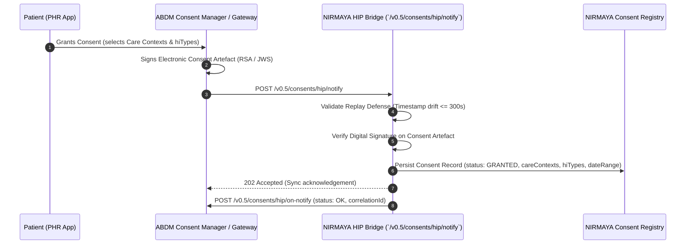

# Day 51: ABDM Milestone 3 Consent Notification & Artefact Ingestion

## 1. Architectural Position & Context
- **Milestone:** Month 3, Week 11 — Milestone 11-01 (ABDM Milestone 3: Health Information Exchange & Consent Management)
- **Role:** Health Information Provider (HIP) Ingress Boundary
- **Objective:** Establish the foundational ingress gateway for ABDM Milestone 3 (M3). Before health records can be packaged and transferred from NIRMAYA to external Health Information Users (HIUs) or patient PHR applications, NIRMAYA must receive, verify, store, and acknowledge patient-approved Electronic Consent Artefacts dispatched by the ABDM Consent Manager (CM) via the Gateway webhook `POST /v0.5/consents/hip/notify`.

---

## 2. Technical Implementation Deliverables

### 2.1 Standardized NHA v0.5 Consent Schemas
Located in [`backend/app/schemas/abdm_m3_consent.py`](file:///e:/nirmaya-side/backend/app/schemas/abdm_m3_consent.py), these Pydantic v2 models strictly conform to the National Health Authority (NHA) ABDM v0.5 Data Flow Specifications:
- `ConsentPatient`: Patient ABHA address (`<username>@abdm` or 14-digit ABHA).
- `ConsentPurpose`: Clinical purpose code (e.g., `CAREMGT`, `PUBHLTH`, `DSRCH`, `PATRQT`, `BTG`).
- `ConsentDateRange`: Permitted clinical date window (`from`, `to`).
- `ConsentPermission`: Access mode (`VIEW`, `STORE`, `STREAM`), clinical records date range, expiration timestamp (`dataEraseAt`), and frequency constraints.
- `ConsentCareContextReference`: Mapping patient reference and specific `careContextReference` IDs.
- `ConsentDetail` & `ConsentArtefact`: Complete electronic consent contract structure with digital `signature` attribute (JWS / SHA256withRSA).
- `ConsentNotificationPayload`: Root payload for inbound Gateway webhook.
- `GatewayConsentOnNotifyCallback`: Standardized asynchronous acknowledgement response for `POST /v0.5/consents/hip/on-notify`.

### 2.2 Ingestion, Signature Verification & Consent Registry Service
Located in [`backend/app/services/abdm_consent.py`](file:///e:/nirmaya-side/backend/app/services/abdm_consent.py):
- **Gateway Replay Protection:** Re-uses standard $\pm 300\text{s}$ timestamp drift validation to neutralize replay attacks.
- **Signature Verification:** Verifies the presence and integrity of the Consent Manager's digital signature over the canonical consent payload.
- **Thread-Safe In-Memory / Redis Registry Store (`ConsentRegistryStore`):**
  - Indexes active and historical consents by `consent_id` and `patient_id`.
  - Supports lifecycle transitions: `GRANTED` $\to$ `REVOKED` $\to$ `EXPIRED`.
- **Fine-Grained Record Authorization Engine (`validate_record_authorization`):**
  - Validates in sub-millisecond time whether an incoming health data request is authorized by verifying:
    1. Active `GRANTED` consent status.
    2. Non-expired validity (`now < dataEraseAt`).
    3. Permitted health information category (`hiTypes` e.g., `OPConsultation`, `DiagnosticReport`, `Prescription`).
    4. Linkage to authorized care contexts (`careContexts`).
    5. Record creation date falls strictly within the permitted `dateRange` window.
- **Asynchronous Callback Dispatcher (`dispatch_consent_on_notify`):** Formulates and dispatches `POST /v0.5/consents/hip/on-notify` correlating `resp.requestId` with the inbound Gateway request.

### 2.3 API Router & Webhook Endpoints
Located in [`backend/app/api/v1/endpoints/abdm_m3_consent.py`](file:///e:/nirmaya-side/backend/app/api/v1/endpoints/abdm_m3_consent.py):
- `POST /v0.5/consents/hip/notify`: Synchronous `202 Accepted` Gateway webhook listener.
- `GET /api/v1/abdm/m3/consent/consents/{consent_id}`: Query internal stored consent details and permissions.
- `GET /api/v1/abdm/m3/consent/consents/patient/{patient_id}`: List all consents registered for a patient.
- `POST /api/v1/abdm/m3/consent/consents/simulate`: Interactive developer testing endpoint generating synthetic consent notifications.
- `POST /api/v1/abdm/m3/consent/consents/{consent_id}/revoke`: Manual simulation endpoint to test revocation propagation.

---

## 3. Protocol Sequence Flow

---

## 4. Verification & Testing

### 4.1 Test Matrix ([`backend/tests/test_abdm_m3_consent.py`](file:///e:/nirmaya-side/backend/tests/test_abdm_m3_consent.py))
- `test_signature_verification_success`: Validates conforming signature strings pass cryptographic check.
- `test_signature_verification_failure`: Asserts empty or malformed signatures fail validation.
- `test_webhook_inbound_notify_accepted`: Verifies `/v0.5/consents/hip/notify` synchronously returns `202 Accepted` and logs telemetry in `webhook_audit_store`.
- `test_webhook_inbound_replay_drift_rejection`: Confirms stale timestamps (>300s drift) are rejected with `HTTP 400`.
- `test_process_granted_consent`: Validates record creation in registry and `on-notify` callback generation.
- `test_process_revoked_consent`: Tests state transition to `REVOKED` upon receiving revocation notification.
- `test_validate_record_authorization`: Evaluates multi-dimensional access control (valid record passes; unauthorized hiType, invalid care context, or out-of-range date rejected).
- `test_query_consent_endpoints`: Verifies retrieval by `consent_id` and `patient_id`.
- `test_simulate_consent_endpoint`: Verifies end-to-end synthetic consent simulation.

### 4.2 Test Execution Results
- **Day 51 Suite:** 9 / 9 passed (100% green in 1.10s).
- **Cumulative Backend Suite:** 337 / 337 passed (100% green in 82.23s).
- **Frontend Production Build:** Next.js 15.5.25 compiled cleanly (13/13 static pages, 0 errors).
