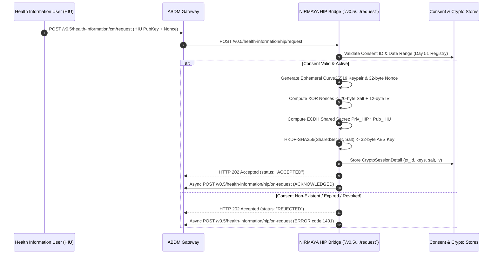

# Day 52: Diffie-Hellman Key Exchange & HKDF-SHA256 Derivation

## 1. Architectural Position & Context
- **Milestone:** Month 3, Week 11 — Milestone 11-02 (ABDM Milestone 3: Health Information Exchange & Consent Management)
- **Role:** Health Information Provider (HIP) End-to-End Encryption Boundary
- **Objective:** Establish the cryptographic key exchange and shared secret derivation foundation for ABDM Milestone 3 data transfer. Conforming strictly to National Health Authority (NHA) **Fidelius** specifications, before sensitive FHIR bundles are transmitted between Health Information Providers (HIP) and Health Information Users (HIU), both parties execute an Elliptic Curve Diffie-Hellman (ECDH) key agreement over Curve25519 (X25519) followed by HKDF-SHA256 symmetric key derivation.

---

## 2. Technical Implementation Deliverables

### 2.1 Standardized NHA v0.5 Cryptographic Schemas
Located in [`backend/app/schemas/abdm_m3_crypto.py`](file:///e:/nirmaya-side/backend/app/schemas/abdm_m3_crypto.py), these Pydantic v2 models strictly conform to NHA ABDM v0.5 Data Flow & Fidelius specifications:
- `KeyUserInfo`: Base64-encoded Curve25519 public key and 32-byte cryptographically secure random nonce.
- `KeyMaterial`: Cryptographic algorithm parameters (`cryptoAlg: "ECDH"`, `curve: "Curve25519"`, `userInfo`).
- `HIRequestDetail` & `HIRequestPayload`: Inbound health information request received on `/v0.5/health-information/hip/request` carrying correlation `transactionId`, `consentId`, requested `dateRange`, `dataPushUrl`, and HIU key material.
- `HIOnRequestAcknowledgement` & `HIOnRequestCallback`: Asynchronous acknowledgement payload dispatched to Gateway `/v0.5/health-information/hip/on-request`.
- `CryptoSessionDetail`: Cache representation storing local ephemeral key, peer public key, XOR nonces, derived 20-byte Salt, 12-byte IV, and 256-bit symmetric encryption key.
- `KeyGenerationResponse` & `KeyExchangeComputeResponse`: Testing and verification models for developer evaluation and diagnostic tooling.

### 2.2 Cryptographic Core Service & Fidelius Engine
Located in [`backend/app/services/abdm_crypto.py`](file:///e:/nirmaya-side/backend/app/services/abdm_crypto.py):
- **Ephemeral Curve25519 Key Pair Generation:** Generates fresh X25519 key pairs per transfer session with raw 32-byte Base64 serialization and multi-format parsing (Raw, DER, PEM).
- **32-Byte CSPRNG Nonce Generation:** Uses `secrets.token_bytes(32)` to guarantee maximum entropy and eliminate replay vulnerability.
- **Dual-Nonce XOR Derivation (Fidelius Specification):**
  - Computes $\text{Nonce}_{\text{XOR}} = \text{Nonce}_{\text{local}} \oplus \text{Nonce}_{\text{peer}}$ (32 bytes).
  - Partitions into:
    - **Salt (First 20 bytes):** Used as salt input for HKDF-SHA256 key derivation.
    - **IV (Last 12 bytes):** Used as the standard 96-bit Initialization Vector for AES-256-GCM authenticated encryption.
- **ECDH Shared Secret Agreement:** Executes scalar multiplication $\text{SharedSecret} = \text{ECDH}(\text{Priv}_{\text{local}}, \text{Pub}_{\text{peer}})$ (32 bytes).
- **HKDF-SHA256 Key Derivation (RFC 5869):** Derives a deterministic 32-byte (256-bit) symmetric AES key from the shared secret and 20-byte salt.
- **Thread-Safe Cryptographic Session Cache (`CryptoSessionStore`):** Stores active sessions indexed by `transactionId` and `consentId` with automated 1-hour TTL expiration.
- **Asynchronous Callback Dispatcher (`dispatch_hi_on_request`):** Formulates and dispatches `/v0.5/health-information/hip/on-request` with audit logging in `WebhookAuditStore`.

### 2.3 Gateway Webhook & Cryptographic Endpoints
Located in [`backend/app/api/v1/endpoints/abdm_m3_crypto.py`](file:///e:/nirmaya-side/backend/app/api/v1/endpoints/abdm_m3_crypto.py):
- `POST /v0.5/health-information/hip/request`: Synchronous `202 Accepted` Gateway webhook listener. Verifies consent in `ConsentRegistryStore`, derives symmetric encryption key, stores session, and schedules async `/on-request` callback.
- `POST /v0.5/health-information/hip/on-request`: Gateway acknowledgement callback receiver.
- `POST /api/v1/abdm/m3/crypto/keys/generate`: Local developer endpoint to generate Curve25519 keypairs and nonces.
- `POST /api/v1/abdm/m3/crypto/exchange`: Direct cryptographic handshake computation verifying shared secret and derived keys.
- `GET /api/v1/abdm/m3/crypto/sessions`: Inspect active cryptographic sessions.
- `GET /api/v1/abdm/m3/crypto/sessions/{transaction_id}`: Fetch session details by transaction ID.

---

## 3. Cryptographic Protocol Sequence Flow

---

## 4. Verification & Quality Gate

### 4.1 Automated Test Suite (`backend/tests/test_abdm_m3_crypto.py`)
11 comprehensive unit and integration tests executed in **0.66s**:
1. `test_key_pair_generation`: Curve25519 generation and 32-byte Base64 serialization.
2. `test_nonce_generation_entropy`: 32-byte CSPRNG nonces with zero collisions across 50 iterations.
3. `test_nonce_xor_and_salt_iv_derivation`: Verifies mathematical partitioning into 20-byte Salt and 12-byte IV.
4. `test_ecdh_shared_secret_symmetry`: Proves Diffie-Hellman symmetry: $\text{DH}(\text{Alice}_{\text{priv}}, \text{Bob}_{\text{pub}}) == \text{DH}(\text{Bob}_{\text{priv}}, \text{Alice}_{\text{pub}})$.
5. `test_hkdf_sha256_derivation`: Deterministic 32-byte symmetric key extraction and expansion.
6. `test_full_peer_key_exchange_handshake`: Full Alice (HIU) and Bob (HIP) handshake producing 100% cryptographic parity across shared secret, salt, IV, and derived symmetric key.
7. `test_crypto_session_store_lifecycle`: Caching, indexing by consent ID, and expiration cleanup.
8. `test_gateway_inbound_hi_request_authorized`: Inbound `/v0.5/health-information/hip/request` with Day 51 consent artefact generates key agreement and caches session.
9. `test_gateway_inbound_hi_request_unauthorized_consent`: Inbound request with non-existent consent correctly rejected.
10. `test_crypto_api_endpoints`: Endpoints `/keys/generate`, `/exchange`, and `/on-request` return HTTP 200.
11. `test_gateway_inbound_hi_request_mismatched_dates`: Rejects data requests when requested date range does not overlap granted consent.

### 4.2 Cumulative System Test Results
- **Backend Test Suite:** **348 / 348 tests passed** (100% green in 68.67s).
- **Frontend Production Build:** Next.js 15.5.25 generated 13/13 static routes with **0 errors**.
