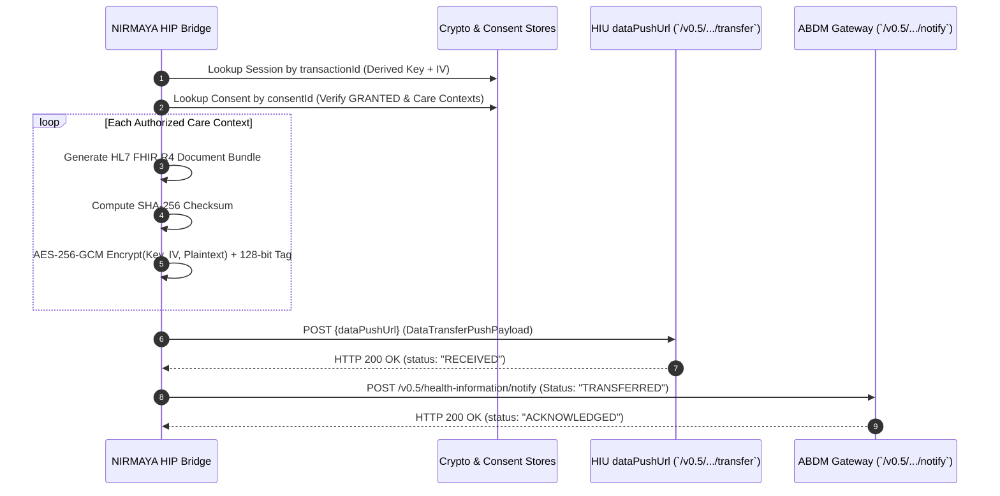

# Day 53: Encrypted Health Data Transfer Pipeline (AES-256-GCM & FHIR Document Bundle Push)

## 1. Architectural Position & Context
- **Milestone:** Month 3, Week 11 — Milestone 11-03 (ABDM Milestone 3: Health Information Exchange & Consent Management)
- **Role:** Health Information Provider (HIP) Data Transfer Egress Boundary
- **Objective:** Implement the end-to-end encrypted health data transfer pipeline. Once an ABDM Electronic Consent Artefact is verified (Day 51) and an Elliptic Curve Diffie-Hellman key agreement established (Day 52), NIRMAYA packages authorized clinical records into standardized HL7 FHIR R4 Document Bundles, performs authenticated symmetric encryption via **AES-256-GCM** using the 256-bit derived key and 12-byte IV, pushes the payload to the Health Information User's (HIU) `dataPushUrl`, and transmits session status notifications to the ABDM Gateway (`POST /v0.5/health-information/notify`).

---

## 2. Technical Implementation Deliverables

### 2.1 Standardized NHA v0.5 Data Transfer Schemas
Located in [`backend/app/schemas/abdm_m3_transfer.py`](file:///e:/nirmaya-side/backend/app/schemas/abdm_m3_transfer.py), these Pydantic v2 models strictly conform to NHA ABDM v0.5 Data Flow specifications:
- `EncryptedDataEntry`: Base64-encoded ciphertext with appended 128-bit authentication tag, MIME type (`application/fhir+json`), tamper-evident SHA-256 checksum, and associated `careContextReference`.
- `DataTransferPushPayload`: Outbound health data push payload carrying `pageNumber`, `pageCount`, correlation `transactionId`, `entries`, and HIP's `keyMaterial` (Curve25519 public key and CSPRNG nonce).
- `DataTransferPushResponse`: Dispatch confirmation containing transaction ID, consent ID, transferred entries count, and delivery timestamp.
- `DataTransferNotificationPayload`: ABDM Gateway notification schema (`POST /v0.5/health-information/notify`) with `statusNotification` (`TRANSFERRED` / `FAILED`) and per-care-context delivery receipts.
- `TransferAuditRecord`: Internal audit model stored in the circular transfer ledger.
- Diagnostic schemas: `DirectEncryptRequest`, `DirectEncryptResponse`, `DirectDecryptRequest`, `DirectDecryptResponse`, `TransferTriggerRequest`.

### 2.2 Core Transfer Service & Packaging Engine
Located in [`backend/app/services/abdm_transfer.py`](file:///e:/nirmaya-side/backend/app/services/abdm_transfer.py):
- **AES-256-GCM Authenticated Encryption:** Uses `cryptography.hazmat.primitives.ciphers.aead.AESGCM` with the 32-byte derived key and 12-byte IV. Appends the 128-bit authentication tag directly to ciphertext to prevent ciphertext malleability.
- **Tamper-Evident SHA-256 Checksums:** Computes pre-encryption SHA-256 digests over plaintext bundles to ensure end-to-end data integrity.
- **HL7 FHIR R4 Document Bundle Generation:** Converts clinical records (OP Consultations, Diagnostic Reports, Prescriptions) into valid FHIR R4 Document Bundles containing `Composition`, `Encounter`, and clinical resource entries (`DiagnosticReport`, `MedicationRequest`).
- **Orchestrated Transfer Pipeline (`execute_data_transfer`):**
  1. Validates active session in `CryptoSessionStore`.
  2. Validates `GRANTED` status in `ConsentRegistryStore`.
  3. Iterates over authorized care contexts, generating and encrypting bundles.
  4. Dispatches HTTP POST payload to HIU `dataPushUrl`.
  5. Emits `POST /v0.5/health-information/notify` with session status `TRANSFERRED`.
- **Thread-Safe Transfer Ledger (`TransferAuditStore`):** In-memory circular buffer tracking outgoing pushes and incoming receipts.

### 2.3 Gateway Webhook & API Endpoints
Located in [`backend/app/api/v1/endpoints/abdm_m3_transfer.py`](file:///e:/nirmaya-side/backend/app/api/v1/endpoints/abdm_m3_transfer.py):
- `POST /v0.5/health-information/transfer`: Synchronous HTTP 200 receiver endpoint when NIRMAYA operates as HIU or receives test data transfers.
- `POST /v0.5/health-information/notify`: Gateway transfer status notification receiver.
- `POST /api/v1/abdm/m3/transfer/push`: Initiates encrypted data transfer push for an established transaction ID.
- `POST /api/v1/abdm/m3/transfer/encrypt`: Direct test utility encrypting arbitrary JSON payloads.
- `POST /api/v1/abdm/m3/transfer/decrypt`: Direct test utility decrypting ciphertext using key and IV.
- `GET /api/v1/abdm/m3/transfer/history`: Query recent data transfer audit history.

---

## 3. Transfer Protocol Sequence Flow

---

## 4. Verification & Quality Gate

### 4.1 Automated Test Suite (`backend/tests/test_abdm_m3_transfer.py`)
9 comprehensive unit, cryptographic, and pipeline tests executed in **1.80s**:
1. `test_aes_gcm_encrypt_decrypt_roundtrip`: Verifies plaintext $\to$ AES-256-GCM $\to$ plaintext exact match.
2. `test_aes_gcm_tampered_ciphertext_fails`: Proves authentication tag verification prevents tampering (bit-flip triggers InvalidTag).
3. `test_aes_gcm_checksum_integrity`: Validates SHA-256 digest matching unencrypted bundle.
4. `test_generate_clinical_bundle_json`: Verifies output is valid FHIR R4 Bundle with Composition, Encounter, and clinical resources.
5. `test_execute_data_transfer_authorized_session`: Complete pipeline test verifying packaging, encryption, and push for authorized care contexts.
6. `test_execute_data_transfer_expired_session`: Rejects transfer if crypto session is expired.
7. `test_execute_data_transfer_revoked_consent`: Rejects transfer if consent was revoked.
8. `test_gateway_transfer_endpoints`: Inbound `/v0.5/health-information/transfer` and `/notify` validation.
9. `test_api_encrypt_decrypt_and_push_endpoints`: Direct diagnostic encryption/decryption utilities and transfer push trigger.

### 4.2 Cumulative System Test Results
- **Backend Test Suite:** **357 / 357 tests passed** (100% green in 96.15s).
- **Crypto & Transfer Joint Suite:** **20 / 20 tests passed in 2.96s**.
- **Frontend Production Build:** Next.js 15.5.25 generated 13/13 static routes with **0 errors**.
