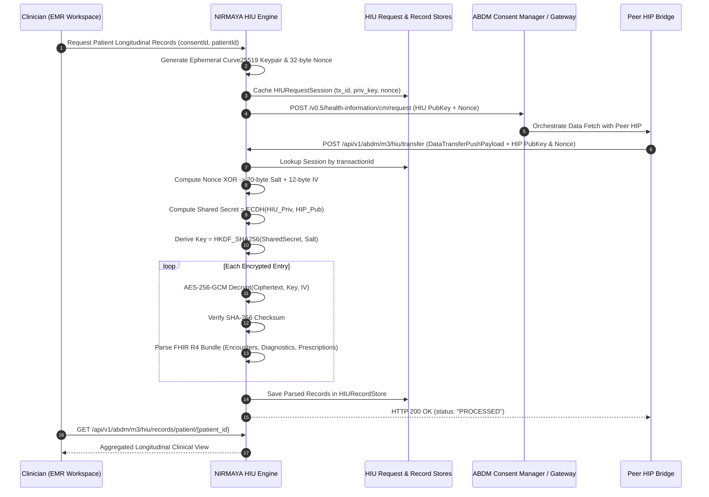

# Day 54: Health Information User (HIU) Data Consumer Engine (Decryption, FHIR Parsing & Longitudinal View)

## 1. Architectural Position & Context
- **Milestone:** Month 3, Week 11 — Milestone 11-04 (ABDM Milestone 3: Health Information Exchange & Consent Management)
- **Role:** Health Information User (HIU) Ingestion & Consumer Boundary
- **Objective:** Establish NIRMAYA's sovereign capabilities as an ABDM Health Information User (HIU). While Days 51–53 established the Health Information Provider (HIP) data release pipeline, Day 54 completes the data consumer role. Clinicians in NIRMAYA can now request longitudinal patient health records from external providers under an approved Electronic Consent Artefact, receive encrypted data pushes at the HIU transfer boundary, derive symmetric keys via Nonce XOR and ECDH, decrypt AES-256-GCM ciphertexts with 128-bit authentication tag validation, verify SHA-256 bundle checksums, and parse HL7 FHIR R4 Document Bundles into structured clinical models (Encounters, Diagnostic Lab Reports, Prescriptions, Observations) for longitudinal clinician view.

---

## 2. Technical Implementation Deliverables

### 2.1 Standardized NHA v0.5 HIU Schemas
Located in [`backend/app/schemas/abdm_m3_hiu.py`](file:///e:/nirmaya-side/backend/app/schemas/abdm_m3_hiu.py), these Pydantic v2 models strictly conform to NHA ABDM v0.5 Data Flow & Fidelius specifications:
- `HIUDataRequestInitiate`: Clinician request schema containing `consentId`, `patientId`, `dateRangeFrom`, `dateRangeTo`, `hiTypes`, and custom `dataPushUrl`.
- `HIURequestSession`: Internal session cache model tracking `transactionId`, `consentId`, `patientId`, ephemeral Curve25519 private/public keys, 32-byte CSPRNG nonce, lifecycle `status` (`REQUESTED`, `TRANSFERRED`, `PROCESSED`, `FAILED`), and 1-hour expiration timestamp.
- **Structured Clinical View Models:**
  - `ParsedEncounter`: Encounter identifier, status, encounter class (`AMB`, `IMP`, `EMER`), linked `careContextReference`, timing, and service provider facility.
  - `ParsedDiagnosticReport`: Report identifier, LOINC / clinical code, display text, conclusion/findings, issued date, and diagnostic laboratory performer.
  - `ParsedPrescription`: MedicationRequest identifier, SNOMED-CT code, brand/generic medication name, dosage directions, and authoring date.
  - `ParsedObservation`: Clinical observation identifier, LOINC code, display name, measured value, and unit of measure.
- `DecryptedClinicalBundle`: Container holding decrypted raw FHIR bundle JSON alongside lists of parsed encounters, diagnostics, prescriptions, and observations.
- `HIUPatientRecordsResponse`: Aggregated response compiling all imported longitudinal records for a patient or transaction.

### 2.2 HIU Core Service & FHIR Bundle Parser
Located in [`backend/app/services/abdm_hiu.py`](file:///e:/nirmaya-side/backend/app/services/abdm_hiu.py):
- **Ephemeral Keypair & Nonce Generation:** Generates fresh Curve25519 keypairs and 32-byte CSPRNG nonces per request initiation.
- **Thread-Safe Session Cache (`HIURequestStore`):** Caches active request sessions indexed by `transactionId` and `consentId` with automated TTL expiration.
- **Inbound Transfer Decryption & Nonce XOR Agreement:**
  - Matches `transactionId` in `HIURequestStore`.
  - Computes $\text{Nonce}_{\text{HIU}} \oplus \text{Nonce}_{\text{HIP}}$ to extract the 20-byte Salt and 12-byte IV.
  - Computes ECDH scalar multiplication: $\text{SharedSecret} = \text{ECDH}(\text{Priv}_{\text{HIU}}, \text{Pub}_{\text{HIP}})$.
  - Derives 32-byte symmetric AES key via RFC 5869 HKDF-SHA256.
  - Decrypts AES-256-GCM ciphertext, validating the 128-bit authentication tag.
  - Validates pre-encryption SHA-256 checksums to reject any payload altered in transit.
- **HL7 FHIR R4 Document Bundle Parser (`parse_fhir_bundle`):** Traverses the decrypted FHIR bundle's entries, safely parsing `Composition`, `Encounter`, `DiagnosticReport`, `MedicationRequest`, and `Observation` resources into structured Python domain models.
- **Longitudinal Record Vault (`HIURecordStore`):** In-memory thread-safe repository storing imported clinical bundles indexed by `patientId` and `transactionId`.

### 2.3 API Router & Endpoints
Located in [`backend/app/api/v1/endpoints/abdm_m3_hiu.py`](file:///e:/nirmaya-side/backend/app/api/v1/endpoints/abdm_m3_hiu.py):
- `POST /api/v1/abdm/m3/hiu/request`: Clinician endpoint triggering outbound health data pull under approved consent.
- `POST /api/v1/abdm/m3/hiu/transfer`: Inbound receiver for encrypted health records pushed by peer HIPs.
- `GET /api/v1/abdm/m3/hiu/records/patient/{patient_id}`: Retrieves all aggregated historical records for a patient.
- `GET /api/v1/abdm/m3/hiu/records/transaction/{transaction_id}`: Retrieves records imported in a specific transaction.
- `GET /api/v1/abdm/m3/hiu/sessions`: List active HIU request sessions and their statuses.
- `GET /api/v1/abdm/m3/hiu/sessions/{transaction_id}`: Fetch session detail by transaction ID.

---

## 3. HIU Data Consumer Protocol Sequence Flow

---

## 4. Verification & Quality Gate

### 4.1 Automated Test Suite (`backend/tests/test_abdm_m3_hiu.py`)
9 comprehensive unit and integration tests executed in **1.62s**:
1. `test_hiu_request_initiation`: Curve25519 keypair and 32-byte nonce generation; Gateway request formulation; session caching in `HIURequestStore`.
2. `test_hiu_inbound_transfer_decryption`: Simulates peer HIP encrypting FHIR bundle and verifies HIU derives key, decrypts AES-256-GCM payload, and parses records.
3. `test_hiu_inbound_transfer_checksum_mismatch`: Rejects transfer if SHA-256 checksum does not match decrypted bundle.
4. `test_hiu_inbound_transfer_invalid_tag`: Rejects tampered ciphertext with AES-GCM tag mismatch error.
5. `test_fhir_bundle_parser_composition_encounter`: Verifies parser extracts Encounter and Composition metadata.
6. `test_fhir_bundle_parser_diagnostic_report`: Verifies parser extracts DiagnosticReport LOINC codes, display names, and conclusions.
7. `test_fhir_bundle_parser_prescription`: Verifies parser extracts MedicationRequest SNOMED codes, brand names, and dosage instructions.
8. `test_hiu_patient_records_aggregation`: Verifies clinician can query aggregated records across multiple care contexts.
9. `test_hiu_api_endpoints_full_lifecycle`: Full E2E API flow test (`/request` $\to$ `/transfer` $\to$ `/records/patient/{patient_id}` $\to$ `/sessions`).

### 4.2 Cumulative System Test Results
- **Full Cumulative Backend Test Suite:** **366 / 366 tests passed** (100% green in 105.69s).
- **ABDM Milestone 3 Joint Suite (Days 51–54):** **38 / 38 tests passed in 2.76s**.
- **Frontend Production Build:** Next.js 15.5.25 generated 13/13 static routes with **0 errors**.
