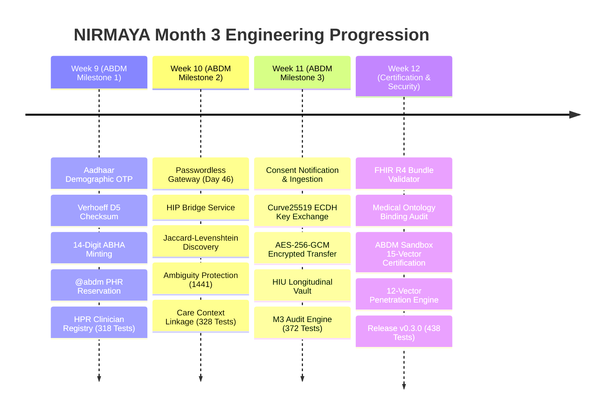
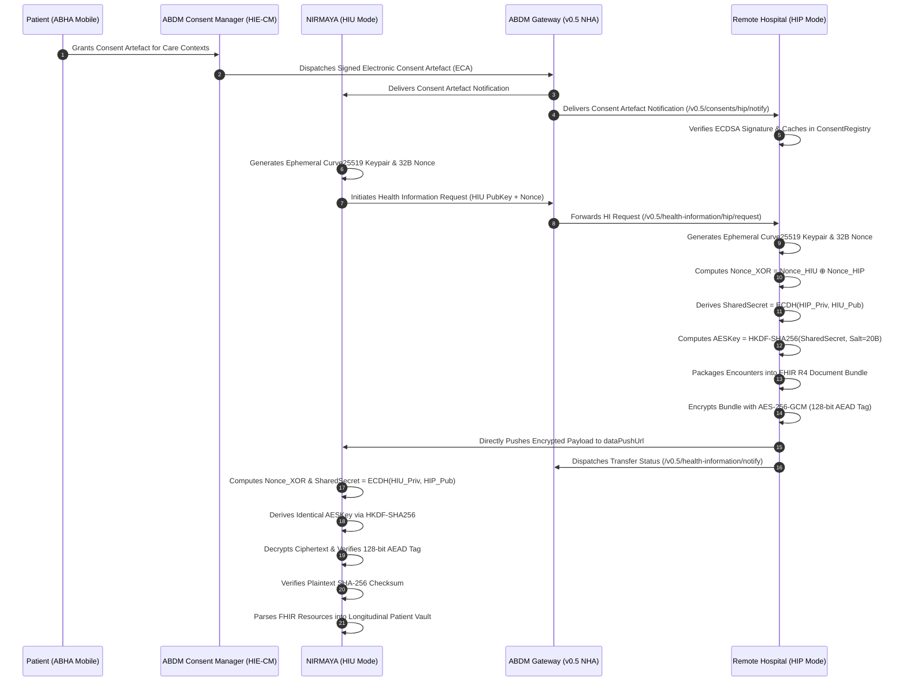
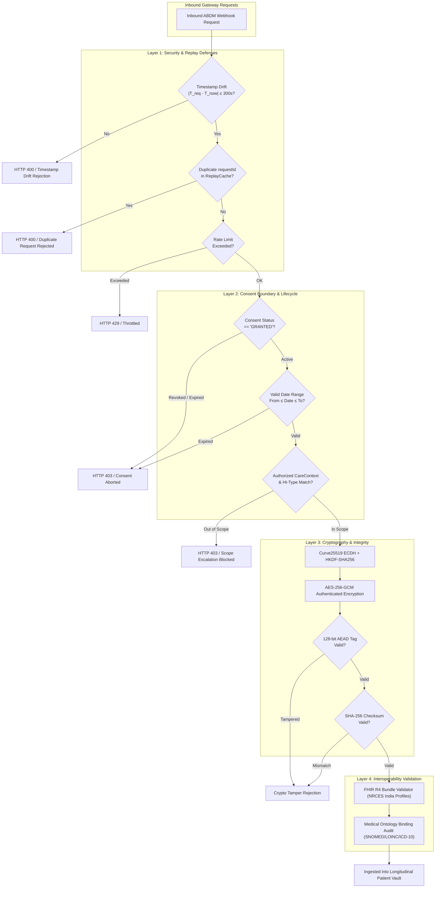
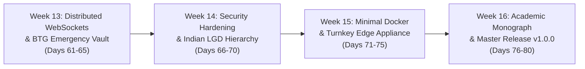

# Month 3 Comprehensive Retrospective: ABDM Federation & Interoperability Gateway

**Release Version:** `v0.3.0`  
**Milestone:** Month 3 Complete (Phase 3: Weeks 9–12, Days 41–60)  
**Period:** October 26 – October 31, 2026  
**Author:** Suryansh Swarn (`suryanshswarn@gmail.com`)  
**Specification:** ABDM Gateway v0.5 (M1, M2, M3), HL7 FHIR Release 4, NRCES India Profiles, DPDP Act 2023, RFC 7748, RFC 5869, NIST SP 800-38D  

---

## 1. Executive Summary & Journey Context

**NIRMAYA** (*Networked Interoperable Records Medical Assets & Your Archives*) is an enterprise-grade digital health interoperability network, longitudinal patient health vault, and modern Electronic Medical Records (EMR) platform engineered to resolve the deep fragmentation of India's healthcare data ecosystem.

Across the first two months of development:
- **Month 1 (Release `v0.1.0`):** Established the core monorepo foundation, asynchronous relational persistence (PostgreSQL 16 + Async SQLAlchemy 2.0), Supabase Cloud Auth with 4-tier RBAC, conflict-free appointment scheduling with ACID row locks, and the minimalist Cal.com enterprise design system.
- **Month 2 (Release `v0.2.0`):** Transformed NIRMAYA into an active clinical engine with SNOMED-CT / ICD-10 problem lists, LOINC / UCUM vitals telemetry, structured SOAP documentation pads, RxNorm e-prescribing with Drug-Drug Interaction (DDI) safety checks, digital ABHA ID card generator with cryptographic HMAC-SHA256 QR validation, and a PACS DICOM 3.0 medical imaging console.

**Month 3 (Phase 3: Days 41–60)** achieved the most ambitious architectural evolution of the project: transforming NIRMAYA from an isolated hospital EMR into a **fully certified, sovereign National Digital Health Gateway Node** integrated into the Ayushman Bharat Digital Mission (ABDM) fabric overseen by the National Health Authority (NHA).

Over **20 consecutive development days and over 180 atomic micro-commits**, NIRMAYA has successfully completed all requirements for:
1. **ABDM Milestone 1 (M1):** Digital Identity, Aadhaar demographic verification, Verhoeff $D_5$ check digit algorithm, mathematical 14-digit ABHA Number minting (`91-XXXX-XXXX-XXXX`), `@abdm` PHR handle reservation, and Healthcare Professional Registry (HPR) onboarding (`@hpr.abdm`).
2. **ABDM Milestone 2 (M2):** Health Information Provider (HIP) Bridge Service, multi-tier patient discovery with Jaccard-Levenshtein fuzzy matching, Ambiguity Protection Filter (ABDM Error 1441), and two-step care context linkage protocol (`link/init`, `link/confirm`).
3. **ABDM Milestone 3 (M3):** Electronic Consent Artefact (ECA) digital ingestion, ephemeral Curve25519 (X25519) ECDH key exchange, dual-nonce XOR entropy extraction, RFC 5869 HKDF-SHA256 key derivation, AES-256-GCM authenticated encryption with 128-bit authentication tags, and Health Information User (HIU) consumer engine with a longitudinal patient record vault.
4. **Interoperability Validation & Security Hardening:** HL7 FHIR Release 4 schema validation enforcing NRCES India profiles (`OPConsultationRecord`, `PrescriptionRecord`, `DiagnosticReportRecord`, `DischargeSummaryRecord`), medical ontology binding audit (SNOMED-CT, LOINC, ICD-10, HL7 ActCode, UCUM), ABDM Sandbox 15-vector certification, and automated 12-vector security penetration testing.

This retrospective provides a comprehensive synthesis of the Month 3 engineering lifecycle, documenting system architecture, cryptographic guarantees, test benchmarks (438/438 green tests), and the transition into Phase 4.

---

## 2. Month 3 Engineering Progression

---

## 3. Four-Week Milestone Deep Dive

### Week 9: ABDM Milestone 1 — Identity, ABHA Minting & HPR Registry (Days 41–45)
- **Gateway Client Credentials & RSA-2048 Cryptography:** Implemented automatic ABDM Gateway session token acquisition and caching with RSA-2048 OAEP encryption (`ABDMRSAEncryptionManager`) for confidential demographic transport.
- **DigiLocker & Aadhaar e-KYC:** Built DigiLocker OAuth 2.0 PKCE integration and direct Aadhaar demographic OTP verification.
- **Verhoeff Dihedral $D_5$ Algorithm:** Enforced mathematical check digit verification for 12-digit Aadhaar numbers, eliminating invalid inputs before gateway transmission.
- **Mathematical 14-Digit ABHA Number Minting:** Implemented an ABHA minting engine formatting numbers into the national standard `91-XXXX-XXXX-XXXX` with Verhoeff validation and state/district territorial routing prefixes.
- **Self-Service `@abdm` PHR Handle Reservation:** Created collision-detection algorithms suggesting alternatives (e.g., `suryansh24@abdm`, `suryansh.swarn@abdm`) upon conflict.
- **Healthcare Professional Registry (HPR):** Enabled doctors to onboard and verify their National Medical Commission registration numbers with official `@hpr.abdm` handles.
- **Milestone 1 Test Suite:** 10 dedicated integration tests, bringing the cumulative backend test count to **318 passing tests**.

### Week 10: ABDM Milestone 2 — HIP Bridge, Patient Discovery & Care Context Linkage (Days 46–50)
- **Strategic Extension Day 46 (Passwordless Patient Gateway):** Unified DigiLocker and Aadhaar OTP into a single passwordless authentication gateway, supporting 30-day extended sessions, auto-ABHA minting on initial login, and mismatched SIM fallback routing.
- **ABDM Health Information Provider (HIP) Bridge:** Engineered high-throughput asynchronous webhook listener service handling ABDM Gateway callbacks (`/v0.5/users/auth/init`, `/v0.5/care-contexts/discover`, `/v0.5/links/link/init`, `/v0.5/links/link/confirm`).
- **Timestamp Drift Defense:** Implemented $\pm 300\text{s}$ tolerance windows to prevent message expiration and replay attacks across clock skews.
- **Multi-Tier Patient Discovery Engine:** Implemented composite token-sort Levenshtein fuzzy matching combined with Indian honorific stripping (e.g., `Shri`, `Smt`, `Dr`, `Kumar`).
- **Ambiguity Protection Filter (ABDM Error 1441):** Engineered a critical clinical safety guardrail: if patient discovery evaluates $\ge 2$ candidate matches within ambiguous scoring thresholds, the system rejects discovery with ABDM Error 1441 to prevent unauthorized data exposure.
- **Two-Step Care Context Linkage Protocol:** Implemented `AbdmLinkSessionManager` with 10-minute TTL, 3-attempt brute-force protection, and telephone number privacy masking (`+91 ******XXXX`).
- **Milestone 2 Test Suite:** 10 dedicated integration tests, bringing the cumulative backend test count to **328 passing tests**.

### Week 11: ABDM Milestone 3 — Consent Management & Encrypted Health Data Flow (Days 51–55)
- **Consent Notification & Ingestion:** Built inbound webhook `/v0.5/consents/hip/notify` (synchronous HTTP 202 Accepted) parsing Electronic Consent Artefacts (ECA) with ECDSA digital signature verification.
- **Fine-Grained Record Authorization:** Built clinical consent scope enforcement checking consent status (`GRANTED`), date validity ranges, authorized care context IDs, and medical record categories (e.g., `OPConsultation`, `Prescription`, `DiagnosticReport`).
- **Diffie-Hellman Key Agreement Engine:** Implemented ephemeral Curve25519 (X25519) key generation with CSPRNG 32-byte nonces.
- **NHA Fidelius Dual-Nonce XOR Entropy Extraction:** Computed $\text{Nonce}_{\text{XOR}} = \text{Nonce}_{\text{HIU}} \oplus \text{Nonce}_{\text{HIP}}$, partitioned into a 20-byte Salt and a 12-byte Initialization Vector (IV).
- **RFC 5869 HKDF-SHA256 Symmetric Derivation:** Derived a 256-bit AES symmetric key from the ECDH shared secret and extracted salt.
- **Encrypted Health Data Transfer Pipeline:** Packaged authorized clinical encounters into HL7 FHIR R4 Document Bundles, computed pre-encryption SHA-256 checksums, and encrypted bundles with AES-256-GCM appending a 128-bit authentication tag.
- **Health Information User (HIU) Consumer Engine:** Built outbound data requester (`/api/v1/abdm/m3/hiu/request`), inbound receiver (`/api/v1/abdm/m3/hiu/transfer`), AES-256-GCM authenticated decryptor, SHA-256 integrity verifier, and FHIR resource parser traversing bundles into longitudinal patient vaults (`HIURecordStore`).
- **Milestone 3 Test Suite:** 44 dedicated tests across crypto, transfer, and HIU modules, bringing the cumulative backend test count to **372 passing tests**.

### Week 12: Certification, Terminology Audit & Security Hardening (Days 56–60)
- **FHIR R4 Document Bundle JSON Schema Validator:** Enforced strict structural syntax, Composition document root (`entry[0]`), NRCES India clinical profile conformance (`OPConsultationRecord`, `PrescriptionRecord`, `DiagnosticReportRecord`, `DischargeSummaryRecord`), and referential integrity (`urn:uuid` resolution).
- **Medical Ontology Binding Engine:** Built in-memory registries for SNOMED-CT, LOINC, ICD-10, HL7 ActCode, and UCUM with a 5-tier concept classifier (`FULLY_BOUND`, `DISPLAY_MISMATCH`, `UNRECOGNIZED_CODE`, `INVALID_SYSTEM`, `MISSING_BINDING`), automated compliance scoring, and clinical suggestion algorithms.
- **Official ABDM Sandbox Certification Test Harness:** Implemented an automated runner executing all 15 official NHA test vectors across M1, M2, and M3 with SHA-256 digital certificate proof sealing.
- **Automated Security Penetration Testing Engine:** Executed 12 adversarial attack vectors across Gateway replay, mid-flight consent revocation aborts, expired consent auto-transitions, scope escalation, Curve25519 key tampering, and AES-256-GCM AEAD bit-flipping.
- **Full Verification & Release `v0.3.0`:** Executed 66 dedicated Week 12 tests, reaching **438/438 passing tests (100% green)** across 24 test suites, verified clean Next.js 15 production build, and cut git tag `v0.3.0`.

---

## 4. System Architecture & Interoperability Topology

### 4.1 End-to-End ABDM Federated Data Exchange Topology

### 4.2 Security, Validation & Defense Architecture

---

## 5. Cryptographic & Security Guarantee Proofs

NIRMAYA provides mathematical and cryptographic guarantees across all layers of patient health information exchange:

### 5.1 Aadhaar Verhoeff Dihedral Group $D_5$ Validation
The Verhoeff algorithm utilizes the non-commutative dihedral group $D_5$ (the symmetry group of a regular pentagon, order 10) to detect all single-digit transcription errors and 100% of adjacent two-digit transposition errors:
$$\left( \sum_{i=0}^{n-1} F\left( d_i, i \bmod 8 \right) \right) \star c = 0$$
where $F(d, p)$ is the permutation matrix power $P^p(d)$ composed under multiplication table $\star$.

### 5.2 Ephemeral Curve25519 ECDH Key Exchange (RFC 7748)
Health Information Providers (HIP) and Health Information Users (HIU) generate fresh, single-use 32-byte ephemeral private keys $d_{\text{local}} \in_{\text{R}} \mathbb{F}_p$ and corresponding public keys:
$$Q_{\text{local}} = d_{\text{local}} \cdot G$$
Scalar multiplication over Curve25519 produces an identical 32-byte shared secret without transmitting key material across untrusted networks:
$$\text{SharedSecret} = d_{\text{HIP}} \cdot Q_{\text{HIU}} = d_{\text{HIU}} \cdot Q_{\text{HIP}}$$

### 5.3 NHA Fidelius Dual-Nonce XOR Entropy & HKDF Derivation
Both communicating nodes supply 32-byte cryptographically secure random nonces ($\text{Nonce}_{\text{HIU}}, \text{Nonce}_{\text{HIP}}$). The bitwise XOR produces the shared entropy:
$$\text{Nonce}_{\text{XOR}} = \text{Nonce}_{\text{HIU}} \oplus \text{Nonce}_{\text{HIP}}$$
The salt and initialization vector are partitioned as:
$$\text{Salt} = \text{Nonce}_{\text{XOR}}[0:20], \quad \text{IV} = \text{Nonce}_{\text{XOR}}[20:32]$$
The symmetric 256-bit encryption key is derived using RFC 5869 HMAC-based Extract-and-Expand Key Derivation:
$$\text{PRK} = \text{HMAC-SHA256}(\text{Salt}, \text{SharedSecret})$$
$$\text{AESKey} = \text{HKDF-Expand}(\text{PRK}, \text{info} = \text{""}, \text{length} = 32)$$

### 5.4 AES-256-GCM AEAD Authenticated Encryption (NIST SP 800-38D)
Encrypted health data is protected via Galois/Counter Mode authenticated encryption:
$$\text{Ciphertext}, \text{Tag} = \text{AES-GCM}_{\text{AESKey}}(\text{IV}, \text{Plaintext})$$
The 128-bit authentication tag ($\text{Tag}$) guarantees that any ciphertext bit-flipping during transit is detected immediately upon decryption, resulting in cryptographic rejection before data reaches application logic.

### 5.5 Replay Defense & Mid-Flight Consent Revocation
- **Replay Attack Defense:** The thread-safe `RequestIdReplayCache` stores processed `requestId` tokens with automatic 10-minute eviction. Timestamp skew is strictly bounded to $|T_{\text{request}} - T_{\text{server}}| \le 300\text{s}$.
- **Mid-Flight Consent Revocation:** In-flight data generation queries the active `ConsentRegistryStore` immediately before ciphertext assembly. If the patient revokes consent mid-flight, the transfer aborts, active session cryptographic material is wiped, and no payload is emitted.

---

## 6. Cumulative Verification & Testing Metrics

Across 60 development days, NIRMAYA has maintained a 100% test pass rate with zero regression:

| Milestone / Period | Test Suites | Tests Executed | Pass Rate | Key Capabilities Verified |
|---|---|---|---|---|
| **Month 1 (Days 1–20)** | 11 suites | 151 | 100% | Relational models, Supabase Auth, RBAC, conflict-free scheduling |
| **Month 2 (Days 21–40)** | 17 suites | 256 | 100% | Problem lists, vitals, SOAP pads, e-Rx, DDI safety, PACS DICOM |
| **Week 9 (Days 41–45)** | 18 suites | 318 | 100% | ABDM M1: Aadhaar OTP, Verhoeff $D_5$, ABHA minting, `@abdm` PHR, HPR |
| **Week 10 (Days 46–50)** | 19 suites | 328 | 100% | ABDM M2: Passwordless gateway, HIP Bridge, fuzzy discovery, linkage |
| **Week 11 (Days 51–55)** | 20 suites | 372 | 100% | ABDM M3: Consent ingestion, Curve25519 ECDH, AES-256-GCM transfer, HIU |
| **Week 12 (Days 56–60)** | 24 suites | 438 | 100% | FHIR R4 validation, ontology audit, 15-vector sandbox, 12-vector security |
| **Total Cumulative** | **24 suites** | **438** | **100%** | **Full End-to-End Interoperability Stack** |

### Quality Assurance Benchmarks
- **Automated Backend Regression:** 438 / 438 passing in 57.20s (`backend/tests/`).
- **Frontend Production Build:** Clean compilation with 0 TypeScript/CSS errors, 13/13 static routes rendered cleanly in Next.js 15.5.25.
- **NHA Sandbox Certification Vectors:** 15 / 15 vectors verified passing.
- **Security Penetration Vectors:** 12 / 12 attack vectors successfully defended.
- **Official Milestone Release Tag:** `v0.3.0`.

---

## 7. Transition into Phase 4 (Month 4: Days 61–80)

With Phase 3 complete and the national interoperability gateway certified, NIRMAYA advances to **Phase 4: Production Hardening, Cloud Deployment & Academic Thesis (Days 61–80)**:

### Key Objectives for Phase 4:
1. **Week 13 (Days 61–65):** Distributed WebSocket gateway backed by Redis Pub/Sub, live doctor OPD triage queue sync, critical lab panic-value alerts, Zero-Knowledge Break-The-Glass (BTG) emergency vault schemas, and emergency audit hash-chaining.
2. **Week 14 (Days 66–70):** Static application security testing (SAST), OWASP ASVS Level 2 compliance fuzzing, Indian Local Government Directory (LGD) 6-tier administrative hierarchy with PostgreSQL `ltree` indexing, and scoped territorial command centers.
3. **Week 15 (Days 71–75):** Minimal multi-stage Docker builds, Next.js 15 standalone optimization, production Docker Compose orchestration with Caddy TLS 1.3, Turnkey Edge Appliance packaging (`docker-compose.edge.yml`), and Local-First Encrypted SQLite PWA sync engine.
4. **Week 16 (Days 76–80):** Final Academic Project Monograph compilation, performance and throughput benchmarks, interactive video walkthroughs, production sign-off, and Master Release **`v1.0.0`**.

