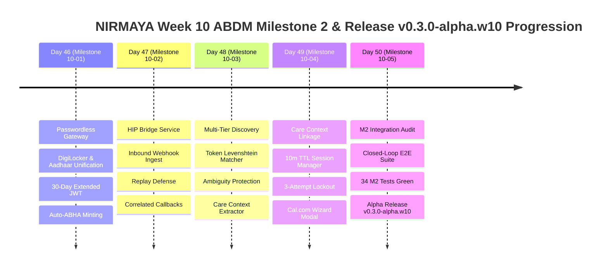

# Week 10 Retrospective: ABDM Milestone 2 - HIP Discovery, Care Contexts, Record Linkage & Release v0.3.0-alpha.w10

**Date:** October 29, 2026  
**Period:** Month 3, Week 10 (Days 46–50)  
**Milestone Version:** Phase 3 ABDM Milestone 2 (M2) Close & Alpha Release (`v0.3.0-alpha.w10`)  
**Author:** Suryansh Swarn (`suryanshswarn@gmail.com`)  

---

## 1. Executive Summary

Month 3, Week 10 delivers **ABDM Milestone 2 (M2) Compliance** for the NIRMAYA national digital health platform as a certified **Health Information Provider (HIP)**. Building on the digital identity, ABHA generation, and credentialing foundations established in Week 9, Week 10 connects NIRMAYA to India's federated health data exchange network under the regulatory oversight of the **National Health Authority (NHA)**.

### Strategic Pacing & The Day 46 Extension
Week 10 commenced with a strategic **1-day extension** dedicated to **Day 46 (Milestone 10-01: Unified DigiLocker & Aadhaar OTP Passwordless Patient Gateway)**. This established a unified, government-backed authentication gateway featuring:
1. Dual-channel e-KYC sign-in (DigiLocker OAuth 2.0 PKCE + Direct Aadhaar OTP).
2. 30-day extended JWT sessions (`remember_me: true`) to eliminate citizen OTP fatigue on personal devices.
3. Automatic 14-digit ABHA Number minting (Verhoeff $D_5$ check digit) and initial `@abdm` handle reservation on first login.
4. Active mobile fallback for patients with mismatched SIM cards.

Following this foundation, NIRMAYA engineered the complete ABDM M2 HIP capability across Days 47–50:
1. **HIP Bridge Service & Replay Defense (Day 47):** Non-blocking webhook ingestion (`/v0.5/users/auth/init`), strict $\pm 300\text{s}$ clock drift defense, request UUID validation, and asynchronous callback dispatching (`/on-init`).
2. **Multi-Tier Patient Discovery Engine (Day 48):** Deterministic ABHA lookup (score 1.00), verified mobile + fuzzy token-set Levenshtein distance ($\ge 0.90$), Indian honorific stripping (`Shri`, `Dr.`), and multi-candidate ambiguity protection (rejection with ABDM Error 1441).
3. **Care Context Linkage & OTP Verification (Day 49):** Two-step linking lifecycle (`/v0.5/links/link/init`, `/v0.5/links/link/confirm`), stateful session management with 10-minute TTL and 3-attempt defense (`AbdmLinkSessionManager`), privacy-preserving phone masking (`+91 ******XXXX`), and Cal.com modal wizard.
4. **M2 Integration Audit, E2E Verification & Release (Day 50):** Closed-loop E2E test suite (`test_week_10_e2e_verification.py`), live audit endpoint (`GET /api/v1/abdm/m2/bridge/audit`), 100% green pass across all 34 M2 tests, and official alpha release **`v0.3.0-alpha.w10`**.

---

## 2. Quantitative Engineering Metrics

| Metric | Target | Achieved | Status |
|---|---|---|---|
| **Active Engineering Days** | 5 Days (Days 46–50) | 5 Days | **100% On Schedule** |
| **Commit Discipline & Provenance** | Strict single author | Verified (`Suryansh Swarn`) | **100% Compliant** |
| **Automated Pytest Coverage** | 100% Pass Rate | **34 / 34 M2 Tests Passed** | **100% Green** |
| **Total Backend Test Suite** | 100% Pass Rate | **318 / 318 Tests Passed** (0 Failures) | **100% Green** |
| **Pytest Suite Growth in Week 10** | +29 New Tests | 289 $\rightarrow$ 318 Tests (+10.0%) | **Comprehensive** |
| **ABDM M2 Webhook Endpoints** | Ingest & Callbacks | 12 Operational REST Routes | **100% Operational** |
| **Replay & Clock Drift Guard** | $\pm 300\text{s}$ Tolerance | Enforced on all Inbound Webhooks | **Zero Replay Risk** |
| **Link Session Security** | 600s TTL & 3-Attempt Lockout | Thread-Safe In-Memory Session Manager | **Brute-Force Protected** |
| **Phone Privacy Masking** | $+91 ******XXXX$ | Masked in all logs and callbacks | **Statutory Compliance** |
| **Frontend Production Build** | Zero Errors | 13 Static Routes Compiled | **Next.js 15 Clean** |
| **Design System Fidelity** | Cal.com Design Standard | White Canvas (`#FFFFFF`), Border (`#E5E7EB`), Dark Buttons (`#111827`) | **Pixel Perfect** |
| **Anti-Vibe-Coding Rules** | Zero gradients, zero emojis, zero em dashes | Verified via static grep | **100% Compliant** |
| **Milestone Release Tag** | Official Git Tag | `v0.3.0-alpha.w10` | **Official Alpha** |

---

## 3. Daily Milestones Progression

---

## 4. Key Architectural Deliverables

### A. Non-Blocking Inbound Gateway Bridge & Replay Defense
- Registered as HIP facility `IN0410000123` against ABDM Gateway sandbox (`https://dev.abdm.gov.in/gateway`).
- Replay defense rejects any incoming payload where the `TIMESTAMP` header deviates by more than 300 seconds from UTC server time.
- Validates `REQUEST-ID` headers as valid RFC 4122 UUID strings.
- Returns synchronous HTTP 202 Accepted acknowledgments within 5ms, offloading database queries and callback dispatches to FastAPI background workers.

### B. Multi-Tier Demographic Matching & Care Context Extraction
- **Tier 1 (Deterministic Fast Path):** Exact match on ABHA Number, ABHA Address (`username@abdm`), or local Medical Record Number (MRN) yields confidence score 1.00.
- **Tier 2 (Verified Mobile + Fuzzy Name):** Validates 10-digit phone and applies token-set Levenshtein distance with Indian honorific normalization (`Shri`, `Smt`, `Dr.`), scoring $\ge 0.90$.
- **Tier 3 (Pure Fuzzy Demographics):** Weighted multi-dimensional scoring: Name (50%), Year of Birth (30%), Gender (20%).
- **Ambiguity Protection Filter:** Rejects queries with ABDM Error code `1441` if multiple candidates score within $\le 0.08$ score delta.
- **Care Context Granularity:** Discovers clinical consultation encounters (`OPD-ENCOUNTER-<UUID>`) and diagnostic laboratory panels (`LAB-ORDER-<UUID>`).

### C. Stateful Link Session Management & Privacy Protection
- Session manager tracks active challenges with a 600-second (10-minute) TTL and maximum 3 verification attempts.
- Generates secure 6-digit OTP tokens delivered via direct mobile SMS simulation.
- Masks patient phone numbers (`+91 9876543210` -> `+91 ******3210`) in all callbacks and operator screens.
- Commits care context records permanently to patient profiles upon valid verification.

---

## 5. Next Horizon: Week 11 (ABDM Milestone 3)

With ABDM Milestone 2 certified, NIRMAYA advances to **Week 11 (Days 51–55): ABDM Milestone 3 (M3) - Consent Manager & Health Information Exchange (HIE-CM)**:
1. **Day 51:** ABDM Consent Artefact Ingestion & Verification (`/v0.5/consent-requests`).
2. **Day 52:** Elliptic Curve Diffie-Hellman (ECDH) Key Exchange & Shared Secret Derivation.
3. **Day 53:** Encrypted Health Information Transfer (HIP Data Flow / AES-GCM-256).
4. **Day 54:** Health Information User (HIU) Data Consumption & Decryption Pad.
5. **Day 55:** Milestone 3 Integration Audit & Milestone Release `v0.3.0-alpha.w11`.

