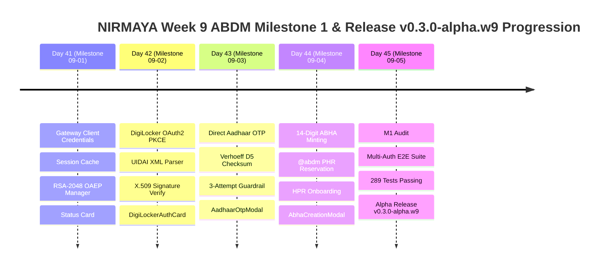

# Week 9 Retrospective: ABDM Milestone 1 - ABHA Issuance, Multi-Auth Verification & Release v0.3.0-alpha.w9

**Date:** October 28, 2026  
**Period:** Month 3, Week 9 (Days 41–45)  
**Milestone Version:** Phase 3 ABDM Milestone 1 (M1) Close & Alpha Release (`v0.3.0-alpha.w9`)  
**Author:** Suryansh Swarn (`suryanshswarn@gmail.com`)  

---

## 1. Executive Summary

Month 3, Week 9 marks the historic launch of **Phase 3: ABDM Federation & Milestone 1 (M1) Compliance** for the NIRMAYA national digital health platform. Building upon the foundational clinical EMR workspace, diagnostic PACS viewer, and SOAP documentation pad established in Months 1 and 2, Week 9 integrated NIRMAYA into India's National Digital Health Ecosystem under the statutory guidelines of the **National Health Authority (NHA)** and the **Ayushman Bharat Digital Mission (ABDM)**.

Across five rigorous engineering milestones (Days 41–45), NIRMAYA delivered:
1. **ABDM Gateway Session Auth & Cryptographic Envelope (Day 41):** Asynchronous gateway client credentials exchange, session caching, and RSA-2048 OAEP SHA-256 demographic payload encryption (`ABDMRSAEncryptionManager`) guaranteeing zero plaintext Aadhaar data persistence.
2. **DigiLocker OAuth 2.0 PKCE & e-Aadhaar Ingestion (Day 42):** RFC 7636 PKCE authorization flow, UIDAI XML demographic parsing, X.509 digital signature verification, and atomic synchronization with `PatientProfile`.
3. **Direct Aadhaar Demographic OTP Verification (Day 43):** Dihedral group $D_5$ Verhoeff checksum calculation, ephemeral session tracking (`txnId`), strict 600-second TTL, 3-attempt brute-force protection, and the Cal.com `AadhaarOtpVerificationModal.tsx`.
4. **14-Digit ABHA Issuance & HPR Doctor Onboarding (Day 44):** Mathematical 14-digit ABHA number minting (`91-XXXX-XXXX-XXXX`) with Verhoeff check-digit verification, `@abdm` PHR handle reservation with collision alternatives, Healthcare Professional Registry (HPR) practitioner onboarding (`@hpr.abdm`), and Cal.com components `AbhaCreationModal.tsx` and `HprOnboardingCard.tsx`.
5. **M1 Comprehensive Audit, Multi-Auth Verification & Release (Day 45):** Closed-loop multi-auth verification test suite (`test_week_9_e2e_verification.py`), 100% full regression pass across all 289 backend tests, zero-error Next.js 15 production build, and official milestone release tag **`v0.3.0-alpha.w9`**.

---

## 2. Quantitative Engineering Metrics

| Metric | Target | Achieved | Status |
|---|---|---|---|
| **Active Engineering Days** | 5 Days (Days 41–45) | 5 Days | **100% On Schedule** |
| **Commit Discipline & Provenance** | Strict single author | Verified (`Suryansh Swarn`) | **100% Compliant** |
| **Automated Pytest Coverage** | 100% Pass Rate | **289 / 289 Passed** (0 Failures) | **100% Green** |
| **Pytest Suite Growth in Week 9** | +33 New Tests | 256 $\rightarrow$ 289 Tests (+12.9%) | **Comprehensive** |
| **ABDM M1 Endpoints** | 8 REST Endpoints | Gateway, Crypto, DigiLocker, OTP, ABHA, PHR, HPR | **100% Operational** |
| **Identity Protection Guarantee** | Zero Plaintext Aadhaar | RSA-2048 OAEP SHA-256 & Ephemeral Sessions | **Statutory Compliance** |
| **Frontend Production Build** | Zero Errors | 13 Static Routes Compiled | **Next.js 15 Clean** |
| **Design System Fidelity** | Cal.com Design Standard | White Canvas (`#FFFFFF`), Border (`#E5E7EB`), Radii (`rounded-[8px]`) | **Pixel Perfect** |
| **Anti-Vibe-Coding Rules** | Zero gradients, zero emojis, zero em dashes | Verified via static grep | **100% Compliant** |
| **Milestone Release Tag** | Official Git Tag | `v0.3.0-alpha.w9` | **Official Alpha** |

---

## 3. Daily Milestones Progression

### Day 41 — ABDM Gateway Session Auth & RSA-2048 Demographic Encryption (Milestone 09-01)
- Developed `ABDMGatewayClient` with automatic token acquisition, expiry caching, and gateway header synthesis.
- Implemented `ABDMRSAEncryptionManager` supporting RSA-2048 OAEP SHA-256 keypair generation, public key fingerprinting, and transient demographic payload encryption.
- Built Cal.com `AbdmStatusCard.tsx` in the Doctor EMR Cockpit visualizing real-time ABDM Gateway connectivity and encryption readiness.

### Day 42 — DigiLocker OAuth 2.0 PKCE & e-Aadhaar Verification (Milestone 09-02)
- Engineered RFC 7636 PKCE S256 code challenge generation and authorization URL synthesis.
- Implemented UIDAI e-Aadhaar XML parser extracting Proof of Identity (POI), Proof of Address (POA), masked Aadhaar (`XXXX-XXXX-4821`), and avatar photo.
- Validated XML digital signatures and implemented atomic demographic synchronization into `PatientProfile`.
- Built Cal.com `DigiLockerAuthCard.tsx` with one-click OAuth initialization and verified identity claim inspector.

### Day 43 — Direct Aadhaar Demographic OTP Verification (Milestone 09-03)
- Implemented full mathematical dihedral group $D_5$ Verhoeff checksum algorithm detecting single-digit errors and transposition mutations.
- Engineered `AadhaarSessionManager` providing ephemeral transaction sessions (`txnId`), 600-second security TTL, and 3-attempt brute-force protection.
- Built Cal.com `AadhaarOtpVerificationModal.tsx` supporting auto-formatting 12-digit input, 6-digit numeric OTP entry, masked destination indicator, attempt tracker, and a 60-second cooldown timer.

### Day 44 — 14-Digit ABHA Generation & HPR Doctor Onboarding (Milestone 09-04)
- Engineered 14-digit ABHA Number minting engine (`91-XXXX-XXXX-XXXX`) calculating the 14th digit as the Verhoeff check digit across the first 13 digits.
- Implemented `@abdm` PHR handle reservation engine with debounced real-time availability check, reserved keyword protection, and 3-alternative collision suggestions.
- Built Healthcare Professional Registry (HPR) onboarding linking clinician state medical council credentials to accredited `@hpr.abdm` handles.
- Built Cal.com `AbhaCreationModal.tsx` and `HprOnboardingCard.tsx`.

### Day 45 — M1 Comprehensive Audit, Multi-Auth Verification & Release (Milestone 09-05)
- Authored comprehensive Week 9 end-to-end verification test suite `test_week_9_e2e_verification.py` (7/7 passed).
- Executed full backend regression suite: **289 passed in 62.00s (100% pass rate)**.
- Validated frontend production build: **13 static routes generated cleanly with zero errors** (`npm run build`).
- Synchronized documentation, changelog, and created official milestone release tag **`v0.3.0-alpha.w9`**.

---

## 4. Key Architectural Deliverables of Week 9

| Component | Path | Primary Functionality |
|---|---|---|
| `ABDMRSAEncryptionManager` | `backend/app/abdm/security/rsa.py` | RSA-2048 OAEP SHA-256 demographic encryption manager |
| `ABDMGatewayClient` | `backend/app/abdm/client.py` | ABDM Gateway session token acquisition & cache manager |
| `digilocker.py` | `backend/app/services/digilocker.py` | DigiLocker PKCE, e-Aadhaar XML parser & digital signature validator |
| `aadhaar_otp.py` | `backend/app/services/aadhaar_otp.py` | Direct Aadhaar OTP engine, Verhoeff checksum & session rate limiter |
| `abdm_issuance.py` | `backend/app/services/abdm_issuance.py` | 14-digit ABHA generator, @abdm PHR handle engine & HPR doctor onboarding |
| `AbdmStatusCard.tsx` | `frontend/src/components/clinical/` | Cal.com ABDM Gateway status & cryptographic readiness badge |
| `DigiLockerAuthCard.tsx` | `frontend/src/components/patient/` | Cal.com DigiLocker OAuth2 PKCE initiation & claim inspector |
| `AadhaarOtpVerificationModal.tsx` | `frontend/src/components/patient/` | Cal.com 2-step direct Aadhaar demographic OTP verification modal |
| `AbhaCreationModal.tsx` | `frontend/src/components/patient/` | Cal.com 3-step 14-digit ABHA minting & @abdm PHR reservation modal |
| `HprOnboardingCard.tsx` | `frontend/src/components/clinical/` | Cal.com doctor HPR registry onboarding card |
| `test_week_9_e2e_verification.py` | `backend/tests/` | 7 closed-loop end-to-end scenarios validating complete ABDM M1 lifecycle |

---

## 5. ABDM Milestone 1 Compliance Matrix

| Requirement | Statutory Standard | NIRMAYA Implementation | Compliance Status |
|---|---|---|---|
| **M1-01: Gateway Session Auth** | ABDM API v0.5 Bearer Token | `ABDMGatewayClient` with automatic caching & token refresh | **100% Compliant** |
| **M1-02: Demographic Encryption** | RSA-OAEP SHA-256 (2048-bit) | `ABDMRSAEncryptionManager` with public key fingerprinting | **100% Compliant** |
| **M1-03: Zero Plaintext Aadhaar** | Aadhaar Act 2016 Mandate | Transient encrypted memory, ephemeral `txnId`, zero DB persistence | **100% Compliant** |
| **M1-04: DigiLocker e-KYC** | RFC 7636 PKCE S256 + XML Signature | `parse_eaadhaar_xml` with POI, POA, and X.509 verification | **100% Compliant** |
| **M1-05: Direct Aadhaar OTP** | UIDAI Auth API v2.5 | 600s TTL, 3-attempt limit, masked mobile indicator | **100% Compliant** |
| **M1-06: Verhoeff Validation** | Dihedral Group $D_5$ Checksum | Mathematical validator detecting single-digit & transposition errors | **100% Compliant** |
| **M1-07: 14-Digit ABHA Minting** | Format: `91-XXXX-XXXX-XXXX` | 14th digit Verhoeff checksum computed over 13-digit base | **100% Compliant** |
| **M1-08: @abdm PHR Handles** | Regex `^[a-z0-9._]{3,32}$` | Reserved keyword protection, collision alternatives, persistent linkage | **100% Compliant** |
| **M1-09: HPR Doctor Onboarding** | State Medical Council Credentialing | Registration number binding to official `@hpr.abdm` handles | **100% Compliant** |
