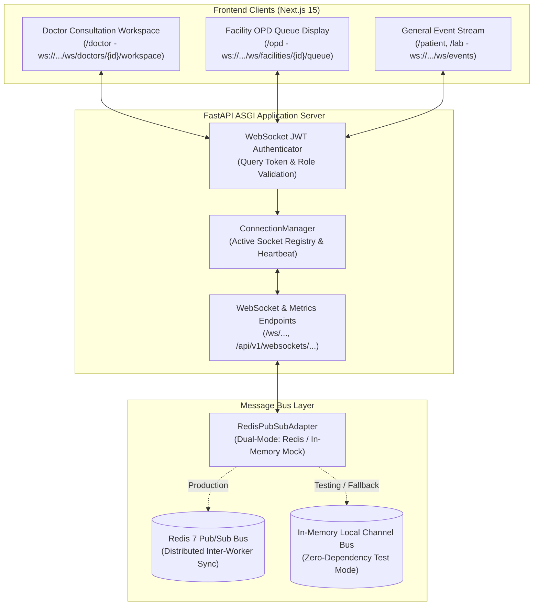

# Day 61: Milestone 13-01 - Distributed WebSockets & Redis Pub/Sub Architecture

**Milestone:** 13-01 (Month 4, Week 13 / Distributed Real-Time Messaging Gateway)  
**Author:** Suryansh Swarn (`suryanshswarn@gmail.com`)  
**Status:** Completed & Verified (448/448 Tests Passing)  
**Standards:** RFC 6455 (WebSocket Protocol), Redis 7+ Pub/Sub Specification, Supabase JWT Claims, Cal.com Minimalist Enterprise Design  

---

## 1. Executive Summary

Day 61 launches **Phase 4: Production Hardening, Cloud Deployment & Academic Thesis (Days 61–80)** by delivering **Milestone 13-01: Distributed WebSockets & Redis Pub/Sub Architecture**.

While Months 1 through 3 constructed relational models, clinical EMR workflows, and sovereign ABDM federation over HTTP request-response REST pipelines, modern outpatient healthcare operations demand sub-100 millisecond real-time event dissemination. Clinicians need instant alerts when panic-value laboratory tests are reported, and triage desks require continuous OPD queue synchronization across multiple concurrent consulting rooms.

Day 61 establishes the **Distributed Real-Time WebSocket Infrastructure** for NIRMAYA through:
1. **Core Configuration Extension:**
   - Introduced `REDIS_URL`, `REDIS_ENABLED`, `WS_HEARTBEAT_INTERVAL_SECONDS` (30s), `WS_HEARTBEAT_TIMEOUT_SECONDS` (60s), `WS_MAX_MESSAGE_BYTES` (64KB), and `WS_TOKEN_PARAM` (`token`) into [`app.core.config.Settings`](file:///e:/nirmaya-side/backend/app/core/config.py).
2. **Clinical WebSocket Event Schemas ([`backend/app/schemas/websocket_events.py`](file:///e:/nirmaya-side/backend/app/schemas/websocket_events.py)):**
   - Registered typed enums: `WebSocketEventType`, `TriageLevel`, `AlertSeverity`, and `HoldStatus`.
   - Formatted canonical channel helpers: `facility:{id}:queue`, `doctor:{id}:workspace`, `patient:{id}:vault`, and `global:events`.
   - Built structured payload models: `QueueUpdatePayload`, `CriticalAlertPayload`, `AppointmentHoldPayload`, `SystemNotificationPayload`, and `ConnectionAckPayload`.
3. **Dual-Mode Redis Pub/Sub Adapter & Connection Manager ([`backend/app/services/websocket_manager.py`](file:///e:/nirmaya-side/backend/app/services/websocket_manager.py)):**
   - Engineered `RedisPubSubAdapter` connecting to Redis 7+ via `redis.asyncio` for multi-worker horizontal scaling.
   - Built `InMemoryPubSubAdapter` for zero-dependency isolated testing and offline single-node deployments.
   - Designed `ConnectionManager` handling connection pooling, channel subscriptions, heartbeat pings/pongs, and broadcast event fanout.
4. **FastAPI Authenticated WebSocket Endpoints ([`backend/app/api/v1/endpoints/websockets.py`](file:///e:/nirmaya-side/backend/app/api/v1/endpoints/websockets.py)):**
   - Built JWT query parameter authentication validating credentials and rejecting unauthorized clients with WebSocket close code `1008 (Policy Violation)`.
   - Mounted stream endpoints:
     - `/ws/events`: Multi-channel clinical and system event stream.
     - `/ws/facilities/{facility_id}/queue`: Dedicated real-time OPD patient queue stream.
     - `/ws/doctors/{doctor_id}/workspace`: Dedicated clinician consultation stream.
   - Implemented diagnostic REST endpoints:
     - `GET /api/v1/websockets/metrics`: Real-time telemetry exposing active sockets, distinct users, channel subscribers, and message counters.
     - `POST /api/v1/websockets/broadcast`: Administrative broadcast dispatcher.
5. **FastAPI Lifespan & Application Mount:**
   - Mounted WebSocket router under `/ws` and `/api/v1/websockets` in [`backend/app/main.py`](file:///e:/nirmaya-side/backend/app/main.py) and [`backend/app/api/v1/router.py`](file:///e:/nirmaya-side/backend/app/api/v1/router.py).
   - Wired `ws_manager.initialize()` and `ws_manager.shutdown()` into the application `lifespan` context manager.
6. **Dedicated Test Suite ([`backend/tests/test_websockets_gateway.py`](file:///e:/nirmaya-side/backend/tests/test_websockets_gateway.py)):**
   - Authored 10 comprehensive unit and integration tests covering handshake authentication, rejection on forged tokens, heartbeat ping/pong, dynamic topic subscription, facility queue updates, clinician critical alerts, multi-client simultaneous broadcast, and REST metrics APIs.
   - Expanded cumulative backend test suite to **448 / 448 passing tests (100% green)** across 25 test modules.

---

## 2. Architecture & Channel Topology



---

## 3. Seven Executed Micro-Commits

1. `247c4fd: feat(config): add redis and websocket settings to core configuration`
2. `cec8273: feat(schemas): define websocket event types, channels, and clinical payload models`
3. `d8b53bf: feat(services): implement dual-mode redis pubsub adapter and distributed connection manager`
4. `b8db5c2: feat(api): implement authenticated websocket endpoints and diagnostic metrics router`
5. `00b4da2: feat(api): mount websocket router in fastapi application and v1 router`
6. `4c1a2ac: test(websockets): author comprehensive test suite for websocket handshake, channels, and broadcasts`
7. `docs(journey): record day 61 milestone log, update week 13 schedule, summary, changelog, and roadmap`

---

## 4. Verification & Testing Benchmark

The dedicated test suite is located in [`backend/tests/test_websockets_gateway.py`](file:///e:/nirmaya-side/backend/tests/test_websockets_gateway.py):

```
============================= test session starts =============================
platform win32 -- Python 3.12.0, pytest-9.1.1, pluggy-1.6.0
collected 10 items

backend\tests\test_websockets_gateway.py::TestWebSocketAuthenticationAndLifecycle::test_ws_rejects_missing_token PASSED [ 10%]
backend\tests\test_websockets_gateway.py::TestWebSocketAuthenticationAndLifecycle::test_ws_rejects_invalid_token PASSED [ 20%]
backend\tests\test_websockets_gateway.py::TestWebSocketAuthenticationAndLifecycle::test_ws_connection_success_and_ack PASSED [ 30%]
backend\tests\test_websockets_gateway.py::TestWebSocketAuthenticationAndLifecycle::test_ws_heartbeat_ping_pong PASSED [ 40%]
backend\tests\test_websockets_gateway.py::TestWebSocketAuthenticationAndLifecycle::test_ws_channel_subscribe_and_unsubscribe_commands PASSED [ 50%]
backend\tests\test_websockets_gateway.py::TestClinicalStreamsAndBroadcasts::test_facility_queue_stream_broadcast PASSED [ 60%]
backend\tests\test_websockets_gateway.py::TestClinicalStreamsAndBroadcasts::test_doctor_workspace_critical_alert PASSED [ 70%]
backend\tests\test_websockets_gateway.py::TestClinicalStreamsAndBroadcasts::test_multi_client_channel_broadcast PASSED [ 80%]
backend\tests\test_websockets_gateway.py::TestWebSocketManagementAndDiagnosticsAPI::test_websocket_metrics_endpoint PASSED [ 90%]
backend\tests\test_websockets_gateway.py::TestWebSocketManagementAndDiagnosticsAPI::test_websocket_admin_broadcast_endpoint PASSED [100%]

======================== 10 passed, 1 warning in 0.61s ========================
```

**Cumulative Backend Test Regression:**  
`448 passed, 3 warnings in 70.27s (100% green)` across all 25 test suites.

---

## 5. Next Steps

With Day 61 successfully delivered, engineering advances to **Day 62: Milestone 13-02 — Live Clinician Consultation Queue & OPD Arrival Sync**, integrating live triage transitions and doctor availability pings directly into the Next.js clinician dashboard.

