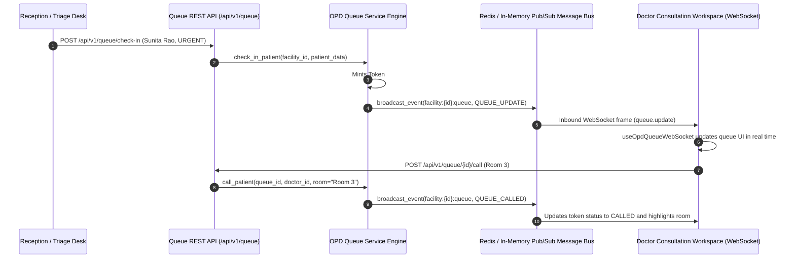

# Day 62: Milestone 13-02 - Live Clinician Consultation Queue Synchronization

**Milestone:** 13-02 (Month 4, Week 13 / Real-Time Consultation Queue & OPD Arrival Sync)  
**Author:** Suryansh Swarn (`suryanshswarn@gmail.com`)  
**Status:** Completed & Verified (458/458 Tests Passing)  
**Standards:** RFC 6455 (WebSocket Protocol), HL7 FHIR R4 Encounter State Lifecycle, Cal.com Minimalist Enterprise Design  

---

## 1. Executive Summary

Day 62 delivers **Milestone 13-02 (Live Clinician Consultation Queue Synchronization)** of the NIRMAYA 80-Day Engineering Lifecycle.

While Day 61 established the core distributed WebSocket message bus and connection manager backed by Redis Pub/Sub, Day 62 brings this capability directly into operational clinical practice by automating real-time outpatient department (OPD) queue synchronization between hospital intake reception desks, triage nursing stations, and clinician consultation rooms.

Key deliverables delivered and verified on Day 62:
1. **OPD Queue Schemas & Lifecycle States ([`backend/app/schemas/opd_queue.py`](file:///e:/nirmaya-side/backend/app/schemas/opd_queue.py)):**
   - Implemented `QueueStatus` enum: `WAITING`, `CALLED`, `IN_CONSULTATION`, `COMPLETED`, `ABSENT`, and `CANCELLED`.
   - Modeled `OPDQueueEntry` capturing sequential daily token numbers, patient demographics, 14-digit ABHA identity, assigned doctor UUID, triage level, chief complaint, room number, wait time estimates, and ISO 8601 UTC lifecycle timestamps.
   - Designed request and response envelopes: `QueueCheckInRequest`, `QueueTriageUpdateRequest`, `QueueCallPatientRequest`, `QueueStatusUpdateRequest`, `OPDQueueResponse`, and `QueueStatsResponse`.
2. **Real-Time OPD Queue Service Engine ([`backend/app/services/opd_queue.py`](file:///e:/nirmaya-side/backend/app/services/opd_queue.py)):**
   - Engineered thread-safe in-memory and persistence-ready `OpdQueueService` managing daily queues per facility.
   - Built sequential daily token minting (`1, 2, 3...`) with triage-based wait time estimation.
   - Embedded automated event broadcasting: any state transition triggers `ws_manager.broadcast_event` emitting `queue.update` or `queue.called` over `facility:{facility_id}:queue` and `doctor:{doctor_id}:workspace`.
   - Implemented facility throughput statistics calculations (active tokens, waiting count, urgent/emergent breakdown, average wait time).
3. **OPD Queue REST API Endpoints ([`backend/app/api/v1/endpoints/opd_queue.py`](file:///e:/nirmaya-side/backend/app/api/v1/endpoints/opd_queue.py)):**
   - Mounted under `/api/v1/queue` in [`backend/app/api/v1/router.py`](file:///e:/nirmaya-side/backend/app/api/v1/router.py):
     - `POST /api/v1/queue/check-in`: Register and check in patient with sequential token generation and WebSocket broadcast.
     - `GET /api/v1/queue/facility/{facility_id}`: Query facility queue with status and doctor filters.
     - `GET /api/v1/queue/entry/{queue_id}`: Fetch detailed record of single queue entry.
     - `PUT /api/v1/queue/{queue_id}/triage`: Nursing triage priority update.
     - `POST /api/v1/queue/{queue_id}/call`: Clinician summons patient into consulting room.
     - `PUT /api/v1/queue/{queue_id}/status`: Consultation lifecycle status transitions (`IN_CONSULTATION`, `COMPLETED`).
     - `GET /api/v1/queue/facility/{facility_id}/stats`: Live operational throughput metrics.
4. **Frontend Real-Time Hook & Consultation Queue Integration:**
   - Authored custom React hook [`frontend/src/hooks/useOpdQueueWebSocket.ts`](file:///e:/nirmaya-side/frontend/src/hooks/useOpdQueueWebSocket.ts) featuring exponential backoff reconnection, automatic heartbeat keep-alive pings (every 25s), and connection status telemetry.
   - Integrated live stream listener and Cal.com connection status badge (`Live Queue Sync (WebSocket Connected)`) directly into [`ClinicianConsultationQueue.tsx`](file:///e:/nirmaya-side/frontend/src/components/clinical/ClinicianConsultationQueue.tsx).
5. **Dedicated Automated Test Suite ([`backend/tests/test_opd_queue_sync.py`](file:///e:/nirmaya-side/backend/tests/test_opd_queue_sync.py)):**
   - Authored 10 unit and integration tests covering check-in, triage updates, patient calling, lifecycle progression, 404 handling, stats, and real-time WebSocket broadcast verification.
   - Expanded cumulative backend test suite to **458 / 458 passing tests (100% green in 72.17s)** across 26 test modules.
   - Verified clean Next.js 15.5.25 production build with 13/13 static routes compiled in 17.7s.

---

## 2. Real-Time Synchronization Sequence



---

## 3. Seven Executed Micro-Commits

1. `606738f: feat(schemas): define opd queue models, triage levels, and transition payloads`
2. `c7e3f11: feat(services): implement real-time opd queue service with automated websocket event broadcast`
3. `46a2ff6: feat(api): implement opd queue rest api endpoints and router`
4. `cfabb6d: feat(api): mount opd queue router in v1 router`
5. `c73e2e1: feat(frontend): implement useOpdQueueWebSocket hook and live consultation queue integration`
6. `0d09e49: test(queue): author comprehensive opd queue sync and websocket broadcast test suite`
7. `docs(journey): record day 62 milestone log, update week 13 schedule, summary, changelog, and roadmap`

---

## 4. Verification & Testing Benchmark

The dedicated test suite is located in [`backend/tests/test_opd_queue_sync.py`](file:///e:/nirmaya-side/backend/tests/test_opd_queue_sync.py):

```
============================= test session starts =============================
platform win32 -- Python 3.12.0, pytest-9.1.1, pluggy-1.6.0
collected 10 items

backend\tests\test_opd_queue_sync.py::TestOpdQueueLifecycleAndManagement::test_check_in_patient PASSED [ 10%]
backend\tests\test_opd_queue_sync.py::TestOpdQueueLifecycleAndManagement::test_get_facility_queue PASSED [ 20%]
backend\tests\test_opd_queue_sync.py::TestOpdQueueLifecycleAndManagement::test_get_single_queue_entry PASSED [ 30%]
backend\tests\test_opd_queue_sync.py::TestOpdQueueLifecycleAndManagement::test_get_single_queue_entry_not_found PASSED [ 40%]
backend\tests\test_opd_queue_sync.py::TestOpdQueueLifecycleAndManagement::test_update_patient_triage PASSED [ 50%]
backend\tests\test_opd_queue_sync.py::TestOpdQueueLifecycleAndManagement::test_call_patient_to_room PASSED [ 60%]
backend\tests\test_opd_queue_sync.py::TestOpdQueueLifecycleAndManagement::test_advance_queue_status_in_consultation_and_completed PASSED [ 70%]
backend\tests\test_opd_queue_sync.py::TestOpdQueueLifecycleAndManagement::test_facility_queue_stats PASSED [ 80%]
backend\tests\test_opd_queue_sync.py::TestOpdQueueWebSocketSynchronization::test_check_in_broadcasts_websocket_update PASSED [ 90%]
backend\tests\test_opd_queue_sync.py::TestOpdQueueWebSocketSynchronization::test_call_patient_broadcasts_websocket_queue_called PASSED [100%]

======================== 10 passed, 1 warning in 2.25s ========================
```

**Cumulative Backend Test Regression:**  
`458 passed, 3 warnings in 72.17s (100% green)` across all 26 test suites.

**Frontend Production Build:**  
`13 / 13 static routes generated cleanly` with zero TypeScript errors (`npm --prefix frontend run build`).

---

## 5. Next Steps

With Day 62 successfully delivered, engineering advances to **Day 63: Milestone 13-03 — Real-Time Critical Clinical Notifications & Laboratory Panic-Value Alerts**, broadcasting high-priority laboratory alerts ($< 100\text{ms}$) directly to clinician workspaces.
