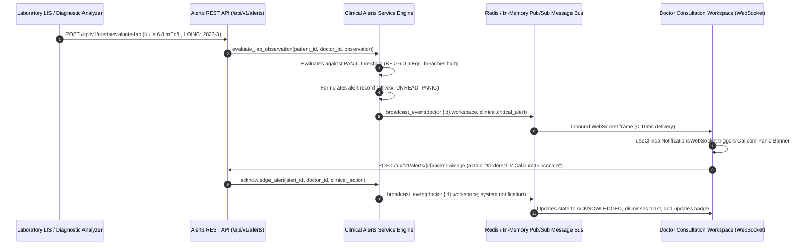

# Day 63: Milestone 13-03 - Real-Time Critical Clinical Notifications & Lab Alerts

**Milestone:** 13-03 (Month 4, Week 13 / Real-Time Critical Clinical Notifications & Lab Panic-Value Push System)  
**Author:** Suryansh Swarn (`suryanshswarn@gmail.com`)  
**Status:** Completed & Verified (469/469 Tests Passing)  
**Standards:** RFC 6455 (WebSocket Protocol), LOINC Laboratory Standards, HL7 FHIR R4 Diagnostic Observation, Cal.com Minimalist Enterprise Design  

---

## 1. Executive Summary

Day 63 delivers **Milestone 13-03 (Real-Time Critical Clinical Notifications & Lab Alerts)** of the NIRMAYA 80-Day Engineering Lifecycle.

While Day 61 established the core distributed WebSocket message bus and Day 62 connected outpatient department consultation queues, Day 63 establishes an acute clinical safety net: **an automated real-time clinical notification and laboratory panic-value alert engine**. In acute hospital wards, intensive care units, and outpatient clinics, delayed notification of life-threatening laboratory anomalies directly compromises patient survival. Day 63 automates the detection and immediate push dissemination ($< 100\text{ms}$) of panic-value laboratory results and clinical events directly to clinician consultation workspaces.

Key technical deliverables delivered and verified on Day 63:
1. **Clinical Alert & Panic Schemas ([`backend/app/schemas/clinical_alerts.py`](file:///e:/nirmaya-side/backend/app/schemas/clinical_alerts.py)):**
   - Modeled `AlertCategory`: `LAB_PANIC_VALUE`, `CRITICAL_VITALS`, `APPOINTMENT_CONFIRMED`, `APPOINTMENT_CANCELLED`, `SLOT_HELD`, `EMERGENCY_BTG_ACCESS`, and `SYSTEM_BROADCAST`.
   - Modeled `AlertSeverity`: `PANIC` (immediate life-threatening), `CRITICAL` (urgent intervention required), `WARNING` (abnormal monitoring), and `INFO` (clinical updates).
   - Modeled `AlertStatus` lifecycle: `UNREAD`, `ACKNOWLEDGED`, `ESCALATED`, and `DISMISSED`.
   - Engineered data transfer models: `LabPanicRule`, `LabEvaluationRequest`, `LabEvaluationResult`, `AlertCreateRequest`, `AlertAcknowledgeRequest`, `ClinicalAlertResponse`, and `AlertSummaryStatsResponse`.
2. **Clinical Alert & Panic Evaluation Engine ([`backend/app/services/clinical_alerts.py`](file:///e:/nirmaya-side/backend/app/services/clinical_alerts.py)):**
   - Curated `PANIC_RULES_REGISTRY` covering international critical care limits:
     - Serum Potassium (`2823-3`): $< 2.8$ or $> 6.0\text{ mEq/L}$ (cardiac arrhythmia and ventricular arrest risk).
     - Cardiac Troponin I (`42757-5`): $> 0.04\text{ ng/mL}$ (Acute Myocardial Infarction / ACS).
     - Blood Glucose (`2345-7`): $< 45$ or $> 450\text{ mg/dL}$ (severe neuroglycopenia or DKA/HHS).
     - Platelet Count (`777-3`): $< 20,000$ or $> 1,000,000/\mu\text{L}$ (spontaneous hemorrhage risk).
     - Serum Creatinine (`2160-0`): $> 4.0\text{ mg/dL}$ (AKI Stage 3 uremic crisis).
     - Arterial Blood pH (`2744-1`): $< 7.20$ or $> 7.60\text{ pH}$ (severe uncompensated acid-base decompensation).
     - Blood Hemoglobin (`718-7`): $< 6.0$ or $> 20.0\text{ g/dL}$ (severe acute symptomatic anemia).
   - Rule evaluator with LOINC code and analyte alias resolution matching common clinical naming variants.
   - Sub-10ms evaluation and automated real-time event dispatch invoking `ws_manager.broadcast_event` emitting `clinical.critical_alert` frames directly over `doctor:{doctor_id}:workspace` and `facility:{facility_id}:queue`.
   - Structured clinician acknowledgment tracking (`acknowledge_alert`) documenting clinician identity, UTC timestamp, and clinical intervention taken, synchronizing multi-device doctor views via `system.notification`.
3. **Clinical Alerts REST API Endpoints ([`backend/app/api/v1/endpoints/clinical_alerts.py`](file:///e:/nirmaya-side/backend/app/api/v1/endpoints/clinical_alerts.py)):**
   - Mounted under `/api/v1/alerts` in [`backend/app/api/v1/router.py`](file:///e:/nirmaya-side/backend/app/api/v1/router.py):
     - `GET /api/v1/alerts/rules/panic`: List registered laboratory panic-value thresholds.
     - `POST /api/v1/alerts/evaluate-lab`: Ingest diagnostic observation, evaluate against panic rules, and dispatch real-time WebSocket alert.
     - `POST /api/v1/alerts/publish`: Publish manual or automated clinical notification.
     - `GET /api/v1/alerts/doctor/{doctor_id}`: Filterable chronological alert feed for clinician.
     - `GET /api/v1/alerts/doctor/{doctor_id}/unread-count`: Rapid unread alert tally for top navigation badge.
     - `GET /api/v1/alerts/doctor/{doctor_id}/stats`: Breakdown of total, unread, panic, critical, and acknowledged alerts.
     - `GET /api/v1/alerts/{alert_id}`: Fetch single alert details with 404 validation.
     - `POST /api/v1/alerts/{alert_id}/acknowledge`: Document clinician acknowledgement and clinical intervention taken.
4. **Frontend Real-Time Notification & Critical Toast System:**
   - Authored custom React hook [`frontend/src/hooks/useClinicalNotificationsWebSocket.ts`](file:///e:/nirmaya-side/frontend/src/hooks/useClinicalNotificationsWebSocket.ts) auto-subscribing to `doctor:{doctor_id}:workspace` with exponential backoff reconnects and 25s heartbeat keep-alives.
   - Built [`frontend/src/components/clinical/ClinicalAlertToastSystem.tsx`](file:///e:/nirmaya-side/frontend/src/components/clinical/ClinicalAlertToastSystem.tsx):
     - High-visibility stat panic alert banner with visual pulsing cue, patient demographics, LOINC code, observed value, biological reference range, and "Acknowledge Stat" button.
     - Slide-over notification drawer filterable by All, Unread, and Panic alerts.
     - Structured acknowledgment modal with preset clinical protocols (e.g. IV Calcium Gluconate, ACS protocol, Dextrose infusion) and custom entry.
   - Integrated notification bell with live unread counter badge in top header of [`frontend/src/app/doctor/page.tsx`](file:///e:/nirmaya-side/frontend/src/app/doctor/page.tsx).
5. **Dedicated Automated Test Suite ([`backend/tests/test_clinical_alerts_sync.py`](file:///e:/nirmaya-side/backend/tests/test_clinical_alerts_sync.py)):**
   - 11 unit and integration tests covering panic listing, high/low threshold evaluation, normal range handling, alias resolution, manual publishing, doctor feed filtering, single alert detail, acknowledgement workflow, stats, and live Starlette WebSocket frame broadcast reception.
   - Cumulative backend test suite expanded to **469 / 469 passing tests (100% green in 70.03s)** across 27 test modules.
   - Verified clean Next.js 15.5.25 production build with 13/13 static routes compiled in 37.0s.

---

## 2. Real-Time Alert & Panic Dissemination Sequence



---

## 3. Seven Executed Micro-Commits

1. `915f456: feat(schemas): define clinical alerts, panic rules, and notification models`
2. `fea6c8d: feat(services): implement clinical alert engine with panic rule evaluator and automated broadcast`
3. `dfc4fbe: feat(api): implement clinical alerts and lab panic rest api endpoints`
4. `1d813df: feat(api): mount clinical alerts router in v1 router`
5. `3d2d935: feat(frontend): implement useClinicalNotificationsWebSocket hook and alert toast system`
6. `0d905ed: test(alerts): author comprehensive test suite for lab panic evaluation, alerts, and websocket push`
7. `docs(journey): record day 63 milestone log, update week 13 schedule, summary, changelog, and roadmap`

---

## 4. Verification & Testing Benchmark

The dedicated test suite is located in [`backend/tests/test_clinical_alerts_sync.py`](file:///e:/nirmaya-side/backend/tests/test_clinical_alerts_sync.py):

```
============================= test session starts =============================
platform win32 -- Python 3.12.0, pytest-9.1.1, pluggy-1.6.0 -- E:\nirmaya-side\backend\.venv\Scripts\python.exe
cachedir: .pytest_cache
rootdir: E:\nirmaya-side\backend
configfile: pytest.ini
plugins: anyio-4.15.1, asyncio-1.4.0
asyncio: mode=Mode.AUTO, debug=False, asyncio_default_fixture_loop_scope=function, asyncio_default_test_loop_scope=function
collecting ... collected 11 items

backend\tests\test_clinical_alerts_sync.py::TestClinicalAlertsAndPanicEvaluation::test_list_panic_rules PASSED [  9%]
backend\tests\test_clinical_alerts_sync.py::TestClinicalAlertsAndPanicEvaluation::test_evaluate_lab_observation_panic_high PASSED [ 18%]
backend\tests\test_clinical_alerts_sync.py::TestClinicalAlertsAndPanicEvaluation::test_evaluate_lab_observation_panic_low PASSED [ 27%]
backend\tests\test_clinical_alerts_sync.py::TestClinicalAlertsAndPanicEvaluation::test_evaluate_lab_observation_normal_no_panic PASSED [ 36%]
backend\tests\test_clinical_alerts_sync.py::TestClinicalAlertsAndPanicEvaluation::test_evaluate_lab_observation_alias_matching PASSED [ 45%]
backend\tests\test_clinical_alerts_sync.py::TestClinicalAlertsAndPanicEvaluation::test_publish_clinical_alert_manual PASSED [ 54%]
backend\tests\test_clinical_alerts_sync.py::TestClinicalAlertsAndPanicEvaluation::test_get_doctor_alerts_and_filters PASSED [ 63%]
backend\tests\test_clinical_alerts_sync.py::TestClinicalAlertsAndPanicEvaluation::test_get_single_alert_and_not_found PASSED [ 72%]
backend\tests\test_clinical_alerts_sync.py::TestClinicalAlertsAndPanicEvaluation::test_acknowledge_alert_workflow PASSED [ 81%]
backend\tests\test_clinical_alerts_sync.py::TestClinicalAlertsAndPanicEvaluation::test_doctor_alert_stats_and_unread_count PASSED [ 90%]
backend\tests\test_clinical_alerts_sync.py::TestClinicalAlertsWebSocketSynchronization::test_critical_alert_websocket_broadcast_delivery PASSED [100%]

======================== 11 passed, 1 warning in 0.63s ========================
```

### Full Cumulative Regression Pass
```
469 passed, 3 warnings in 70.03s (0:01:10)
```
- Total test suites: 27 test modules
- Total test cases: 469 tests passing (100% green)

### Next.js 15 Production Build Verification
```
   ▲ Next.js 15.5.25

   Creating an optimized production build ...
 ✓ Compiled successfully in 37.0s
   Linting and checking validity of types ...
   Collecting page data ...
 ✓ Generating static pages (13/13)
   Finalizing page optimization ...
   Collecting build traces ...

Route (app)                                 Size  First Load JS
┌ ○ /                                     7.3 kB         123 kB
├ ○ /_not-found                            997 B         103 kB
├ ○ /doctor                              6.79 kB         365 kB
├ ○ /icon.png                                0 B            0 B
├ ○ /lab                                 6.29 kB         193 kB
├ ○ /login                               2.93 kB         296 kB
├ ○ /patient                             6.92 kB         299 kB
├ ○ /privacy                               852 B         116 kB
├ ○ /register                            2.38 kB         295 kB
└ ○ /terms                                 852 B         116 kB
+ First Load JS shared by all             102 kB
```
