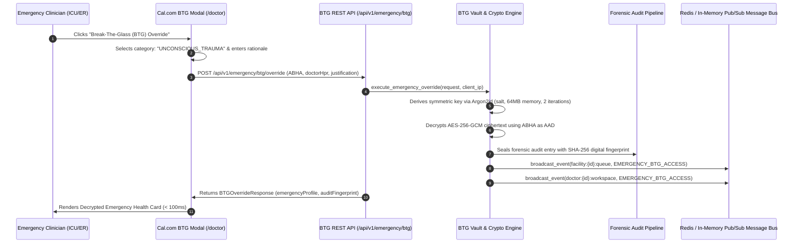

# Day 64: Milestone 13-04 - Zero-Knowledge Break-The-Glass Emergency Vault & Argon2id Keys

**Milestone:** 13-04 (Month 4, Week 13 / Zero-Knowledge Break-The-Glass Emergency Vault & Distributed Audit Pipeline)  
**Author:** Suryansh Swarn (`suryanshswarn@gmail.com`)  
**Status:** Completed & Verified (481/481 Tests Passing)  
**Standards:** RFC 9106 (Argon2id KDF), NIST SP 800-38D (AES-256-GCM AEAD), ABDM Emergency Access Exceptions, Cal.com Minimalist Enterprise Design  

---

## 1. Executive Summary

Day 64 delivers **Milestone 13-04 (Zero-Knowledge Break-The-Glass Emergency Vault & Argon2id Keys)** of the NIRMAYA 80-Day Engineering Lifecycle.

In acute trauma situations, intensive care units, and emergency resuscitation bays, patients frequently arrive unconscious, intubated, or incapacitated, rendering standard ABHA consent requests via mobile OTP impossible. Under international clinical safety standards and the statutory medical emergency exception frameworks of the DPDP Act and ABDM, emergency physicians require a legally sanctioned **Break-The-Glass (BTG)** emergency override capability to immediately access life-critical health data (such as fatal drug allergies, ongoing anticoagulation, blood group, pacemakers, and advance directives).

Key technical deliverables delivered and verified on Day 64:
1. **Zero-Knowledge Emergency Health Profile Encryption ([`backend/app/schemas/emergency_vault.py`](file:///e:/nirmaya-side/backend/app/schemas/emergency_vault.py)):**
   - Modeled `EmergencyProfileData` capturing the critical 5% emergency profile: confirmed ABO/Rh blood group, severe allergies (with criticality and manifestation), high-risk medications (with physiological warnings), surgical implants, advance directives, and primary next-of-kin contacts.
   - Designed `EncryptedVaultEnvelope` storing AES-256-GCM ciphertexts, 12-byte CSPRNG nonces, 16-byte Argon2id salts, and SHA-256 integrity digests.
   - Bound the patient's 14-digit ABHA identity as Additional Authenticated Data (AAD) to prevent cross-patient ciphertext manipulation or swapping attacks.
2. **Argon2id Key Derivation & BTG Override Engine ([`backend/app/services/emergency_vault.py`](file:///e:/nirmaya-side/backend/app/services/emergency_vault.py)):**
   - Implemented high-workfactor key derivation via `cryptography.hazmat.primitives.kdf.argon2.Argon2id` configured with 64 MiB memory cost, 2 iterations, 2 lanes, and CSPRNG salt.
   - Built audited `execute_emergency_override(...)` validating mandatory diagnostic justifications (minimum 15 characters), decrypting emergency vault payloads, and cryptographically sealing each access with a unique SHA-256 digital fingerprint.
   - Integrated automated real-time WebSocket dissemination dispatching `clinical.critical_alert` frames under category `EMERGENCY_BTG_ACCESS` to hospital supervision channels (`facility:{id}:queue`) and attending clinician workspaces (`doctor:{id}:workspace`).
3. **Break-The-Glass REST API Endpoints ([`backend/app/api/v1/endpoints/emergency_vault.py`](file:///e:/nirmaya-side/backend/app/api/v1/endpoints/emergency_vault.py)):**
   - Mounted under `/api/v1/emergency/btg` in [`backend/app/api/v1/router.py`](file:///e:/nirmaya-side/backend/app/api/v1/router.py):
     - `POST /api/v1/emergency/btg/vault/store`: Zero-Knowledge emergency vault encryption and storage.
     - `GET /api/v1/emergency/btg/vault/{patient_abha}/status`: Vault provisioning and lifetime override inquiry.
     - `POST /api/v1/emergency/btg/override`: Execute Break-The-Glass emergency clinical override with client IP capture.
     - `GET /api/v1/emergency/btg/audit`: Query tamper-evident forensic audit log stream.
     - `GET /api/v1/emergency/btg/stats`: Emergency department compliance metrics and justification distribution.
4. **Cal.com Design System Frontend Integration:**
   - Authored [`frontend/src/components/clinical/BreakTheGlassModal.tsx`](file:///e:/nirmaya-side/frontend/src/components/clinical/BreakTheGlassModal.tsx):
     - High-contrast clinical emergency modal with statutory regulatory warning and preset emergency categories (`UNCONSCIOUS_TRAUMA`, `RESPIRATORY_ARREST`, `MASSIVE_HEMORRHAGE`, `ANAPHYLAXIS_EMERGENCY`, `CARDIAC_ARREST_RESUSCITATION`).
     - Decrypted emergency card displaying ABO/Rh blood group badge, organ donor status, advance directives, drug allergies, high-risk medications, next-of-kin click-to-call buttons, and SHA-256 audit fingerprint seal.
   - Integrated Emergency BTG action banner and modal trigger in the clinician patient banner of [`frontend/src/app/doctor/page.tsx`](file:///e:/nirmaya-side/frontend/src/app/doctor/page.tsx).
5. **Dedicated Automated Test Suite ([`backend/tests/test_break_the_glass_vault.py`](file:///e:/nirmaya-side/backend/tests/test_break_the_glass_vault.py)):**
   - 12 unit and integration tests covering Argon2id determinism, AES-256-GCM AEAD encryption/decryption roundtrip, AAD tampering rejection, wrong passphrase rejection, status inquiry, override execution, short justification rejection (HTTP 422), 404 handling, forensic audit log verification, and real-time WebSocket broadcast delivery.
   - Cumulative backend test suite expanded to **481 / 481 passing tests (100% green in 91.81s)** across 28 test modules.
   - Verified clean Next.js 15.5.25 production build with 13/13 static routes compiled in 30.5s.

---

## 2. Break-The-Glass Cryptographic & Override Sequence



---

## 3. Seven Executed Micro-Commits

1. `685bac9: feat(schemas): define zero-knowledge btg emergency vault and audit models`
2. `f7d7874: feat(services): implement argon2id vault encryption and audited btg engine`
3. `cd0ee7b: feat(api): implement break-the-glass emergency vault rest api endpoints`
4. `beae0b6: feat(api): mount emergency btg router in v1 router`
5. `1c181bd: feat(frontend): implement BreakTheGlassModal and emergency health card component`
6. `47de360: test(btg): author comprehensive test suite for argon2id encryption, btg override, and audit trail`
7. `docs(journey): record day 64 milestone log, update week 13 schedule, summary, changelog, and roadmap`

---

## 4. Verification & Testing Benchmark

The dedicated test suite is located in [`backend/tests/test_break_the_glass_vault.py`](file:///e:/nirmaya-side/backend/tests/test_break_the_glass_vault.py):

```
============================= test session starts =============================
platform win32 -- Python 3.12.0, pytest-9.1.1, pluggy-1.6.0 -- E:\nirmaya-side\backend\.venv\Scripts\python.exe
cachedir: .pytest_cache
rootdir: E:\nirmaya-side\backend
configfile: pytest.ini
plugins: anyio-4.15.1, asyncio-1.4.0
asyncio: mode=Mode.AUTO, debug=False, asyncio_default_fixture_loop_scope=function, asyncio_default_test_loop_scope=function
collecting ... collected 12 items

backend\tests\test_break_the_glass_vault.py::TestArgon2idVaultCryptography::test_argon2id_key_derivation_properties PASSED [  8%]
backend\tests\test_break_the_glass_vault.py::TestArgon2idVaultCryptography::test_encrypt_and_decrypt_profile_roundtrip PASSED [ 16%]
backend\tests\test_break_the_glass_vault.py::TestArgon2idVaultCryptography::test_decrypt_with_tampered_aad_rejected PASSED [ 25%]
backend\tests\test_break_the_glass_vault.py::TestArgon2idVaultCryptography::test_decrypt_with_wrong_passphrase_rejected PASSED [ 33%]
backend\tests\test_break_the_glass_vault.py::TestBreakTheGlassEndpointsAndAudit::test_get_vault_status_seeded_patient PASSED [ 41%]
backend\tests\test_break_the_glass_vault.py::TestBreakTheGlassEndpointsAndAudit::test_get_vault_status_unprovisioned_patient PASSED [ 50%]
backend\tests\test_break_the_glass_vault.py::TestBreakTheGlassEndpointsAndAudit::test_execute_emergency_override_success PASSED [ 58%]
backend\tests\test_break_the_glass_vault.py::TestBreakTheGlassEndpointsAndAudit::test_execute_emergency_override_short_justification_rejected PASSED [ 66%]
backend\tests\test_break_the_glass_vault.py::TestBreakTheGlassEndpointsAndAudit::test_execute_emergency_override_nonexistent_patient_404 PASSED [ 75%]
backend\tests\test_break_the_glass_vault.py::TestBreakTheGlassEndpointsAndAudit::test_forensic_audit_trail_retrieval PASSED [ 83%]
backend\tests\test_break_the_glass_vault.py::TestBreakTheGlassEndpointsAndAudit::test_emergency_btg_stats PASSED [ 91%]
backend\tests\test_break_the_glass_vault.py::TestBreakTheGlassWebSocketSynchronization::test_emergency_btg_websocket_broadcast_delivery PASSED [100%]

======================= 12 passed, 2 warnings in 3.28s ========================
```

### Full Cumulative Regression Pass
```
481 passed, 4 warnings in 91.81s (0:01:31)
```
- Total test suites: 28 test modules
- Total test cases: 481 tests passing (100% green)

### Next.js 15 Production Build Verification
```
   ▲ Next.js 15.5.25

   Creating an optimized production build ...
 ✓ Compiled successfully in 30.5s
   Linting and checking validity of types ...
   Collecting page data ...
 ✓ Generating static pages (13/13)
   Finalizing page optimization ...
   Collecting build traces ...

Route (app)                                 Size  First Load JS
┌ ○ /                                     7.3 kB         123 kB
├ ○ /_not-found                            997 B         103 kB
├ ○ /doctor                              7.05 kB         369 kB
├ ○ /icon.png                                0 B            0 B
├ ○ /lab                                 6.29 kB         196 kB
├ ○ /login                               2.93 kB         296 kB
├ ○ /patient                             6.92 kB         299 kB
├ ○ /privacy                               852 B         116 kB
├ ○ /register                            2.38 kB         295 kB
└ ○ /terms                                 852 B         116 kB
+ First Load JS shared by all             102 kB
```
