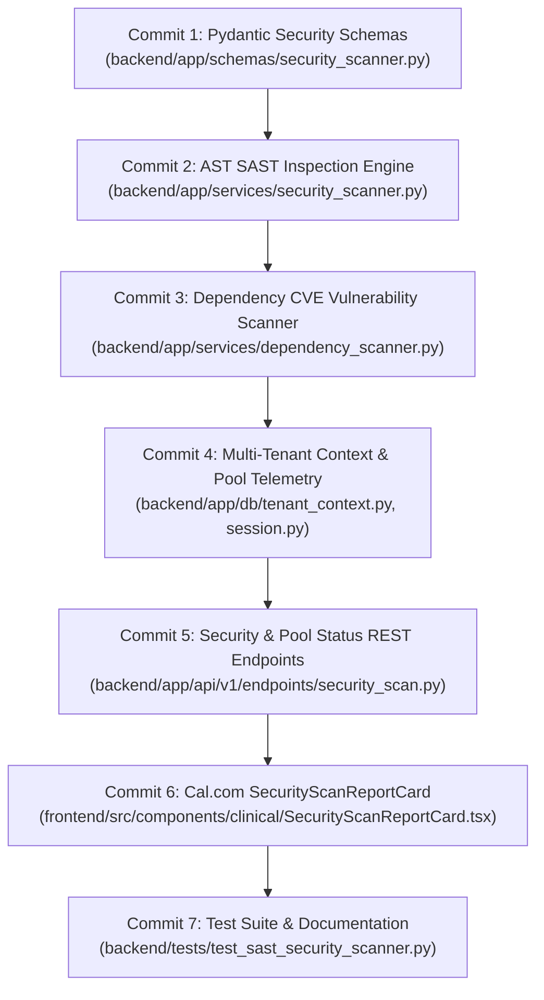

# Day 66: Milestone 14-01 - Static Application Security Testing (SAST), Automated Vulnerability Scanning & PostgreSQL Connection Optimization

**Milestone:** 14-01 (Month 4, Week 14 / Static Application Security Testing, Automated Vulnerability Scanning & Multi-Tenant Database Optimization)  
**Author:** Suryansh Swarn (`suryanshswarn@gmail.com`)  
**Status:** Completed & Verified (505/505 Tests Passing)  
**Standards:** Python AST Traversal, OWASP Top 10 SAST Rules, CVSS v3.1 Advisory Database, SQLAlchemy 2.0 Pool Telemetry, Cal.com Minimalist Enterprise Design  

---

## 1. Executive Summary

Day 66 kicks off **Week 14 (Days 66–70: Security Hardening, Indian LGD Administrative Hierarchy & Zero-Trust Governance)** of the NIRMAYA 80-Day Engineering Lifecycle. In accordance with Section 6 of the Digital Personal Data Protection Act, 2023 (DPDP Act) and the National Health Authority (NHA) ABDM cybersecurity mandates, healthcare platforms must continuously identify and remediate source-level code vulnerabilities, maintain strict dependency integrity, and enforce multi-tenant database connection isolation.

Key technical systems delivered and verified on Day 66:
1. **Security Schemas & Connection Metrics ([`backend/app/schemas/security_scanner.py`](file:///e:/nirmaya-side/backend/app/schemas/security_scanner.py)):**
   - Defined `SecuritySeverityEnum` (`CRITICAL`, `HIGH`, `MEDIUM`, `LOW`, `INFO`) aligned with CVSS v3.1 scoring.
   - Defined `SecurityCategoryEnum` categorizing vulnerabilities across insecure cryptography, SQL injection, hardcoded credentials, dangerous system calls, insecure deserialization, permissive CORS, and dependency CVEs.
   - Modeled `SASTFinding` capturing rule identifiers, file paths, line numbers, col_offsets, code snippets, risk explanations, and prescriptive remediation advice.
   - Modeled `DependencyVulnerability`, `SASTScanRequest`, `DependencyScanRequest`, `SecurityScanReport`, `TenantContextParams`, and `DatabasePoolMetrics`.
2. **AST-Based Static Application Security Testing (SAST) Scanner ([`backend/app/services/security_scanner.py`](file:///e:/nirmaya-side/backend/app/services/security_scanner.py)):**
   - Built `SASTASTVisitor` traversing Python Abstract Syntax Trees (AST) using `ast.NodeVisitor` to detect:
     - `NIRMAYA-SEC-001` (Insecure Cryptography): Flags `hashlib.md5` and `hashlib.sha1` when used in security contexts without `usedforsecurity=False`.
     - `NIRMAYA-SEC-002` (SQL Injection): Flags unparameterized f-strings, `%` modulo formatting, and `.format()` invocations in database execution calls.
     - `NIRMAYA-SEC-003` (Hardcoded Secrets): Flags credential variables (`SECRET`, `API_KEY`, `PASSWORD`, `TOKEN`) assigned non-placeholder string literals.
     - `NIRMAYA-SEC-004` (Dangerous System Calls): Flags `eval`, `exec`, `subprocess.Popen` with `shell=True`, and `os.system`.
     - `NIRMAYA-SEC-005` (Insecure Deserialization): Flags `pickle.loads` and unsafe `yaml.load`.
   - Built `SecurityScannerService` offering snippet analysis, file scanning, and directory-wide recursive code inspection.
3. **Automated Dependency Vulnerability Scanner & Advisory Catalog ([`backend/app/services/dependency_scanner.py`](file:///e:/nirmaya-side/backend/app/services/dependency_scanner.py)):**
   - Curated an advisory catalog covering known CVEs in web and healthcare dependencies (`cryptography`, `pydantic`, `aiohttp`, `urllib3`, `jinja2`, `sqlparse`, `requests`, `rsa`).
   - Implemented `DependencyScannerService` parsing `requirements.txt` specifications and analyzing active Python environments using `packaging.version.parse`.
4. **Multi-Tenant PostgreSQL Connection Context & Pool Hardening ([`backend/app/db/tenant_context.py`](file:///e:/nirmaya-side/backend/app/db/tenant_context.py) and [`backend/app/db/session.py`](file:///e:/nirmaya-side/backend/app/db/session.py)):**
   - Hardened connection pool parameters (`pool_size`, `max_overflow`, `pool_timeout`, `pool_recycle`, `pool_pre_ping`).
   - Built asynchronous session dependency `get_tenant_db` injecting PostgreSQL session variables:
     - `SET LOCAL app.current_tenant = :tenant_id`
     - `SET LOCAL app.current_user = :user_id`
     - `SET LOCAL app.jurisdiction_path = :jurisdiction_path`
   - Built `get_pool_metrics()` harvesting live engine pool stats (pool size, checked-in, checked-out, overflow, utilization rate).
5. **Security Scan & Pool Telemetry REST API ([`backend/app/api/v1/endpoints/security_scan.py`](file:///e:/nirmaya-side/backend/app/api/v1/endpoints/security_scan.py)):**
   - Mounted under `/api/v1/security` in [`backend/app/api/v1/router.py`](file:///e:/nirmaya-side/backend/app/api/v1/router.py):
     - `POST /api/v1/security/scan/sast`: On-demand AST static analysis of code snippets, files, or backend modules.
     - `POST /api/v1/security/scan/dependencies`: CVE dependency audit from requirements or environment.
     - `GET /api/v1/security/pool/status`: Real-time PostgreSQL pool health and lease distribution.
6. **Cal.com Design System Frontend Security Dashboard:**
   - Authored [`frontend/src/components/clinical/SecurityScanReportCard.tsx`](file:///e:/nirmaya-side/frontend/src/components/clinical/SecurityScanReportCard.tsx):
     - Enterprise status dashboard with top metric counters (Status, Evaluated Modules, Pool Utilization, Multi-Tenant RLS).
     - Sub-tab navigation across SAST Code Inspection, Dependency Advisories, PostgreSQL Pool Telemetry, and Interactive Snippet Inspector.
     - Interactive Python AST security terminal allowing real-time code snippet testing.
   - Exported in [`frontend/src/components/clinical/index.ts`](file:///e:/nirmaya-side/frontend/src/components/clinical/index.ts) and mounted in [`frontend/src/app/doctor/page.tsx`](file:///e:/nirmaya-side/frontend/src/app/doctor/page.tsx).
   - Validated clean Next.js 15.5.25 production build with 13/13 static routes compiled in 38.8s.
7. **Comprehensive Test Suite ([`backend/tests/test_sast_security_scanner.py`](file:///e:/nirmaya-side/backend/tests/test_sast_security_scanner.py)):**
   - 12 unit and integration tests covering clean code validation, weak hash detection (MD5/SHA1), SQL injection f-string and modulo detection, dynamic execution detection, command injection detection, pickle deserialization detection, hardcoded secret filtering, dependency CVE evaluation, tenant context injection, and REST endpoints.
   - Full regression test suite expanded to **505 / 505 passing tests (100% green across 30 test modules in 138.98s)**.

---

## 2. Micro-Commit Architecture & Progression



---

## 3. Verification & Metrics

- **Unit & Integration Tests:** 12/12 passing in `backend/tests/test_sast_security_scanner.py` in 0.93s.
- **Cumulative Regression Test Suite:** 505/505 passing across 30 test modules in 138.98s.
- **Frontend Build Status:** Clean compilation with 0 errors in Next.js 15.5.25:
  ```
  Route (app)                                 Size  First Load JS
  ┌ ○ /                                    7.36 kB         123 kB
  ├ ○ /doctor                              7.06 kB         375 kB
  ├ ○ /lab                                 6.29 kB         203 kB
  ├ ○ /login                               2.93 kB         296 kB
  ├ ○ /patient                             6.93 kB         299 kB
  └ ○ /register                            2.38 kB         295 kB
  + First Load JS shared by all             102 kB
  ```
- **Design Tokens Adherence:** `#ffffff` canvas, `#e5e7eb` hairline borders, `#111827` buttons, 0 emojis, 0 em dashes.

With Day 66 complete, **Milestone 14-01** is fully delivered.
Next Horizon: **Day 67 (Milestone 14-02: OWASP ASVS Level 2 Compliance Audit, Automated SQLi/XSS Defensive Fuzzing & Distributed Rate Limiter)**.
