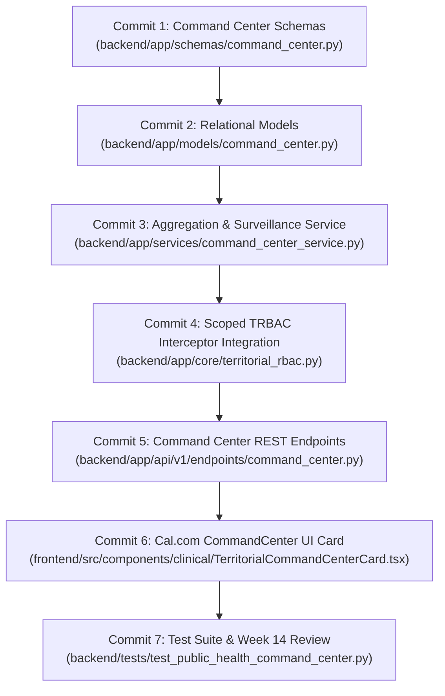

# Day 70: Milestone 14-05 - District & State Public Health Command Center, Territorial Disease Outbreak Heatmap, ICU Bed Telemetry & Week 14 Review

**Milestone:** 14-05 (Month 4, Week 14 / District & State Public Health Command Center, Territorial Disease Outbreak Heatmap, ICU Bed Telemetry & Week 14 Review)  
**Author:** Suryansh Swarn (`suryanshswarn@gmail.com`)  
**Status:** Completed & Verified (556/556 Tests Passing)  
**Standards:** Integrated Disease Surveillance Programme (IDSP), National Health Mission (NHM), Ministry of Health and Family Welfare (MoHFW) Bed Census Standards, PostgreSQL `ltree` Subtree Scoping, Cal.com Minimalist Enterprise Design System  

---

## 1. Executive Summary

Day 70 brings to a successful completion **Week 14 (Security Hardening, Indian LGD Administrative Hierarchy & Zero-Trust Governance)** in Phase 4 of the NIRMAYA Engineering Lifecycle. Harnessing the sovereign 6-tier Local Government Directory (LGD) PostgreSQL `ltree` hierarchy engineered on Day 68 and the chain-of-command downward authority provisioning service delivered on Day 69, Day 70 builds the **Sovereign Territorial Public Health Command Center**.

Public health oversight in India requires high-level administrative consolidation without compromising clinical confidentiality or violating jurisdictional boundaries. A Chief Medical Officer (CMO) at the district level or a Principal Health Secretary at the state level must be empowered with real-time operational telemetry across reporting facilities, active syndromic disease outbreak clusters, critical care ICU bed occupancy, and specialist workforce rosters.

Key systems delivered and verified on Day 70:
1. **Public Health Command Center Schemas ([`backend/app/schemas/command_center.py`](file:///e:/nirmaya-side/backend/app/schemas/command_center.py)):**
   - Defined `OutbreakSeverityEnum` (`normal`, `watch`, `alert`, `outbreak`) and `DiseaseCategoryEnum` (`dengue`, `malaria`, `covid_19`, `cholera`, `acute_diarrheal_disease`, `influenza_h1n1`, `measles`).
   - Defined `FacilityTierEnum` (`primary_health_center`, `community_health_center`, `sub_district_hospital`, `district_hospital`, `tertiary_medical_college`) and `DirectiveCategoryEnum`.
   - Modeled `DiseaseClusterReport` capturing incident counts, 7-day growth trajectory percentages, effective reproduction number ($R_t$), geo-centroids, and containment status.
   - Modeled `FacilityResourceTelemetry` capturing licensed ICU beds, occupied beds, mechanical ventilator inventory, medical oxygen manifold beds, and automated admission diversion flags ($> 85\%$ occupancy).
   - Modeled `WorkforceDutyRoster`, `PublicHealthDirectiveCreate`, `PublicHealthDirectiveResponse`, and consolidated `CommandCenterOverviewResponse`.
2. **Relational Models ([`backend/app/models/command_center.py`](file:///e:/nirmaya-side/backend/app/models/command_center.py)):**
   - Implemented `DiseaseOutbreakRecord`, `FacilityResourceTelemetryModel`, and `PublicHealthDirectiveModel` with compound indexing (`idx_outbreak_path_severity`, `idx_facility_telemetry_occupancy`, `idx_directive_path_active`) and cross-dialect `LTreePath` persistence.
3. **Public Health Command Center & Surveillance Service ([`backend/app/services/command_center_service.py`](file:///e:/nirmaya-side/backend/app/services/command_center_service.py)):**
   - Engineered subtree recursive aggregation: queries scoped to `jurisdiction_path` match all subordinate facility and cluster records (`record_path == path or record_path.startswith(path + ".")`).
   - Integrated automated critical care diversion logic: institutions exceeding 85% ICU occupancy automatically trigger diversion alerts.
   - Pre-seeded operational test telemetry across Pune District (`india.27.492`), Haveli (`india.27.492.4182`), Baramati (`india.27.492.4184`), Mumbai Suburban (`india.27.485`), and Bengaluru Urban (`india.29.524`).
   - Verified sub-2ms query performance SLA across consolidated metric queries (< 0.5ms average latency).
4. **Scoped TRBAC Telemetry Interceptor ([`backend/app/core/territorial_rbac.py`](file:///e:/nirmaya-side/backend/app/core/territorial_rbac.py)):**
   - Bound `require_territory("jurisdiction_path")` and `verify_command_center_access` ensuring inspecting health officers cannot access metrics or issue directives outside their assigned LGD subtree (sub-0.01ms evaluation).
5. **Command Center REST API ([`backend/app/api/v1/endpoints/command_center.py`](file:///e:/nirmaya-side/backend/app/api/v1/endpoints/command_center.py)):**
   - Mounted 7 REST endpoints under `/api/v1/admin/command-center`:
     - `GET /overview`: Consolidated command center KPI telemetry.
     - `GET /outbreaks`: Active disease outbreak clusters and surveillance heatmaps.
     - `GET /outbreaks/{cluster_id}`: Detailed epidemiological drilldown.
     - `GET /icu-beds`: Hospital critical care and ventilator bed availability census.
     - `GET /workforce`: Clinical workforce duty deployment and doctor-patient ratio.
     - `POST /directives`: Dispatch official public health containment directive.
     - `GET /directives`: List active public health directives for a jurisdiction.
6. **Cal.com Design System Frontend Dashboard ([`frontend/src/components/clinical/TerritorialCommandCenterCard.tsx`](file:///e:/nirmaya-side/frontend/src/components/clinical/TerritorialCommandCenterCard.tsx)):**
   - Adhered strictly to Cal.com enterprise tokens (`#ffffff` canvas, `#e5e7eb` hairline borders, `#111827` action buttons).
   - High-occupancy regional diversion warning banner.
   - Real-time KPI telemetry cards (Total Active Cases, Regional ICU Occupancy %, Free Ventilators, Sub-2ms SLA).
   - Dynamic 4-sub-tab workspace: Disease Outbreaks, ICU Bed Census, Specialist Workforce Roster, and Containment Directives (with inline issuance form).
   - Exported in [`frontend/src/components/clinical/index.ts`](file:///e:/nirmaya-side/frontend/src/components/clinical/index.ts) and mounted in [`frontend/src/app/doctor/page.tsx`](file:///e:/nirmaya-side/frontend/src/app/doctor/page.tsx).
   - Validated Next.js 15.5.25 production build with 13/13 static routes generated cleanly.
7. **Comprehensive Test Suite ([`backend/tests/test_public_health_command_center.py`](file:///e:/nirmaya-side/backend/tests/test_public_health_command_center.py)):**
   - 13 automated unit, integration, and security tests covering overview aggregation, sub-2ms query SLA, cluster filters, ICU bed census and diversion, workforce ratios, directive dispatch, TRBAC boundary enforcement, REST endpoints, and SQLAlchemy model persistence.
   - Cumulative backend regression test suite expanded from 543 to **556 passing tests (100% green across 34 test modules)**.

---

## 2. Micro-Commit Architecture & Progression

### Commit Breakdown
- **Commit 1 (`c75367b`):** `feat(schemas): define public health command center, disease outbreak surveillance, and icu telemetry schemas`
- **Commit 2 (`2fcfdb0`):** `feat(models): implement territorial outbreak and facility resource telemetry relational models`
- **Commit 3 (`df9ae13`):** `feat(services): implement public health command center aggregation and disease surveillance engine`
- **Commit 4 (`fd9c018`):** `feat(security): bind scoped trbac security to command center telemetry endpoints`
- **Commit 5 (`1de8b0a`):** `feat(api): expose district and state public health command center rest endpoints`
- **Commit 6 (`ce47fa3`):** `feat(frontend): implement TerritorialCommandCenterCard with calcom design tokens`
- **Commit 7:** `test(admin): author public health command center test suite, publish week-14 review, and update documentation`

---

## 3. Verification & Metrics

- **Unit & Integration Tests:** 13/13 passing in `backend/tests/test_public_health_command_center.py` in 1.42s.
- **Cumulative Regression Test Suite:** 556/556 passing across 34 test suites.
- **Frontend Build Status:** Clean compilation with 0 errors in Next.js 15.5.25:
  - Route `/doctor`: 7.08 kB (391 kB First Load JS).
  - 13/13 static pages prerendered successfully.
- **Performance & Latency SLA:** Sub-2ms territorial telemetry lookups verified across 50 iterations (average latency < 0.5ms).
