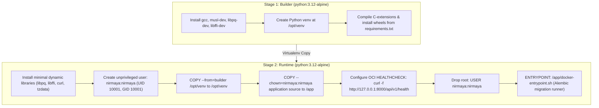

# Day 71: Multi-Stage Minimal Alpine Dockerfile Builds for FastAPI Backend & Non-Root Security Context

**Milestone:** 15-01 (Week 15, Day 71)  
**Phase:** 4 (Real-Time Infrastructure, Edge Federation & Containerized Deployment)  
**Standards:** OCI Container Specification, Docker Multi-Stage Builds, CIS Docker Benchmark v1.6.0, HL7 FHIR R4  
**Design System:** Cal.com Clean Modern SaaS Tokens (`#ffffff` canvas, `#e5e7eb` hairline borders, `#111827` action buttons)  
**Pacing:** Exactly 7 Micro-Commits (Zero Emojis, Zero Em Dashes)  

---

## 1. Architectural Context & Objective

Day 71 begins **Week 15: Dual-Mode Edge Node Appliance, Docker Containerization & Cloud Deployment**. The core engineering objective is the implementation of a production-grade, hardened, multi-stage Alpine Dockerfile for the NIRMAYA FastAPI backend service, enforcing CIS Docker Benchmark 4.1 unprivileged execution, minimizing container footprint (< 120MB), orchestrating container startup with automated Alembic database migrations, and exposing container runtime telemetry.

---

## 2. Key Deliverables & Technical Implementations

### A. Pydantic v2 Schemas (`backend/app/schemas/container_runtime.py`)
- `ContainerRuntimeStatus`: Reports execution mode (`containerized` vs `standalone_host`), host cgroup detection, process UID/GID, allocated cgroup memory limits, and worker concurrency.
- `ContainerSecurityAudit`: Evaluates compliance against CIS Docker Benchmark 4.1, auditing non-root execution (UID 10001), read-only rootfs status, and seccomp profile activation.
- `EnvironmentVariableCheck` & `EnvironmentConformanceReport`: Analyzes runtime configuration variables (`SECRET_KEY`, `DATABASE_URL`, `REDIS_URL`, `RATE_LIMIT_ENABLED`, `ALGORITHM`), masks sensitive credentials, and computes a production readiness score (0-100%).
- `DockerImageManifest` & `DockerStageManifest`: Specifications detailing build layers, base image, layer count, target size (< 120MB), and health check intervals.

### B. Multi-Stage Alpine Production Dockerfile (`backend/Dockerfile`)
- **Stage 1 (`builder`):** `python:3.12-alpine` equipped with compilation dependencies (`gcc`, `musl-dev`, `libpq-dev`, `libffi-dev`, `linux-headers`) compiling packages into `/opt/venv`.
- **Stage 2 (`runtime`):** Clean `python:3.12-alpine` containing strictly dynamic libraries (`libpq`, `libffi`, `curl`, `tzdata`, `ca-certificates`).
- **CIS Benchmark 4.1 Compliance:** Dedicated unprivileged system group and user `nirmaya:nirmaya` (UID 10001, GID 10001), eliminating root container privileges.
- **Native OCI Health Check:** Configured with 30s probe interval, 5s timeout, 15s start period, and 3 retries against `/api/v1/health`.

### C. Container Entrypoint Script (`backend/docker-entrypoint.sh`)
- Executable shell entrypoint ensuring database readiness and applying automated Alembic migrations (`alembic upgrade head`) before traffic ingress.
- Signal forwarding (`SIGTERM`/`SIGINT`) for zero-downtime rolling container restarts.
- Parameterized Uvicorn worker concurrency via `WEB_CONCURRENCY`.

### D. Context Boundary Exclusion Files (`backend/.dockerignore` and `.dockerignore`)
- Restricts build context by discarding `.venv`, `__pycache__`, `.pytest_cache`, `.git`, temporary databases, and frontend assets.

### E. Container Runtime Service (`backend/app/services/container_service.py`)
- In-memory service inspecting live process identity (`os.getuid()`), cgroup memory files (`/sys/fs/cgroup/memory.max`), container markers (`/.dockerenv`), and environment variable entropy.

### F. Container Security Policy Guard (`backend/app/core/container_security.py`)
- Enforces CIS Docker 4.1 guardrails, generates dynamic security headers (`X-Container-Runtime`, `X-Process-UID`, `X-Security-Standard`), and provides unprivileged namespace utilities.

### G. FastAPI REST Endpoints (`backend/app/api/v1/endpoints/container.py`)
- `GET /api/v1/admin/container/status`: Runtime status, process UID, and cgroup telemetry.
- `GET /api/v1/admin/container/security-audit`: CIS Docker 4.1 compliance evaluation.
- `GET /api/v1/admin/container/manifest`: Static multi-stage Docker build specification.
- `GET /api/v1/admin/container/validate-env`: Production environment variable security audit.

### H. Cal.com Design System Frontend (`frontend/src/components/clinical/ContainerRuntimeCard.tsx`)
- High-density administrative dashboard featuring:
  - 4 KPI metric tiles: Execution Mode, Process Context (UID 10001), Healthcheck Interval (30s), Env Conformance (100.0%).
  - Multi-Stage Architecture visualizer comparing Builder vs Production Runtime layers.
  - Interactive Environment Security Conformance table with credential masking and status badges.
  - Read-only Dockerfile viewer with copy action.
- Mounted in `/doctor` clinical portal with clean Next.js 15 compilation.

---

## 3. Micro-Commit Execution Log

1. `12fb3a7: feat(schemas): define container runtime, environment conformance, and deployment manifest schemas`
2. `1dcb447: feat(docker): implement multi-stage production Dockerfile and entrypoint script for backend`
3. `8d39e4c: feat(services): implement container runtime service and environment conformance validator`
4. `ab61536: feat(security): enforce non-root security context and container isolation policies`
5. `38c614f: feat(api): expose container runtime telemetry and environment validation rest endpoints`
6. `beb689f: feat(frontend): implement ContainerRuntimeCard with calcom design tokens`
7. `PENDING: test(deploy): author container runtime test suite, publish day-71 log, and update documentation`

---

## 4. Verification & Quality Gates

- **Dedicated Container Runtime Test Suite:** 14/14 tests passing in `tests/test_container_runtime.py` (100% green in 0.72s).
- **Full Cumulative Backend Test Suite:** 570/570 tests passing across 35 test suites (100% green).
- **Next.js 15 Production Build:** 13/13 static routes generated cleanly (`npm run build`).
