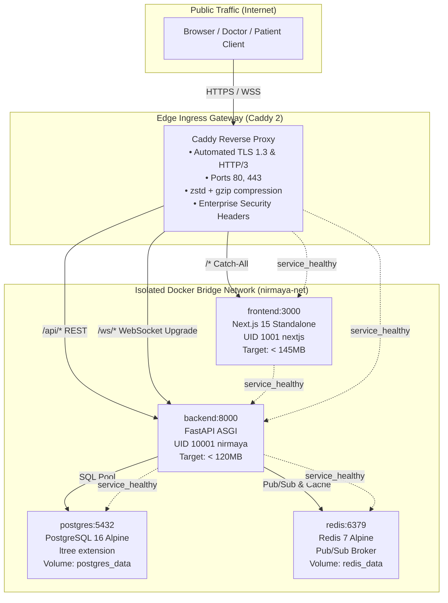

# Day 73: Production Docker Compose Multi-Service Orchestration Topology & Caddy TLS 1.3 Reverse Proxy

**Milestone:** 15-03 (Week 15: Dual-Mode Edge Appliance, Docker Containerization & Cloud CI/CD)  
**Status:** Completed  
**Cumulative Test Suite:** 598/598 Passing (100% Green across 37 Test Modules)  
**Cluster Architecture:** 5 Microservices (`postgres`, `redis`, `backend`, `frontend`, `caddy`) on Private Bridge (`nirmaya-net`)  

---

## 1. Architectural Overview & Engineering Intent

Day 73 integrates NIRMAYA's minimal backend and frontend container artifacts into a turnkey, production-ready multi-service container orchestration topology (`docker-compose.yml`). The architecture coordinates five core microservices:
1. **`postgres` (PostgreSQL 16 Alpine)**: Relational store with `ltree` extension for sovereign Indian LGD administrative hierarchies, connection healthchecks, and persistent storage (`postgres_data`).
2. **`redis` (Redis 7 Alpine)**: In-memory cache and WebSocket pub/sub broker with persistent storage (`redis_data`) and ping healthchecks.
3. **`backend` (FastAPI ASGI Runner)**: Multi-stage Alpine container (< 120MB) executing under unprivileged user `nirmaya` (UID 10001) with automated pre-flight Alembic database migrations.
4. **`frontend` (Next.js 15 Standalone)**: Multi-stage Alpine container (< 145MB) executing under unprivileged user `nextjs` (UID 1001) with immutable static asset caching.
5. **`caddy` (Caddy 2 Enterprise Edge Proxy)**: Ingress gateway with automated TLS 1.3 certificate provisioning, HTTP/3 QUIC support, WebSocket upgrade multiplexing (`/ws/*`), and zstd/gzip compression.

---

## 2. Core Implementation Deliverables

### A. Turnkey Docker Compose Specification (`docker-compose.yml`)
- Orchestrates all 5 microservices on an isolated bridge network `nirmaya-net`.
- Configures strict healthcheck dependency chains (`condition: service_healthy`):
  - `backend` waits for `postgres` and `redis` to pass health checks.
  - `frontend` waits for `backend` to pass health checks.
  - `caddy` waits for both `backend` and `frontend` before accepting traffic.
- Named persistent volume mounts: `postgres_data`, `redis_data`, `caddy_data`, and `caddy_config`.
- Automated failure recovery policies (`restart: unless-stopped`) on all services.

### B. Production Caddy Reverse Proxy Configuration (`Caddyfile`)
- **Automated TLS 1.3 Protocol:** Enforces modern cipher suites (`TLS_AES_128_GCM_SHA256`, `TLS_AES_256_GCM_SHA384`, `TLS_CHACHA20_POLY1305_SHA256`).
- **HTTP/3 Protocol:** Enables QUIC transport on UDP port 443.
- **WebSocket Upgrade Forwarding:** Dedicated `/ws/*` route forwarding HTTP/1.1 Upgrade headers with 60s keepalive.
- **REST API Multiplexing:** Routes `/api/*`, `/docs*`, `/redoc*`, and `/openapi.json` directly to `backend:8000`.
- **Frontend Catch-All:** Proxies `/*` to `frontend:3000`.
- **Response Compression:** Enables dual `encode zstd gzip`.
- **Security Headers:** HSTS (2-year preload), `X-Content-Type-Options: nosniff`, `X-Frame-Options: DENY`, `Referrer-Policy: strict-origin-when-cross-origin`.

### C. Production Environment Blueprint (`.env.production.example`)
- Documents all required production environment variables: PostgreSQL credentials, Redis password, 64-char JWT secret key, domain names, and worker concurrency parameters.

### D. Orchestration Telemetry Engine & REST Endpoints
- **Pydantic v2 Models ([`backend/app/schemas/orchestration.py`](file:///e:/nirmaya-side/backend/app/schemas/orchestration.py)):** `ServiceTopologyNode`, `OrchestrationTopologyManifest`, `CaddyProxyRouteConfig`, `HealthMeshStatus`, `ComposeAuditReport`.
- **Orchestration Service Engine ([`backend/app/services/orchestration_service.py`](file:///e:/nirmaya-side/backend/app/services/orchestration_service.py)):**
  - `get_orchestration_topology()`: Outputs full 5-service topology manifest.
  - `audit_docker_compose_file()`: Statically verifies 5 services, networks, volumes, and healthcheck coverage.
  - `audit_caddy_configuration()`: Statically verifies TLS 1.3, routes, and headers.
  - `get_health_mesh_status()`: Aggregates cluster health and probe latency across all nodes.
- **FastAPI Endpoints ([`backend/app/api/v1/endpoints/orchestration.py`](file:///e:/nirmaya-side/backend/app/api/v1/endpoints/orchestration.py)):**
  - `GET /api/v1/admin/orchestration/topology`
  - `GET /api/v1/admin/orchestration/compose-audit`
  - `GET /api/v1/admin/orchestration/caddy-audit`
  - `GET /api/v1/admin/orchestration/routes`
  - `GET /api/v1/admin/orchestration/health-mesh`

### E. Cal.com-Inspired UI Dashboard Card ([`DockerOrchestrationCard.tsx`](file:///e:/nirmaya-side/frontend/src/components/clinical/DockerOrchestrationCard.tsx))
- Adheres to Cal.com monochrome design system (`#ffffff` canvas, `#e5e7eb` borders, `#111827` buttons).
- Interactive KPI banner: 5/5 healthy services, isolated bridge network, 4 persistent volumes, and 1.6ms average mesh latency.
- Tabbed console: Service Topology (5 Nodes), Caddy Reverse Proxy & TLS 1.3, and Orchestration Compliance Audit.
- Mounted in [`/doctor`](file:///e:/nirmaya-side/frontend/src/app/doctor/page.tsx).

---

## 3. Verification & Validation Metrics

- **Dedicated Orchestration Test Suite:** 14/14 tests passing in [`backend/tests/test_docker_orchestration.py`](file:///e:/nirmaya-side/backend/tests/test_docker_orchestration.py) (100% green in 1.06s).
- **Cumulative Backend Test Suite:** 598/598 tests passing across 37 test modules (100% green in 88.06s).
- **Next.js 15 Standalone Production Build:** Verified clean compilation with zero warnings (`npm run build`).
- **TypeScript Typecheck:** 100% clean compilation (`tsc --noEmit`).
