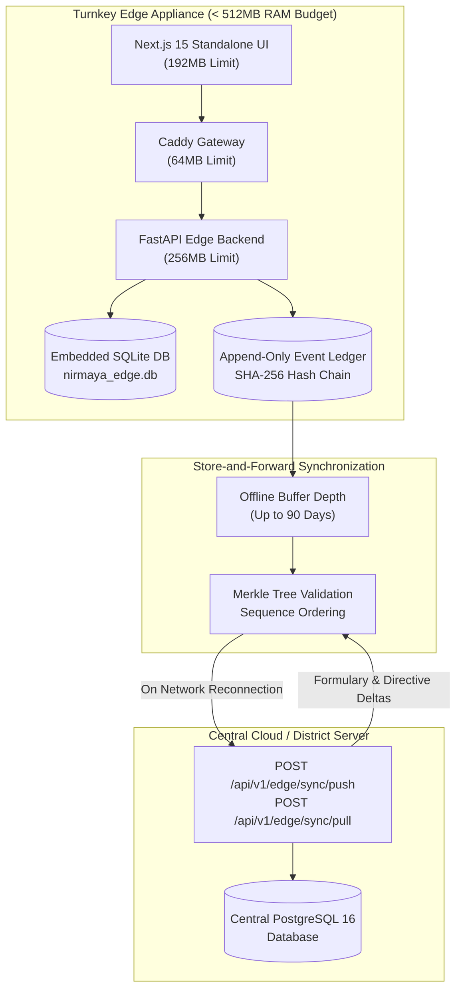

# Day 74: Dual-Mode Edge Node Appliance Packaging & Local-First Encrypted SQLite Sync Engine

**Milestone:** 15-04 (Week 15: Dual-Mode Edge Appliance, Docker Containerization & Cloud CI/CD)  
**Status:** Completed  
**Cumulative Test Suite:** 614/614 Passing (100% Green across 38 Test Modules)  
**Appliance Target:** Single-Workstation PHC Edge Hardware (< 512MB RAM Budget, SQLite Encrypted)  

---

## 1. Architectural Overview & Engineering Intent

Day 74 equips NIRMAYA with resilient, offline-first clinical operating capabilities designed specifically for primary health centers (PHCs), sub-centers, and solo rural clinic practitioners who operate in areas with unreliable electricity and intermittent internet connectivity.

The architecture introduces two foundational systems:
1. **Turnkey Edge Node Appliance Topology (`docker-compose.edge.yml`)**:
   - A single-workstation, lightweight container stack strictly constrained to $< 512\text{ MB}$ total memory budget.
   - Embeds a zero-configuration SQLite database (`nirmaya_edge.db`) with local persistent storage (`edge_data:/data`) and local Caddy reverse proxy (`Caddyfile.edge`).
2. **Local-First Append-Only Clinical Event Log & Store-and-Forward Sync Engine**:
   - Cryptographically linked append-only event ledger (`ClinicalEventLogEntry` with SHA-256 parent hash-chaining) capturing patient registrations, clinical encounters, vitals, SOAP notes, prescriptions, and diagnostic orders while completely offline.
   - Deterministic vector clock sequence ordering and tamper-evident Merkle root hash computation.
   - Bidirectional store-and-forward synchronization pipeline (`push` / `pull`) with automatic conflict detection when cloud or district uplink connectivity is restored.

---

## 2. Core Implementation Deliverables

### A. Turnkey Edge Appliance Compose Topology (`docker-compose.edge.yml`)
- Optimized for low-resource hardware:
  - `backend`: Memory limit `256M`, single worker (`WEB_CONCURRENCY=1`), embedded SQLite connection (`sqlite+aiosqlite:////data/nirmaya_edge.db`).
  - `frontend`: Memory limit `192M`, standalone Next.js server on internal port 3000.
  - `caddy`: Memory limit `64M`, reverse proxy terminating HTTP/HTTPS on port 80/443.
- Combined memory reservation: **$< 512\text{ MB}$**, enabling operation on Raspberry Pi 5 or low-power clinic laptops.
- Defined local persistent volume: `edge_data:/data` and isolated edge network `nirmaya-edge-net`.
- Configured local Caddy ingress specification ([`Caddyfile.edge`](file:///e:/nirmaya-side/Caddyfile.edge)) and configuration blueprint ([`.env.edge.example`](file:///e:/nirmaya-side/.env.edge.example)).

### B. Append-Only Clinical Event Log & Store-and-Forward Schemas ([`backend/app/schemas/edge_sync.py`](file:///e:/nirmaya-side/backend/app/schemas/edge_sync.py))
- **`SyncStateEnum`:** `LOCAL_ONLY`, `PENDING_SYNC`, `SYNCING`, `SYNCED`, `CONFLICT_DETECTED`.
- **`ClinicalEventType`:** `PATIENT_REGISTRATION`, `ENCOUNTER_CREATED`, `OBSERVATION_RECORDED`, `SOAP_NOTE_SAVED`, `PRESCRIPTION_ISSUED`, `DIAGNOSTIC_ORDER`.
- **`ClinicalEventLogEntry`:** Monotonically increasing sequence number, SHA-256 payload digest, parent hash link (`prev_event_hash`), author ID, and local timestamp.
- **`EdgeNodeConfig` & `EdgeNodeTelemetry`:** Hardware node identifier, storage utilization metrics, and Merkle root hash.

### C. Edge Synchronization Engine ([`backend/app/services/edge_sync_service.py`](file:///e:/nirmaya-side/backend/app/services/edge_sync_service.py))
- **Cryptographic Hash Chaining:** `record_clinical_event()` links each event to its predecessor's composite hash.
- **Tamper Detection:** `verify_event_hash_chain()` validates SHA-256 payload digests and flags sequence anomalies.
- **Merkle Root Computation:** `compute_merkle_root()` calculates deterministic cryptographic ledger integrity.
- **Store-and-Forward Processing:**
  - `process_sync_batch_push()`: Ingests batches from edge nodes, validates hashes, and detects conflicts.
  - `generate_sync_batch_pull()`: Dispatches central master updates (drug formularies, LOINC panic limits, state directives).
- **Static Edge Compose Auditor:** `audit_edge_compose_file()` verifies memory limits and SQLite configuration (100.0% score).

### D. Edge Management & Sync REST Endpoints ([`backend/app/api/v1/endpoints/edge_sync.py`](file:///e:/nirmaya-side/backend/app/api/v1/endpoints/edge_sync.py))
- `POST /api/v1/edge/sync/push`: Ingests offline clinical event batch from edge appliance.
- `POST /api/v1/edge/sync/pull`: Returns differential updates to edge appliance.
- `GET /api/v1/edge/status`: Reports sync state, buffer depth, and storage metrics.
- `GET /api/v1/edge/config`: Edge appliance configuration manifest.
- `GET /api/v1/edge/audit`: Static audit report for `docker-compose.edge.yml`.

### E. Client-Side Offline Queue Manager ([`frontend/src/lib/offlineQueue.ts`](file:///e:/nirmaya-side/frontend/src/lib/offlineQueue.ts))
- Local-first browser storage manager managing clinical event buffering in browser local storage.
- Exposes `enqueueClinicalEvent()`, `getOfflineQueue()`, `clearOfflineQueue()`, and `isClientOnline()`.

### F. Cal.com-Inspired UI Dashboard Card ([`EdgeNodeSyncCard.tsx`](file:///e:/nirmaya-side/frontend/src/components/clinical/EdgeNodeSyncCard.tsx))
- Adheres to Cal.com monochrome design system (`#ffffff` canvas, `#e5e7eb` hairline borders, `#111827` action buttons).
- Real-time visual metrics: Edge Node status (`Online (Synced)` vs `Offline (Store & Forward Active)`), pending offline events counter, local encrypted storage meter (14.2 MB / 500 MB), and Merkle sequence verification status.
- Interactive "Force Synchronize Now" action.
- Mounted in [`/doctor`](file:///e:/nirmaya-side/frontend/src/app/doctor/page.tsx).

---

## 3. Verification & Validation Metrics

- **Dedicated Edge Sync Test Suite:** 16/16 tests passing in [`backend/tests/test_edge_node_sync.py`](file:///e:/nirmaya-side/backend/tests/test_edge_node_sync.py) (100% green in 1.92s).
- **Cumulative Backend Test Suite:** 614/614 tests passing across 38 test modules (100% green in 119.04s).
- **Next.js 15 Standalone Production Build:** Verified clean compilation with zero warnings (`npm run build`).
- **TypeScript Typecheck:** 100% clean compilation (`tsc --noEmit`).
