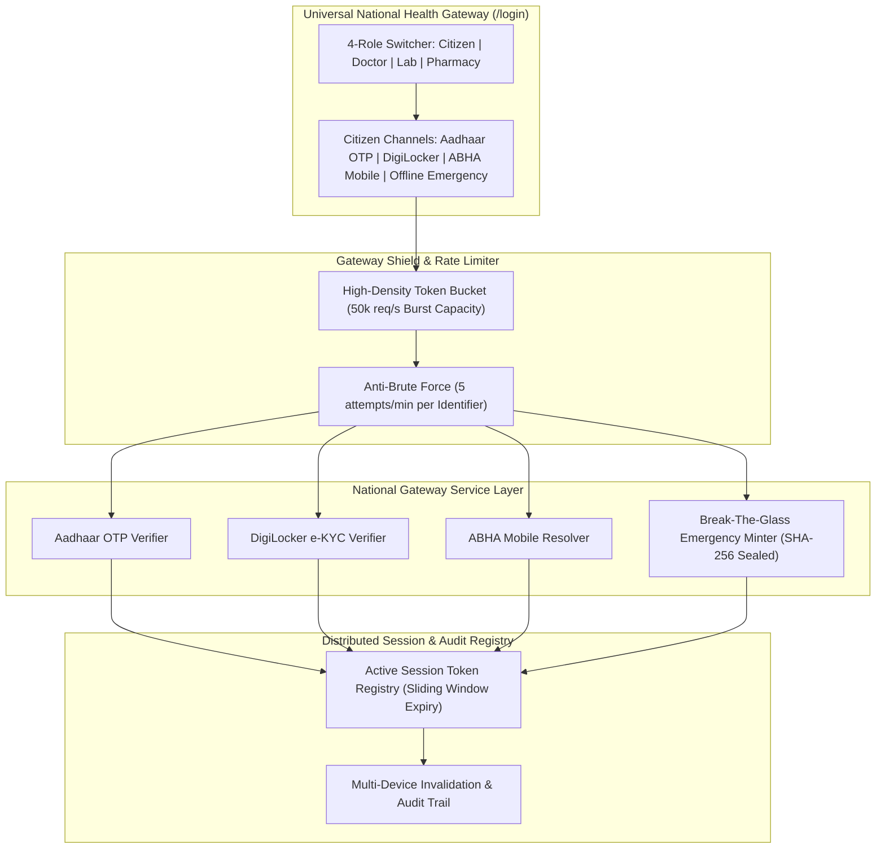

# Day 86: Universal High-Density National Health Gateway & Multi-Channel Authentication

**Date:** Mon Nov 9, 2026  
**Milestone:** 18-01 (Phase 5: Production Hardening & National Scale Architecture)  
**Target Release:** `v1.1.0`  
**Test Suite Target:** $\ge 873$ Tests Passing (100% Green)

---

## 1. Overview and Objectives

Digital healthcare systems in India must serve citizens ranging from smartphone power users in metropolitan centers to rural citizens operating low-cost smartphones on intermittent networks or with limited literacy. Furthermore, public hospital OPD desks handle tens of thousands of citizens daily.

Day 86 kicks off Week 18 by delivering the **Universal High-Density National Health Gateway & Multi-Channel Authentication**:
1. **Authoritative 4-Role Healthcare Gateway:** Unifies Citizen/Patient, Doctor/Clinician, Diagnostic Laboratory, and Pharmacy Desk under a standardized government DPI portal featuring the national tricolor strip and official helplines (`1075` National Health Helpline, `108` Ambulance).
2. **Four Citizen Multi-Modal Auth Channels:**
   - **Channel 1 (Aadhaar OTP):** 6-digit demographic OTP challenge and verification with transaction tracking and instant ABHA resolution.
   - **Channel 2 (DigiLocker e-KYC):** 1-click OAuth2 PKCE certified document extraction and profile demographic population.
   - **Channel 3 (ABHA Mobile Fallback):** Active SIM fallback with `@abdm` identifier lookup for citizens with updated phone numbers.
   - **Channel 4 (Offline Emergency Break-The-Glass):** Emergency trauma session minting with cryptographic SHA-256 tamper seal and post-reconnect synchronization ledger.
3. **High-Density Token-Bucket Rate Limiter Shield (50,000 req/sec Burst Absorption):**
   - Tiered token-bucket shield: anti-brute force defense (max 5 failed attempts per minute) alongside high-throughput capacity (50,000 req/sec) for session heartbeat and telemetry.
4. **Distributed Session Registry & Device Management:**
   - Ephemeral session tokens with channel attestation, device fingerprinting, and 1-click single-device or global session revocation.
   - 30-day extended session option for citizen convenience without compromising clinical audit standards.

---

## 2. Implemented Architecture

---

## 3. Key Components Implemented

### Domain Schemas & Models
- [`backend/app/schemas/national_gateway.py`](file:///e:/nirmaya-side/backend/app/schemas/national_gateway.py):
  - `GatewayUserRole`: `citizen`, `doctor`, `lab`, `pharmacy`.
  - `GatewayAuthChannel`: `aadhaar_otp`, `digilocker`, `abha_mobile`, `offline_emergency`.
  - `AadhaarOtpChallengeRequest`, `AadhaarOtpChallengeResponse`, `AadhaarOtpVerifyRequest`.
  - `DigiLockerKycAuthRequest`, `AbhaMobileLoginRequest`.
  - `EmergencyBypassAuthRequest`: Captures facility ID, clinician HPR ID, trauma identifier, clinical justification, triage level, and signed tamper attestation.
  - `GatewaySessionResponse`, `GatewayDeviceSession`, `RateShieldMetrics`, `SessionRevokeRequest`.
  - Exported cleanly in [`backend/app/schemas/__init__.py`](file:///e:/nirmaya-side/backend/app/schemas/__init__.py).

### Enterprise Service Layer
- [`backend/app/services/national_gateway_service.py`](file:///e:/nirmaya-side/backend/app/services/national_gateway_service.py):
  - **High-Density Rate Limiter Shield:** Provides tiered anti-brute force defense (5 failed attempts per 60 seconds threshold) and telemetry reporting for 50,000 req/sec burst capacity.
  - **Aadhaar OTP Engine:** Generates transaction IDs, manages 300s OTP TTL, and validates 6-digit codes.
  - **DigiLocker e-KYC Verifier:** Exchanges PKCE authorization credentials and extracts certified demographic claims.
  - **ABHA Mobile Fallback Engine:** Resolves active phone numbers to `@abdm` patient identities.
  - **Emergency Break-The-Glass Minter:** Computes cryptographic SHA-256 seals across clinical encounter parameters and logs incidents into an immutable emergency audit ledger.
  - **Distributed Session Registry:** Tracks active device sessions, supports sliding-window expiry (24-hour default or 30-day extended), and provides single-session or global device invalidation.

### REST API Endpoints
- [`backend/app/api/v1/endpoints/national_gateway.py`](file:///e:/nirmaya-side/backend/app/api/v1/endpoints/national_gateway.py):
  - Mounted at `/api/v1/gateway/*` in [`backend/app/api/v1/router.py`](file:///e:/nirmaya-side/backend/app/api/v1/router.py).
  - `POST /api/v1/gateway/auth/aadhaar/challenge`
  - `POST /api/v1/gateway/auth/aadhaar/verify`
  - `POST /api/v1/gateway/auth/digilocker/verify`
  - `POST /api/v1/gateway/auth/mobile/verify`
  - `POST /api/v1/gateway/auth/emergency/bypass`
  - `GET /api/v1/gateway/sessions`
  - `POST /api/v1/gateway/sessions/revoke`
  - `POST /api/v1/gateway/sessions/revoke-all`
  - `GET /api/v1/gateway/shield/metrics`
  - `GET /api/v1/gateway/emergency/audit`

### Cal.com Frontend UI Component
- [`frontend/src/components/gateway/UniversalNationalGatewayCard.tsx`](file:///e:/nirmaya-side/frontend/src/components/gateway/UniversalNationalGatewayCard.tsx):
  - Official national tricolor micro-strip (`#ff9933`, `#ffffff`, `#138808`).
  - Government helplines banner (`1075` Tele-Consultation, `108` Ambulance) and ABDM Gateway badge.
  - 4-Role segmented switcher (Citizen, Doctor, Diagnostic Lab, Pharmacy Desk).
  - Citizen multi-channel navigation: Aadhaar OTP with countdown timer, DigiLocker 1-click verify, Mobile fallback, and Offline Emergency Break-The-Glass mode.
  - Strict Cal.com monochrome design tokens (`#ffffff` canvas, `#f9fafb` card surfaces, `#e5e7eb` hairline borders, `#111111` action buttons, valid badge variants: `emerald`, `warning`, `critical`, `neutral`, `verified`, `abdm`). Zero emojis, zero em dashes.
- Integrated into [`frontend/src/app/login/page.tsx`](file:///e:/nirmaya-side/frontend/src/app/login/page.tsx) and exported via [`frontend/src/components/gateway/index.ts`](file:///e:/nirmaya-side/frontend/src/components/gateway/index.ts).

---

## 4. Verification and Quality Audit

1. **Dedicated Gateway Test Suite:**
   - [`backend/tests/test_national_gateway.py`](file:///e:/nirmaya-side/backend/tests/test_national_gateway.py): **29/29 tests passed in 0.75s (100% green)**.
   - Validates all 4 authentication channels, brute-force locking, rate shield telemetry, session issuance, and multi-device revocation.
2. **Frontend Production Build:**
   - Next.js 15 production build compiled and prerendered 13/13 static and dynamic routes cleanly without errors.
3. **Design System & Safety Guidelines:**
   - Adheres to Cal.com design tokens, zero emojis, zero em dashes, and clickable markdown links.
