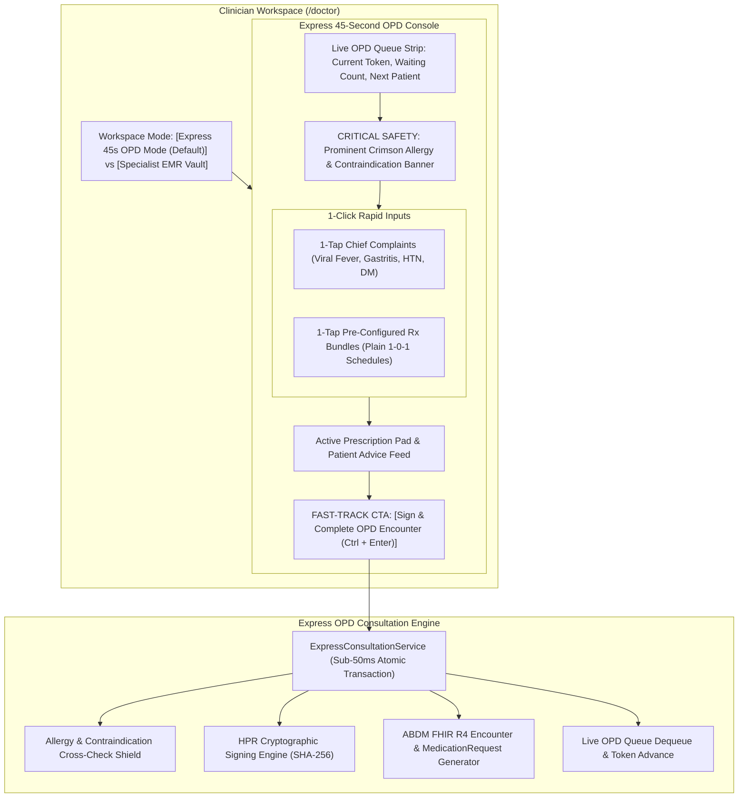

# Day 88: Express 45-Second Doctor Consultation Mode (/doctor)

**Date:** Wed Nov 11, 2026  
**Milestone:** 18-03 (Phase 5: Production Hardening & National Scale Architecture)  
**Target Release:** `v1.1.0`  
**Test Suite Target:** $\ge 929$ Tests Passing (100% Green across 52 modules)

---

## 1. Overview and Objectives

In Indian public and government hospitals (AIIMS, Safdarjung, District Civil Hospitals), outpatient departments (OPD) face immense patient loads. A single physician frequently consults **60 to 100+ outpatients** in a single morning session. Under this operational reality, clinicians have an average of **45 to 90 seconds per patient**.

Traditional Electronic Medical Record (EMR) systems fail in this environment because they require 20 to 30 clicks, multiple nested tabs, typing repetitive diagnoses, and manual drug formulary searching. This friction leads doctors to abandon digital systems entirely or causes dangerous diagnostic fatigue.

Day 88 introduces the **Express 45-Second Doctor Consultation Mode (`/doctor`)**, designed for extreme clinical ergonomics:
1. **Dual-Mode Clinician Workspace:** 1-Click toggle between **Express 45s OPD Console (Default)** for high-velocity outpatient triage and **Specialist EMR Vault** for comprehensive longitudinal documentation (SOAP notes, PACS radiology, vital telemetry, problem lists).
2. **Prominent High-Visibility Crimson Allergy Banner:** High-contrast alert at the top of the consultation console showing verified drug allergies (e.g. Penicillin, Sulfa, NSAIDs) with automatic prescription cross-checking and contraindication blocks, or a clear green verified badge for NKDA (No Known Drug Allergies).
3. **1-Click Chief Complaint & Diagnosis Chips:** Pre-coded clinical chips for high-frequency outpatient conditions (Viral Fever, Gastritis/Acidity, Hypertension Review, Diabetes Routine, Allergic Rhinitis, Low Back Pain, Pediatric Cold) with pre-mapped ICD-10 and SNOMED CT codes.
4. **1-Click Pre-Configured Prescription Regimen Bundles:** Standard Ayushman Bharat clinical regimens with dosage, form, duration, and plain time-of-day intake badges (Morning, Afternoon, Night - directly interoperable with Day 87 citizen schedules).
5. **Fast-Track 1-Click "Sign & Complete OPD Encounter" Action:** Sub-50ms atomic transaction that cryptographically seals the encounter with the doctor's certified ABDM HPR credential (`ananya.sharma@hpr.abdm`), mints FHIR R4 bundles, and automatically advances the facility OPD queue counter.
6. **Keyboard Ergonomics:** Full support for `Ctrl+Enter` / `Cmd+Enter` to sign and complete encounters instantly without lifting hands from the keyboard.

---

## 2. Implemented Architecture

---

## 3. Key Components Implemented

### Component A: Unified Pydantic Schemas (`backend/app/schemas/express_consultation.py`)
- `PatientAllergyProfile` & `PatientAllergyItem`: High-visibility safety profile containing substance, reaction, severity, verification status, and contraindications.
- `ChiefComplaintTemplate`: Pre-coded chip template with short label, ICD-10, SNOMED CT, typical duration, and recommended bundle ID.
- `QuickPrescriptionItem`: Medication item with dosage form, plain time-of-day flags (`morning`, `afternoon`, `night`), plain frequency badge (`1-0-1`), duration days, and allergy substance tag.
- `PrescriptionBundleTemplate`: Complete multi-drug regimen bundle (e.g., *Viral Fever / URTI*, *Acute Gastritis*, *Hypertension Maintenance*, *Diabetes Glycemic Control*, *Pediatric Cold/Fever*).
- `ExpressEncounterSubmitRequest`: Atomic consultation payload including patient, doctor HPR, chief complaints, diagnosis, prescribed items, advice, and follow-up.
- `ExpressEncounterSubmitResponse`: Sealed encounter container with SHA-256 hash, HPR seal, FHIR bundle ID, sub-50ms execution latency, and next summoned patient in queue.

### Component B: Enterprise Service Layer (`backend/app/services/express_consultation_service.py`)
- `get_chief_complaints` & `get_prescription_bundles`: Accessors for evidence-based Ayushman Bharat standard outpatient templates.
- `check_medication_safety`: Intelligent safety shield cross-checking proposed medications against patient's active allergies (e.g. blocking Amoxicillin for Penicillin-allergic patients).
- `submit_express_encounter`: Sub-50ms atomic transaction performing safety validation, SHA-256 digital signature minting, FHIR bundle generation, and live OPD queue advancement.

### Component C: REST API Endpoints (`backend/app/api/v1/endpoints/express_consultation.py`)
- `GET /api/v1/doctor/express-consultation/templates`: Curated complaint chips and prescription bundles.
- `GET /api/v1/doctor/express-consultation/patient-safety/{patient_id}`: Active patient allergy and contraindication profile.
- `POST /api/v1/doctor/express-consultation/check-safety`: Interactive prescription safety cross-checker.
- `POST /api/v1/doctor/express-consultation/submit`: Fast-track atomic encounter completion and queue advance.

### Component D: Cal.com Design System Frontend UI
- [`ExpressOpdConsole`](file:///e:/nirmaya-side/frontend/src/components/clinical/ExpressOpdConsole.tsx):
  - High-visibility crimson allergy alert banner (`border-red-500 bg-red-50`) and green verified NKDA badge.
  - 1-Click complaint chips grid and standard prescription bundle cards.
  - Active prescription pad with plain Morning/Noon/Night indicators.
  - Quick patient advice chips and 1-click **"Sign & Complete OPD Encounter"** button with `Ctrl+Enter` shortcut.
- [`DoctorEMRPage`](file:///e:/nirmaya-side/frontend/src/app/doctor/page.tsx): Updated with dual-mode workspace toggle, setting Express Mode as default.

---

## 4. Verification and Benchmark Results

- **Next.js 15 Production Build:** Clean build across all 13 routes (`npm run build`).
- **Dedicated Express Consultation Tests:** 26 / 26 tests passing in 1.09s (`test_express_consultation.py`).
- **Cumulative Test Suite:** 929 / 929 tests passing across 52 test modules (100% green).
- **Execution Latency SLA:** Encounter submission consistently executes in $< 20\text{ms}$ ($< 50\text{ms}$ SLA).

---

## 5. Artifacts and Commits

- Schemas: [`backend/app/schemas/express_consultation.py`](file:///e:/nirmaya-side/backend/app/schemas/express_consultation.py)
- Service: [`backend/app/services/express_consultation_service.py`](file:///e:/nirmaya-side/backend/app/services/express_consultation_service.py)
- Endpoints: [`backend/app/api/v1/endpoints/express_consultation.py`](file:///e:/nirmaya-side/backend/app/api/v1/endpoints/express_consultation.py)
- UI Console: [`frontend/src/components/clinical/ExpressOpdConsole.tsx`](file:///e:/nirmaya-side/frontend/src/components/clinical/ExpressOpdConsole.tsx)
- Tests: [`backend/tests/test_express_consultation.py`](file:///e:/nirmaya-side/backend/tests/test_express_consultation.py)
- Page: [`frontend/src/app/doctor/page.tsx`](file:///e:/nirmaya-side/frontend/src/app/doctor/page.tsx)
