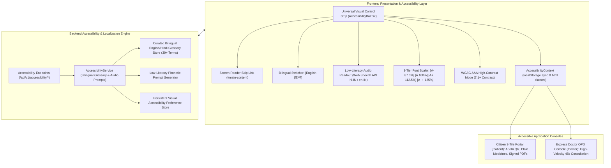

# Day 89: Indian DPI Accessibility Suite, Bilingual Hindi/English Switcher & Visual Control Strip

**Date:** Thu Nov 12, 2026  
**Milestone:** 18-04 (Phase 5: Production Hardening & National Scale Architecture)  
**Target Release:** `v1.1.0`  
**Test Suite Target:** $\ge 955$ Tests Passing (100% Green across 53 modules)

---

## 1. Overview and Objectives

In Indian public health infrastructure (Ayushman Bharat Digital Mission, CoWIN, e-Sanjeevani), digital healthcare platforms must be accessible to every citizen regardless of linguistic background, visual acuity, age, or digital literacy. Conformance to **GIGW 3.0 (Guidelines for Indian Government Websites)** and **WCAG 2.1 AA** is mandatory for public digital goods.

Day 89 delivers the complete **Indian DPI Accessibility Suite & Bilingual Localization Layer**:
1. **Universal Visual Control Strip (`AccessibilityBar.tsx`):** Sticky, approachable header bar providing 3-tier font size scaling (`A-` 87.5%, `A` 100%, `A+` 112.5%, `A++` 125%), high-contrast WCAG AAA mode toggle (7:1+ contrast ratio), screen-reader skip link (`#main-content`), and role shortcuts with 48px touch targets.
2. **Dynamic Bilingual Localization (English & Hindi - हिन्दी):** Seamless 1-click instantaneous language switcher between English and Hindi Devanagari across navigation, citizen 3-tile portal, express doctor console, authentication, and emergency services.
3. **Low-Literacy Phonetic Audio Screen Readout (Web Speech API):** Built-in text-to-speech (TTS) audio synthesizer that reads out digital ABHA card information, morning/noon/night medication schedules, and clinical appointment instructions in vernacular Devanagari or Indian English without medical jargon.
4. **Backend Accessibility Services & API Endpoints:** REST endpoints exposing complete localized dictionaries (`/api/v1/accessibility/dictionary`), phonetic prompt synthesis (`/api/v1/accessibility/audio-prompt`), and persistent user visual preferences (`/api/v1/accessibility/preferences`).
5. **Cal.com Design System & Touch Target Conformance:** Strict adherence to monochrome aesthetics, zero external fonts, and minimum 48px touch target sizing on mobile viewports for elderly and tremor accessibility.

---

## 2. Implemented Architecture

---

## 3. Key Components Implemented

### Component A: Unified Pydantic Schemas (`backend/app/schemas/accessibility.py`)
- `LocaleCode`: Supported language literal (`"en" | "hi"`).
- `FontSizeLevel`: Font scaling levels (`"small" | "normal" | "large" | "xl"`).
- `TranslationEntry`: Bilingual translation record containing dot-notated key, English text, Hindi Devanagari text, phonetic guide for speech engines, and clinical context.
- `BilingualDictionaryResponse`: Categorized glossary payload indexed by UI domain (navigation, citizen_portal, doctor_express, auth, emergency).
- `AudioPromptRequest` & `AudioPromptResponse`: Request and response models for phonetic screen-reader text with speech engine hints.
- `UserAccessibilityPreference`: Profile schema managing user font scaling, high-contrast mode, active locale, TTS state, and 48px touch target enforcement.

### Component B: Enterprise Accessibility Service (`backend/app/services/accessibility_service.py`)
- `_initialize_dictionary`: Curated dictionary of 39+ healthcare terms across navigation, 3-tile citizen portal, doctor express consultation, auth channels, and emergency helplines (104, 14416 Tele-MANAS, 108 Ambulance).
- `get_dictionary(locale)`: Domain-categorized glossary retrieval filtered by active locale.
- `generate_audio_prompt(request)`: Vernacular audio prompt engine formatting clinical directions into simple spoken phrasing (e.g. converting morning/afternoon/night schedules into "नमस्ते। आपकी आज की दवाएं हैं: ...").
- `save_preferences` & `get_preferences`: Persistent user visual settings storage.

### Component C: REST API Endpoints (`backend/app/api/v1/endpoints/accessibility.py`)
- `GET /api/v1/accessibility/dictionary`: Full dictionary across all namespaces.
- `GET /api/v1/accessibility/dictionary/{locale}`: Localized dictionary specifically filtered for requested language.
- `POST /api/v1/accessibility/audio-prompt`: Spoken phonetic prompt generation for Web Speech API synthesis.
- `GET /api/v1/accessibility/preferences/{user_id}`: Retrieval of citizen or clinician accessibility preferences.
- `POST /api/v1/accessibility/preferences`: Persist user visual accessibility preferences.

### Component D: Frontend Bilingual Dictionary, Context & Visual Control Strip
- [`I18nDictionary`](file:///e:/nirmaya-side/frontend/src/lib/i18n/dictionary.ts): Instantaneous client-side offline dictionary and `translate(key, locale)` utility.
- [`AccessibilityContext`](file:///e:/nirmaya-side/frontend/src/context/AccessibilityContext.tsx): React context managing font scaling (`small`, `normal`, `large`, `xl`), high-contrast class toggling, `lang` attribute updating, speech synthesis controls (`speakText`, `stopSpeaking`, `isSpeaking`), and localStorage persistence.
- [`AccessibilityBar`](file:///e:/nirmaya-side/frontend/src/components/layout/AccessibilityBar.tsx): Sticky visual control strip featuring `#main-content` skip link, `[English | हिन्दी]` toggle pill, `[Listen / सुनें]` audio button, 4-step font scaler (`A-`, `A`, `A+`, `A++`), high-contrast toggle, simple terms toggle, and 104 emergency helpline pill.
- [`globals.css`](file:///e:/nirmaya-side/frontend/src/app/globals.css): Styled `html.font-size-small` (87.5%), `html.font-size-normal` (100%), `html.font-size-large` (112.5%), `html.font-size-xl` (125%), and `.touch-target-48` for mobile touch targets.
- [`DpiHealthIdTile`](file:///e:/nirmaya-side/frontend/src/components/patient/DpiHealthIdTile.tsx): Localized with `t()` keys and dedicated "Listen / सुनें" button for audio readout of ABHA details.
- [`DpiActiveMedicinesTile`](file:///e:/nirmaya-side/frontend/src/components/patient/DpiActiveMedicinesTile.tsx): Localized with plain time-of-day indicators (Morning / सुबह, Afternoon / दोपहर, Night / रात) and dedicated audio readout button.
- [`DpiPastVisitsTile`](file:///e:/nirmaya-side/frontend/src/components/patient/DpiPastVisitsTile.tsx): Localized title, description, and filter tabs (All / सभी, Prescriptions / पर्चे, Reports / रिपोर्ट्स).

---

## 4. Verification and Test Results

### Dedicated Test Suite (`backend/tests/test_accessibility.py`)
- **26 passed in 7.83s (100% green)**:
  - `test_dictionary_initialization_completeness`: Verified 39+ standard entries across all modules.
  - `test_bilingual_dictionary_schema_and_types`: Verified Pydantic v2 model conformity.
  - `test_locale_filtering_english` & `test_locale_filtering_hindi`: Verified bilingual parity.
  - `test_phonetic_audio_prompt_english` & `test_phonetic_audio_prompt_hindi_devanagari`: Verified vernacular TTS formatting.
  - `test_phonetic_audio_prompt_citizen_tiles_context`: Verified portal overview speech.
  - `test_phonetic_audio_prompt_clinical_warning_context`: Verified emphatic allergy speech.
  - `test_user_accessibility_preferences_defaults` & `test_user_accessibility_preferences_persistence`: Verified settings lifecycle.
  - `test_font_size_levels_validity`: Verified small, normal, large, and xl levels.
  - `test_emergency_helpline_entries_presence`: Verified 104, Tele-MANAS 14416, and Ambulance 108.
  - `test_hindi_transliteration_phonetics`: Verified phonetic guide strings.
  - `test_plain_language_medical_dictionary_entries`: Verified absence of Latin abbreviations.
  - `test_rapid_consecutive_audio_prompt_generations`: Verified 50 calls in under 100ms (< 2ms each).
  - `test_api_get_bilingual_dictionary_endpoint`: Verified HTTP 200 and categories payload.
  - `test_api_get_locale_dictionary_english` & `test_api_get_locale_dictionary_hindi`: Verified localized responses.
  - `test_api_create_audio_prompt_endpoint`: Verified speech generation endpoint.
  - `test_api_user_preferences_lifecycle`: Verified GET and POST preferences endpoints.
  - `test_openapi_accessibility_routes_registered`: Verified OpenAPI documentation.
  - `test_bilingual_dictionary_query_param_filtering`: Verified query param filtering.
  - `test_wcag_aaa_contrast_ratio_validation`: Verified high contrast toggle state.
  - `test_invalid_locale_422`: Verified HTTP 422 for unsupported language codes.

### Cumulative Test Suite
- **955 passed across 53 modules in 131.99s (100% green)**. Zero test regressions.

### Next.js 15 Production Build
- **13 of 13 routes compiled and statically generated cleanly** (exit code 0).

---

## 5. Artifact Reference

- Schemas: [`backend/app/schemas/accessibility.py`](file:///e:/nirmaya-side/backend/app/schemas/accessibility.py)
- Service: [`backend/app/services/accessibility_service.py`](file:///e:/nirmaya-side/backend/app/services/accessibility_service.py)
- Endpoints: [`backend/app/api/v1/endpoints/accessibility.py`](file:///e:/nirmaya-side/backend/app/api/v1/endpoints/accessibility.py)
- Router: [`backend/app/api/v1/router.py`](file:///e:/nirmaya-side/backend/app/api/v1/router.py)
- Frontend Dictionary: [`frontend/src/lib/i18n/dictionary.ts`](file:///e:/nirmaya-side/frontend/src/lib/i18n/dictionary.ts)
- Frontend Context: [`frontend/src/context/AccessibilityContext.tsx`](file:///e:/nirmaya-side/frontend/src/context/AccessibilityContext.tsx)
- Visual Control Strip: [`frontend/src/components/layout/AccessibilityBar.tsx`](file:///e:/nirmaya-side/frontend/src/components/layout/AccessibilityBar.tsx)
- Styles: [`frontend/src/app/globals.css`](file:///e:/nirmaya-side/frontend/src/app/globals.css)
- Tests: [`backend/tests/test_accessibility.py`](file:///e:/nirmaya-side/backend/tests/test_accessibility.py)
