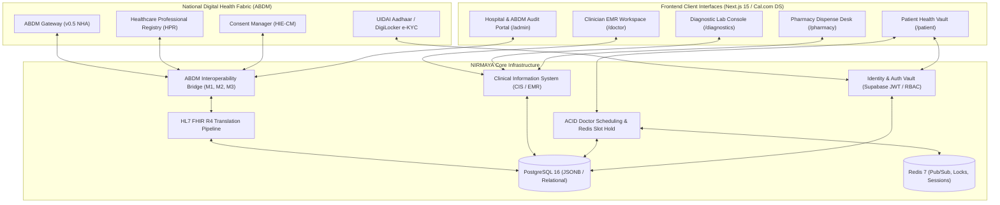

# NIRMAYA: Master Engineering Roadmap & Technical Blueprint (Days 1–80)
## Complete End-to-End System Architecture, Implemented Foundations & Future Specifications

**Academic Target:** Final Year Major Project in Health Informatics & Computer Systems Engineering  
**Candidate & Project Lead:** Suryansh Swarn (`suryanshswarn@gmail.com`)  
**Repository:** `https://github.com/SuryanshSwarn09/NIRMAYA`  
**Pacing:** 4 Months / 16 Weeks / 80 Development Days  
**Current Status:** Day 60 Completed (Phase 3 100% Complete / Release `v0.3.0` Certified / 438 Tests Passing)  
**Next Horizon:** Day 61 (Month 4, Week 13 / Distributed WebSockets, Redis Pub/Sub & Real-Time OPD Queue)  
**Standards Compliance:** HL7 FHIR Release 4 & Ayushman Bharat Digital Mission (ABDM) Gateway v0.5 (M1, M2, M3)  

---

## Abstract

**NIRMAYA** (*Networked Interoperable Records Medical Assets & Your Archives*) is an enterprise-grade digital health interoperability network, longitudinal patient health vault, and modern Electronic Medical Records (EMR) platform engineered to resolve the fragmentation of India's healthcare data ecosystem. Rather than isolating clinical encounters in proprietary database schemas or unstructured paper documents, NIRMAYA structures encounters, demographic profiles, prescriptions, vitals telemetry, and diagnostic observations around international healthcare protocols (**HL7 FHIR Release 4**) and integrates directly into the national health backbone (**Ayushman Bharat Digital Mission - ABDM**).

This document serves as the authoritative, end-to-end Master Engineering Roadmap for the entire 80-day development journey. It details:
1. The **foundational motive and multi-tier architectural topology** powering NIRMAYA across Patients, Clinicians, Diagnostic Facilities, Pharmacies, and ABDM Network Nodes.
2. The **complete day-by-day engineering progression from Day 1 to Day 80**, delineating verified implementations (Days 1–60) from planned upcoming milestones (Days 61–80).
3. The **chronological record of architectural pivots, strategic scope expansions, and critical enhancements** introduced during development (including the Cal.com design system migration, Vercel monorepo fixes, Drug-Drug Interaction Clinical Decision Support, the Day 46 DigiLocker/Aadhaar 1-day extension, and ABDM Ambiguity Protection filters).
4. The **system health metrics, testing benchmarks (438/438 green tests), and certification status** under NHA ABDM Gateway v0.5 standards.

---

## Table of Contents

1. [Foundational System Motive & Architecture Topology](#1-foundational-system-motive--architecture-topology)
2. [Master 80-Day Engineering Lifecycle Overview](#2-master-80-day-engineering-lifecycle-overview)
3. [Phase 1: Foundation, Schemas, Supabase Auth & Scheduling (Days 1–20) [COMPLETED]](#3-phase-1-foundation-schemas-supabase-auth--scheduling-days-120-completed)
4. [Phase 2: Clinical EMR, Observational Telemetry & CIS (Days 21–40) [COMPLETED]](#4-phase-2-clinical-emr-observational-telemetry--cis-days-2140-completed)
5. [Phase 3: ABDM Federation & Interoperability Gateway (Days 41–60) [COMPLETED]](#5-phase-3-abdm-federation--interoperability-gateway-days-4160-completed)
6. [Phase 4: Production Hardening, Cloud Deployment & Thesis (Days 61–80) [ACTIVE]](#6-phase-4-production-hardening-cloud-deployment--thesis-days-6180-active)
7. [Chronology of Architectural Pivots & Strategic Scope Additions](#7-chronology-of-architectural-pivots--strategic-scope-additions)
8. [Codebase Health, Verification Suite & Current Status](#8-codebase-health-verification-suite--current-status)

---

## 1. Foundational System Motive & Architecture Topology

India's healthcare delivery fabric experiences profound data fragmentation:
- **Degraded Physical Paper Records:** Prescriptions are predominantly handwritten and easily misplaced, preventing longitudinal pharmacological reconciliation and contraindication checks.
- **Unsearchable Diagnostic Attachments:** Diagnostic laboratories generate rasterized PDFs whose quantitative metrics (e.g., HbA1c, platelet counts, lipid panels) cannot be ingested or trended by machine algorithms.
- **Zero Inter-Hospital Visibility:** Attending doctors treat acute clinical conditions with zero access to historical diagnoses, baseline vitals, or drug allergies documented by other providers.

NIRMAYA addresses this by treating medical records as **standardized, structured, and patient-sovereign digital assets** interconnected via ABDM.



---

## 2. Master 80-Day Engineering Lifecycle Overview

```mermaid
gantt
    title NIRMAYA 80-Day Engineering Pacing
    dateFormat  X
    axisFormat Day %d
    section Month 1: Foundation (v0.1.0)
    Week 1: Scaffold & CI/CD               :done, w1, 1, 5
    Week 2: Core Schemas & Vault           :done, w2, 6, 10
    Week 3: Supabase Auth & Cal.com DS     :done, w3, 11, 15
    Week 4: Appointment Engine & FHIR      :done, w4, 16, 20
    section Month 2: Clinical EMR (v0.2.0)
    Week 5: Problems, Vitals & Orders      :done, w5, 21, 25
    Week 6: Formulary, Rx & DDI Engine     :done, w6, 26, 30
    Week 7: Patient Vault & QR ABHA Card   :done, w7, 31, 35
    Week 8: Clinician EMR & PACS Viewer    :done, w8, 36, 40
    section Month 3: ABDM Federation (v0.3.0)
    Week 9: ABDM M1 (ABHA & HPR)           :done, w9, 41, 45
    Week 10: ABDM M2 (Discovery & Linking) :done, w10, 46, 50
    Week 11: ABDM M3 (Consent & Data Flow) :done, w11, 51, 55
    Week 12: FHIR R4 Certification & Audit :active, w12, 56, 60
    section Month 4: Production & Monograph (v1.0.0)
    Week 13: Distributed WebSockets       :w13, 61, 65
    Week 14: Security Hardening & Zero-Trust:w14, 66, 70
    Week 15: Docker Compose & Cloud CI/CD  :w15, 71, 75
    Week 16: Academic Thesis & Release v1  :w16, 76, 80
```

---

## 3. Phase 1: Foundation, Schemas, Supabase Auth & Scheduling (Days 1–20) [COMPLETED]
*Status:* **100% Completed** | *Milestone Release:* **`v0.1.0`**

### Week 1: Monorepo Scaffolding & Foundational Architecture (Days 1–5)
- **Day 1:** Monorepo architecture setup (`frontend/` Next.js 15 App Router, `backend/` FastAPI async, `docs/` GitBook tree). Strict TypeScript and Python linting setup.
- **Day 2:** Tailwind CSS v4 design tokens, clinical palette definitions (`#ffffff` canvas, `#111827` buttons, `#e5e7eb` borders).
- **Day 3:** FastAPI application factory pattern, CORS middleware configuration, custom timing middleware (`X-Process-Time`), and distributed request correlation ID (`X-Request-ID`).
- **Day 4:** Atomic UI component library scaffold (Button, Input, Badge, Card, Modal, Dropdown, Table) with accessibility primitives.
- **Day 5:** System health check endpoints (`/health`, `/health/db`), environment configuration managers (`pydantic-settings`), and initial CI linting workflows.

### Week 2: Relational Schemas, PostgreSQL 16 & Patient Vault (Days 6–10)
- **Day 6:** PostgreSQL 16 connection engine via `asyncpg`, connection pooling with overflow tuning, and Alembic database migration harness (`0001_initial_core_schema`).
- **Day 7:** Core identity relational entities: `User`, `PatientProfile`, `DoctorProfile`, and `DiagnosticLabFacility` models with foreign key constraints and indexed lookup fields.
- **Day 8:** Deterministic database seeder (`backend/app/db/seeds/`) populating simulated hospital practitioners, patient records, and OPD departments.
- **Day 9:** Patient Vault CRUD endpoints (`/api/v1/patients/`) with demographic validation, address structuring, and emergency contact associations.
- **Day 10:** Integration test suite for Patient Vault operations; initial Vercel monorepo configuration isolation to prevent build collisions.

### Week 3: Supabase Auth Integration & Cal.com Design System (Days 11–15)
- **Day 11:** Supabase Auth JWT verification pipeline; asymmetric public key verification (`get_current_user` FastAPI dependency).
- **Day 12:** Role-Based Access Control (RBAC) middleware (`require_role(["patient", "doctor", "admin", "lab"])`).
- **Day 13:** Cal.com design system migration across all foundational screens: replacing early colorful UI with strict, ultra-clean monochrome borders, 8px radii, and minimal aesthetic.
- **Day 14:** Passwordless magic link and email OTP authentication hooks; user registration state machine syncing Supabase auth events to local `User` records.
- **Day 15:** Security audit of auth tokens, CORS origin restrictions, and end-to-end authentication test suite.

### Week 4: Appointment Scheduling Engine & FHIR Encounter Foundations (Days 16–20)
- **Day 16:** Scheduling schema models: `DoctorSlot`, `Appointment`, and `DoctorAvailability` with timezone-aware timestamp constraints.
- **Day 17:** Conflict-free slot generation engine; ACID row-level locking (`SELECT ... FOR UPDATE`) to prevent concurrent double-booking.
- **Day 18:** 10-minute temporary slot reservation engine backed by Redis key TTL with automatic expiration sweep.
- **Day 19:** HL7 FHIR R4 transformers for `Encounter` and `Appointment` resources; bidirectional translation between SQL rows and FHIR JSON.
- **Day 20:** Frontend Cal.com-inspired interactive calendar slot picker; Month 1 wrap-up, milestone tagging (`v0.1.0`), and GitBook documentation update.

---

## 4. Phase 2: Clinical EMR, Observational Telemetry & CIS (Days 21–40) [COMPLETED]
*Status:* **100% Completed** | *Milestone Release:* **`v0.2.0`**

### Week 5: Problem Lists, Vitals Telemetry & Diagnostic Orders (Days 21–25)
- **Day 21:** Longitudinal Problem List schema (`ClinicalCondition`), SNOMED-CT diagnosis coding, and ICD-10 clinical mapping.
- **Day 22:** Condition lifecycle state machine (active, relapse, remission, resolved) and FHIR R4 `Condition` resource transformer.
- **Day 23:** Vitals telemetry engine (`VitalSignReading`) covering Blood Pressure, Heart Rate, SpO2, Respiratory Rate, Body Temperature, and BMI with LOINC codes.
- **Day 24:** Structured SOAP clinical note schema (`ClinicalNote`) with chief complaint, subjective, objective, assessment, and plan sections.
- **Day 25:** Diagnostic test requisition engine (`ServiceRequest`) linking doctor consultation orders to laboratory fulfillment queues.

### Week 6: Medication Formulary, e-Prescribing & DDI Safety Engine (Days 26–30)
- **Day 26:** Master Drug Catalog and Formulary engine (`Medication`) structured with RxNorm, WHO-ATC, and SNOMED-CT substance identifiers.
- **Day 27:** Digital e-Prescription authoring engine (`MedicationRequest`) supporting dosing schedules, duration, routes of administration, and refill limits.
- **Day 28:** Clinical Decision Support (CDS) Drug-Drug Interaction (DDI) rule engine cross-checking active patient prescriptions for contraindications and severe interactions before signing.
- **Day 29:** Pharmacy fulfillment workflow (`MedicationDispense`) tracking batch numbers, expiry dates, and pharmacist dispense validation.
- **Day 30:** Patient digital medicine cabinet view; prescription PDF generation service with QR cryptographic signature.

### Week 7: Patient Health Vault & Digital ABHA Experience (Days 31–35)
- **Day 31:** Responsive Patient Health Portal layout in Next.js 15 (`/patient`), implementing Cal.com design system standards.
- **Day 32:** Interactive Patient Health Vault displaying consolidated timeline of diagnoses, prescriptions, lab results, and clinical notes.
- **Day 33:** Digital ABHA ID Card generator: official card rendering, 14-digit ABHA display, `@abdm` PHR handle badge, and dynamic QR code generation.
- **Day 34:** Vitals telemetry visualizer: time-series interactive charts (Recharts) tracking blood pressure trends, glucose curves, and vitals anomalies.
- **Day 35:** Patient document upload vault (`DocumentReference`) with secure S3/Supabase storage presigned URLs and client-side encryption.

### Week 8: Clinician EMR Workspace, Queue & PACS DICOM Viewer (Days 36–40)
- **Day 36:** Doctor EMR Command Center (`/doctor`) with real-time OPD waiting queue, triage status badges, and patient appointment cards.
- **Day 37:** Clinician consultation desk: unified SOAP note editor with real-time SNOMED-CT autocomplete and clinical condition tagging.
- **Day 38:** Integrated prescription pad with instant DDI warning alerts, favorite medication templates, and one-click dosage calculators.
- **Day 39:** Diagnostic requisition desk and PACS DICOM web viewer (Cornerstone.js / OHIF integration) for reviewing radiology scans.
- **Day 40:** Month 2 integration audit; comprehensive CIS test suite execution (100% green); milestone release tagging (`v0.2.0`).

---

## 5. Phase 3: ABDM Federation & Interoperability Gateway (Days 41–60) [COMPLETED]
*Status:* **100% Completed** | *Milestone Release:* **`v0.3.0`**

### Week 9: ABDM Milestone 1 - Identity, ABHA Minting & HPR Registry (Days 41–45)
*Status:* **Completed** | *Tag:* **`v0.3.0-alpha.w9`**
- **Day 41:** ABDM Gateway Client Credentials session authentication manager; automatic JWT token refresh, memory caching, and RSA-2048 OAEP demographic encryption pipeline (`ABDMRSAEncryptionManager`).
- **Day 42:** DigiLocker OAuth 2.0 PKCE authentication flow; UIDAI XML demographic parser extracting verified name, gender, birth date, and photo.
- **Day 43:** Direct Aadhaar Demographic OTP verification protocol; Verhoeff $D_5$ check digit algorithm validation; 600s TTL and 3-attempt brute-force guardrail; `AadhaarOtpVerificationModal.tsx`.
- **Day 44:** Mathematical 14-digit ABHA Number minting engine (`91-XXXX-XXXX-XXXX`); `@abdm` PHR address reservation with collision-detection suggestions; Healthcare Professional Registry (HPR) doctor onboarding (`@hpr.abdm`).
- **Day 45:** ABDM Milestone 1 Comprehensive Audit; multi-path e-KYC integration test suite; release tagging `v0.3.0-alpha.w9`.

### Week 10: ABDM Milestone 2 - HIP Bridge, Patient Discovery & Care Context Linkage (Days 46–50)
*Status:* **Completed** | *Tag:* **`v0.3.0-alpha.w10`**
- **Day 46 (Strategic Extension Day):** Unified DigiLocker & Aadhaar OTP Passwordless Patient Gateway; 30-day extended JWT session issuance (`remember_me: true`); automatic ABHA minting on first login; mismatched SIM card fallback routing.
- **Day 47:** ABDM Health Information Provider (HIP) Bridge Service; asynchronous webhook callback architecture; inbound webhook router (`/v0.5/users/auth/init`); $\pm 300\text{s}$ replay attack defense; UUID header compliance.
- **Day 48:** Multi-Tier Patient Discovery Engine (`/v0.5/care-contexts/discover`); composite token-sort Levenshtein fuzzy matcher; Indian honorific stripper; strict Ambiguity Protection Filter (rejection with ABDM Error 1441 if $\ge 2$ match candidates); care context extractor; `PatientDiscoverySimulatorModal.tsx`.
- **Day 49:** Care Context Linkage & Verification Protocol (`/v0.5/links/link/init`, `/v0.5/links/link/confirm`); `AbdmLinkSessionManager` with 10-minute TTL and 3-attempt rate-limiting; masked phone privacy (`+91 ******XXXX`); Cal.com `CareContextLinkageModal.tsx`.
- **Day 50:** ABDM Milestone 2 Integration Audit & Review; E2E verification test suite (`test_week_10_e2e_verification.py` - 6 scenarios); live audit endpoint (`GET /api/v1/abdm/m2/bridge/audit`); Cal.com audit drawer in `HipBridgeConsoleCard.tsx`; release tagging `v0.3.0-alpha.w10`.

### Week 11: ABDM Milestone 3 - Consent Management & Encrypted Data Flow (Days 51–55)
*Status:* **Completed** | *Tag:* **`v0.3.0-alpha.w11`**
- **Day 51 (Milestone 11-01) [COMPLETED]:** Consent Notification & Artefact Ingest (`POST /v0.5/consents/hip/notify`); cryptographic Electronic Consent Artefact (ECA) signature verifier; thread-safe Consent Registry (`ConsentRegistryStore`); fine-grained record authorization engine; async acknowledgement (`POST /v0.5/consents/hip/on-notify`).
- **Day 52 (Milestone 11-02) [COMPLETED]:** Diffie-Hellman Key Exchange Service; ephemeral ECDH Curve25519 (X25519) key pair generation; CSPRNG 32-byte nonces; Dual-Nonce XOR entropy extraction (20-byte Salt + 12-byte IV); HKDF-SHA256 256-bit symmetric encryption key derivation compliant with NHA Fidelius specifications; thread-safe `CryptoSessionStore`; Gateway inbound listener (`POST /v0.5/health-information/hip/request`).
- **Day 53 (Milestone 11-03) [COMPLETED]:** Encrypted Health Data Transfer Pipeline; FHIR R4 Document Bundle packaging per care context; AES-256-GCM authenticated symmetric encryption with 128-bit authentication tag; SHA-256 tamper-evident checksums; data push to HIU bridge (`POST {dataPushUrl}` / `/v0.5/health-information/transfer`); Gateway status notification (`POST /v0.5/health-information/notify`).
- **Day 54 (Milestone 11-04) [COMPLETED]:** Health Information User (HIU) Data Consumer Engine; outbound data request initiation (`POST /api/v1/abdm/m3/hiu/request`); ephemeral Curve25519 keypair and nonce generation; `HIURequestStore`; Nonce XOR + ECDH + HKDF-SHA256 key agreement on inbound transfer; AES-256-GCM authenticated decryption with tag verification; SHA-256 checksum validation; clinical FHIR R4 Document Bundle parser; longitudinal patient record vault (`HIURecordStore`).
- **Day 55 (Milestone 11-05) [COMPLETED]:** ABDM Milestone 3 Integration Audit; full-loop consent request -> approval -> encrypted transfer -> HIU rendering test suite; live diagnostic audit API (`GET /api/v1/abdm/m3/audit`); release tagging `v0.3.0-alpha.w11`.

### Week 12: FHIR R4 Certification, Sandbox Validation & M3 Sign-Off (Days 56–60)
*Status:* **Completed** | *Tag:* **`v0.3.0`**
- **Day 56 (Milestone 12-01) [COMPLETED]:** FHIR R4 Bundle Validation Engine; strict schema validation for `OPConsultationRecord`, `PrescriptionRecord`, `DiagnosticReportRecord`, and `DischargeSummaryRecord`; Composition document manifest root enforcement (`entry[0]`); referential integrity resolution across internal `urn:uuid` and relative references; standard clinical coding systems (SNOMED-CT, LOINC, ICD-10, HL7 ActCode); validation REST APIs (`POST /api/v1/fhir/bundle/validate`, `GET /api/v1/fhir/bundle/profiles`); 393/393 passing tests.
- **Day 57 (Milestone 12-02) [COMPLETED]:** Medical Ontology Binding Audit: curated in-memory terminology registries (SNOMED-CT, LOINC, ICD-10, HL7 ActCode, UCUM); concept binding status classification (`FULLY_BOUND`, `DISPLAY_MISMATCH`, `UNRECOGNIZED_CODE`, `INVALID_SYSTEM`, `MISSING_BINDING`); automated weighted Ontology Compliance Score (0–100%); natural language clinical code suggestion engine; REST APIs (`POST /api/v1/fhir/ontology/audit`, `GET /api/v1/fhir/ontology/lookup`, `GET /api/v1/fhir/ontology/suggest`, `GET /api/v1/fhir/ontology/systems`); 416/416 passing tests.
- **Day 58 (Milestone 12-03) [COMPLETED]:** ABDM Official Sandbox E2E Certification: automated test harness executing 15 official NHA test vectors across M1, M2, and M3; SHA-256 digital certificate proof sealing; REST APIs (`POST /api/v1/abdm/certification/run`, `GET /api/v1/abdm/certification/report`, `GET /api/v1/abdm/certification/vectors`); 426/426 passing tests.
- **Day 59 (Milestone 12-04) [COMPLETED]:** Consent Revocation, Expired Consent & Security Penetration Testing: automated penetration test harness executing 12 attack vectors across replay, mid-flight revocation, expired consent, scope escalation, and AES-256-GCM AEAD bit-flipping; SHA-256 sealed security reports; REST APIs (`POST /api/v1/abdm/security/audit/run`, `GET /api/v1/abdm/security/audit/report`, `GET /api/v1/abdm/security/audit/vectors`); 438/438 passing tests.
- **Day 60 (Milestone 12-05) [COMPLETED]:** Month 3 Retrospective, GitBook documentation finalization, full backend test regression (438/438 passed), Next.js 15 build, and Production Milestone Release `v0.3.0`.

---

## 6. Phase 4: Production Hardening, Cloud Deployment & Thesis (Days 61–80) [ACTIVE]
*Target Milestone Release:* **`v1.0.0`**

### Week 13: Distributed WebSockets, BTG Emergency Vault & Real-Time Queue (Days 61–65)
- **Day 61:** Distributed WebSocket gateway in FastAPI backed by Redis Pub/Sub channels for multi-worker synchronization.
- **Day 62:** Live Doctor OPD Queue synchronization: instant push notifications when patients arrive, check in, or undergo triage.
- **Day 63:** Critical Laboratory Alert push notification system alerting clinicians within $< 100\text{ms}$ of abnormal panic-value lab results.
- **Day 64:** Zero-Knowledge Break-The-Glass (BTG) Emergency Health Profile Vault schemas, Argon2id key derivation, and audited emergency override API for ICU/ER clinicians.
- **Day 65:** Cryptographic audit trail (SHA-256 hash-chaining) and automated SMS alert dispatch to patient emergency contacts upon BTG access.

### Week 14: Security Hardening, Indian LGD Administrative Hierarchy & Zero-Trust (Days 66–70)
- **Day 66:** Static application security testing (SAST) and automated vulnerability scanning with Bandit and Safety.
- **Day 67:** OWASP Application Security Verification Standard (ASVS) Level 2 compliance audit; automated SQL injection and XSS fuzzing.
- **Day 68:** Indian Local Government Directory (LGD) 6-Tier Administrative Hierarchy schema (`administrative_units`, `administrative_officers`); PostgreSQL `ltree` extension migration and sub-2ms territorial GIST indexing.
- **Day 69:** Chain-of-Command Administrative Provisioning Service (National SuperAdmin -> State -> Division -> District -> Block) with official `@gov.in` email and Aadhaar OTP MFA; Scoped Territorial RBAC.
- **Day 70:** District & State Command Center endpoints (outbreak heatmaps, ICU bed occupancy, doctor roster); automated test suite `test_administrative_hierarchy.py` and security sign-off.

### Week 15: Dual-Mode Edge Appliance, Docker Containerization & Cloud CI/CD (Days 71–75)
- **Day 71:** Multi-stage minimal Alpine Dockerfile builds for FastAPI backend with non-root security context.
- **Day 72:** Next.js 15 standalone output optimization; minimal Docker containerization with production asset caching.
- **Day 73:** Production Docker Compose orchestration topology: FastAPI, Next.js, PostgreSQL 16, Redis 7, and Caddy reverse proxy with automated Let's Encrypt TLS 1.3.
- **Day 74:** Dual-Mode Edge Node Appliance packaging (`docker-compose.edge.yml`) and Local-First Encrypted SQLite PWA client sync engine (Append-Only Clinical Event Log) for solo practitioners without servers.
- **Day 75:** PostgreSQL Foreign Data Wrapper (`postgres_fdw`) & legacy database read-only adapter enabling hospitals with existing HIS (MySQL/Oracle) to federate records into NIRMAYA.

### Week 16: Academic Project Monograph & Master Production Release (Days 76–80)
- **Day 76:** Compilation of comprehensive 80-day Academic Project Monograph / Thesis detailing architectural proofs, standards compliance, and clinical data models.
- **Day 77:** Performance benchmarking: database latency benchmarks, Redis lock throughput, FHIR bundle serialization speeds, and ABDM crypto benchmarks.
- **Day 78:** High-definition video walkthrough, interactive demonstration scripts, and API documentation portal (Swagger / ReDoc / GitBook).
- **Day 79:** Final code freeze, production sign-off, dependency license compliance verification, and security certificate validation.
- **Day 80:** Production Master Release **`v1.0.0`**, release notes publication, and graduation from engineering sprint to long-term maintenance.

---

## 7. Chronology of Architectural Pivots & Strategic Scope Additions

During active implementation, several critical architectural enhancements and scope expansions were introduced to ensure clinical safety, regulatory compliance, and bulletproof user experience:

| Scope Addition / Pivot | Phase Introduced | Technical Details & Architectural Rationale |
| :--- | :--- | :--- |
| **Cal.com Design System Standard** | Week 2 & 3 | Replaced initial generic UI with a strict, minimalist enterprise design system: `#ffffff` canvas, hairline `#e5e7eb` borders, `#111827` action buttons, `8px` corner radii, and zero emojis/gradients. |
| **Vercel Monorepo Build Isolation** | Week 2 | Solved Next.js 15 / Turborepo parent path build failure on Vercel by isolating package configurations and establishing standalone export structures. |
| **ACID Slot Locking with Redis Hold** | Week 4 | Implemented row-level locking (`SELECT FOR UPDATE`) on Doctor Slots combined with 10-minute temporary Redis key reservations to prevent concurrent double-booking. |
| **Drug-Drug Interaction (DDI) Rule Engine** | Week 6 | Added Clinical Decision Support (CDS) cross-checking RxNorm and WHO-ATC codes to warn prescribers of fatal contraindications before committing prescriptions. |
| **Verhoeff Check Digit & RSA Encryption** | Week 9 | Implemented dihedral group $D_5$ Verhoeff algorithm for Aadhaar validation and RSA-2048 OAEP encryption with SHA-256 for secure demographic payload transit. |
| **Unified Passwordless Gateway (Day 46 Extension)** | Week 10 (Day 46) | **Added 1 extra strategic day** to build a unified passwordless patient gateway supporting DigiLocker and Aadhaar OTP with 30-day extended JWT sessions, auto-ABHA minting, and mismatched SIM fallbacks. |
| **Ambiguity Protection Filter (ABDM Error 1441)** | Week 10 (Day 48) | Added strict safety guardrail: if patient discovery finds $\ge 2$ patients with close fuzzy match scores, system rejects matching to prevent leaking clinical records to the wrong patient. |
| **Phone Privacy Masking** | Week 10 (Day 49) | Automatically masks patient phone numbers (`+91 ******XXXX`) during care context discovery and linkage flows in compliance with NHA data privacy guidelines. |
| **Automated M2 Audit Report Engine** | Week 10 (Day 50) | Built a live diagnostic engine (`GET /api/v1/abdm/m2/bridge/audit`) computing real-time discovery accuracy, callback latency, and linkage security scores. |
| **Federated Database, Edge Network & Solo Doctor PWA** | Week 11 (Day 51) | Formulated 3-tier multi-tenancy spectrum: On-premise Edge Node for hospitals + Turnkey Docker Appliance for clinics + Local-First Encrypted SQLite PWA with Append-Only Event Log sync for solo doctors without servers. Integrated 2-tier data storage (95% on-demand pull + 5% Zero-Knowledge Break-The-Glass Emergency Vault) and Dual-Registration ABDM Bridge ensuring 100% DPDP Act compliance with instant 2-minute onboarding. |
| **6-Tier Indian LGD Administrative Governance Hierarchy** | Week 11 (Day 51) | Designed sovereign Indian administrative chain of command (Sub-District -> District CMO -> Division -> State Secretary -> National SuperAdmin) utilizing PostgreSQL `ltree` indexing with official Ministry LGD codes, Chain-of-Command delegation with Aadhaar MFA, and Dual-Plane privacy air-gapping administrative oversight from private clinical records. |

---

## 8. Codebase Health, Verification Suite & Current Status

As of **Day 60 (Phase 3 Complete / Milestone 12-05 / Release `v0.3.0`)**:
- **Backend Test Suite:** **438 / 438 tests passing (100% green in 57.20s)** across 24 test suites
- **ABDM & FHIR R4 Specific Suites:** 110 tests passing across M1, M2, M3, FHIR R4 Bundle Validation, Medical Ontology Binding, ABDM Sandbox Certification, and Security Penetration Testing
- **Frontend Typecheck & Build:** Clean compilation with 0 TypeScript errors and 13/13 static routes rendered cleanly in Next.js 15.5.25
- **Official Milestone Release Tag:** **`v0.3.0`**
- **Git Repository Branch:** `main` (synchronized with `origin/main`)
- **Next Operational Milestone:** **Day 61 (Milestone 13-01: Distributed WebSockets & Real-Time OPD Queue Synchronization)**

