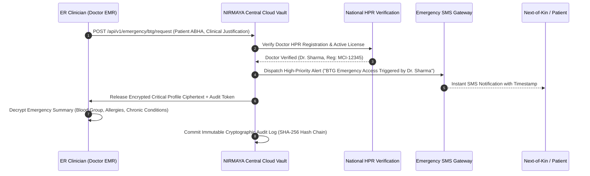

# Federated Database Systems & Edge-Node Interoperability in Healthcare

## 1. Executive Summary & Foundational Context

Healthcare data architectures worldwide face an existential tension between **centralization** and **decentralization**:
- **The Centralization Trap:** Storing national or enterprise health records in a single monolithic cloud database creates an irresistible honeypot for cyber adversaries, introduces catastrophic single-point-of-failure vulnerabilities, and directly violates data sovereignty and privacy mandates (such as the Indian **Digital Personal Data Protection Act, 2023 (DPDP Act)**, **DISHA**, and **HIPAA**). Hospitals and clinics are legally forbidden or commercially unwilling to surrender raw patient databases to third-party central clouds.
- **The Decentralization Imperative:** Conversely, completely isolated hospital data silos prevent longitudinal patient care, cause lethal diagnostic blindspots in emergency rooms, and force patients to physically transport paper folders and CD-ROMs between doctors.

The architectural solution to this dilemma is the **Federated Database & Edge-Node Network**.

This technical document outlines the principles of database federation in healthcare, analyzes what works versus what fails catastrophically, and details the **Hybrid Edge-Node & Consent-Bound FHIR Federation Architecture** designed for NIRMAYA through architectural analysis and formal design evaluation (`/grill-me`).

---

## 2. What is a Federated Database System (FDBS)?

A **Federated Database System (FDBS)** is an architecture that integrates multiple autonomous, disparate database systems into a single virtual federated system without physically centralizing or copying all records into one monolithic repository.

```
                    ┌──────────────────────────────────────────────┐
                    │       VIRTUAL FEDERATION INTERFACE           │
                    │   (Unified Query & Interoperability Layer)   │
                    └──────┬───────────────┬──────────────┬────────┘
                           │               │              │
           ┌───────────────┘               │              └──────────────┐
           ▼                               ▼                             ▼
┌──────────────────────┐       ┌──────────────────────┐       ┌──────────────────────┐
│  HOSPITAL A NODE     │       │  HOSPITAL B NODE     │       │  DIAGNOSTIC LAB C    │
│  Autonomous Database │       │  Autonomous Database │       │  Autonomous Database │
│  (PostgreSQL on-prem)│       │  (Legacy Oracle HIS) │       │  (Cloud MySQL Lab)   │
└──────────────────────┘       └──────────────────────┘       └──────────────────────┘
```

### Core Characteristics of Federation:
1. **Local Autonomy:** Each constituent hospital retains complete, uncompromised control over its local data, schemas, storage engine, physical security, and operational workflows. Local operations continue seamlessly even if external network links fail.
2. **Physical Distribution:** Clinical records physically reside where the care was delivered—within the hospital's local security perimeter.
3. **Engine Heterogeneity:** Constituent nodes do not need to share the same underlying database software; Hospital A can run PostgreSQL, Hospital B can run Oracle, and Lab C can run MongoDB.
4. **Virtual Transparency:** An authorized querying entity (such as a doctor or the patient's PHR application) accesses the network through a standardized interface as though querying a unified record, with the federation layer resolving the physical data retrieval dynamically.

---

## 3. What is WRONG: Anti-Patterns of Raw Database-Level Federation

When software teams attempt to implement "federated databases" in healthcare using traditional relational database clustering or direct SQL federation, they invariably encounter critical architectural failures:

```
[ANTI-PATTERN: Direct Cross-Hospital SQL Federation]

Hospital A (PostgreSQL) ─── Port 5432 over Public WAN ───► Hospital B (PostgreSQL)
   ❌ Massive Firewall Vulnerability (Exposing database ports)
   ❌ Distributed 2-Phase Commit (2PC) Deadlocks during WAN lag
   ❌ Tightly Coupled Schemas (One migration breaks all hospital queries)
   ❌ Bypasses Patient Consent & Clinical RBAC at SQL layer
```

### Anti-Pattern 1: Direct SQL Links (dblink, `postgres_fdw`, Linked Servers) over WAN
- **The Defect:** Opening raw database ports (e.g., PostgreSQL port 5432, MySQL port 3306) across the public internet through hospital enterprise firewalls is an unforgivable security vulnerability. It exposes internal database engines directly to automated exploit scanning and ransomware vectors.
- **The Impact:** Hospital network security teams will immediately block such connections.

### Anti-Pattern 2: Distributed 2-Phase Commit (2PC) Transactions
- **The Defect:** Attempting to maintain ACID transactional guarantees across disparate hospitals via distributed commits means that if Hospital B's fiber connection drops or suffers high packet loss while Hospital A is executing a transaction, database locks remain held indefinitely.
- **The Impact:** Cascading connection pool exhaustion, application freezes, and complete outage of local hospital operations.

### Anti-Pattern 3: Tight Schema Coupling & Migration Fragility
- **The Defect:** In a database-level federation, queries rely on exact table definitions (`patients`, `encounters`, `prescriptions`). If Hospital A upgrades its internal schema or alters a column name, all cross-database queries from other hospitals fail instantly.
- **The Impact:** Prevents individual hospitals from independently evolving or upgrading their internal clinical software.

### Anti-Pattern 4: Circumvention of Patient Consent & Clinical Governance
- **The Defect:** Standard SQL query engines (`SELECT * FROM encounters WHERE patient_id = ...`) have no native understanding of clinical consent contracts, temporal validity windows, emergency "Break-the-Glass" access modes, or purpose-of-use constraints (`CAREMGT` vs `PUBHLTH`).
- **The Impact:** Direct violation of Section 6 of the Indian DPDP Act 2023 and HIPAA Minimum Necessary rules, exposing operators to severe regulatory penalties.

---

## 4. What is RIGHT: Modern Healthcare Federation Standard

Rather than federating at the **Database Storage Layer**, modern enterprise healthcare federates at the **API & Cryptographic Interoperability Layer**. This is the architectural foundation of the **Ayushman Bharat Digital Mission (ABDM)**, **HL7 FHIR Release 4**, and NIRMAYA.

```
[GOLD STANDARD: Consent-Bound API Federation & Edge Nodes]

1. Central Cloud stores ONLY metadata & identity tokens (0 bytes of clinical records)
2. Discovery uses standardized ABHA handles (<username>@abdm)
3. Retrieval is unlocked strictly via digitally signed Consent Artefacts
4. Data travels as Ephemeral Encrypted FHIR Streams (ECDH Curve25519 + AES-256-GCM)
5. Hospital Edge Nodes operate independently and buffer local clinical workflows
```

### Pillar 1: Contract Abstraction via HL7 FHIR R4
Instead of sharing database tables, systems expose standardized, vendor-neutral HL7 FHIR R4 REST resources (`Patient`, `Encounter`, `Condition`, `Observation`, `MedicationRequest`, `DiagnosticReport`). Internal database schemas can be completely arbitrary; the edge adapter maps internal representations to canonical FHIR JSON.

### Pillar 2: Dynamic Identity Resolution & Care Context Discovery
Patient identity is federated via national 14-digit ABHA Numbers and verifiable ABHA addresses (`<username>@abdm`). When a patient presents at Hospital B, the system queries the ABDM Gateway (`/v0.5/care-contexts/discover`) using deterministic identifiers or fuzzy demographic matching (Levenshtein distance), returning lightweight token references (Care Contexts) without moving any clinical records.

### Pillar 3: Consent Artefact Governance (ABDM M3)
Clinical data cannot be requested or transferred without an **Electronic Consent Artefact (ECA)** digitally signed by an authorized Consent Manager (CM). The consent artefact specifies:
- Explicit permitted health information types (`hiTypes` e.g., `OPConsultation`, `Prescription`).
- Strict clinical date ranges (`permission.dateRange`).
- Hard auto-expunge deadlines (`permission.dataEraseAt`).

### Pillar 4: Ephemeral Forward-Secret Cryptography
Data is never transferred in cleartext. The requesting Health Information User (HIU) and the responding Health Information Provider (HIP) perform an **ephemeral Diffie-Hellman Key Exchange (ECDH Curve25519 / X25519)** to derive a dynamic shared secret via HKDF-SHA256. The FHIR bundle is encrypted with **AES-256-GCM** with a 128-bit authentication tag, streamed directly across HTTPS, and decrypted strictly in memory by the recipient.

---

## 5. NIRMAYA Architecture: 2-Tier Storage Topology

Based on formal design resolution, NIRMAYA implements a **Hybrid 2-Tier Data Storage Topology**:

```
                  ┌────────────────────────────────────────────────────────┐
                  │          NIRMAYA CENTRAL CLOUD ORCHESTRATOR           │
                  │  (ABDM Gateway, HIE-CM Consent Manager, ABHA Registry) │
                  └──────┬─────────────────────────┬───────────────────────┘
                         │                         │
     Metadata & Consent  │                         │  Metadata & Consent
     Webhooks (/v0.5)    │                         │  Webhooks (/v0.5)
                         ▼                         ▼
         ┌────────────────────────┐       ┌────────────────────────┐
         │ HOSPITAL A EDGE NODE   │       │ HOSPITAL B EDGE NODE   │
         │ (NIRMAYA Dual-Mode)    │       │ (NIRMAYA Dual-Mode)    │
         │                        │       │                        │
         │ ┌────────────────────┐ │       │ ┌────────────────────┐ │
         │ │ Local PostgreSQL   │ │       │ │ Local PostgreSQL   │ │
         │ │ (95% Clinical Data)│ │       │ │ (95% Clinical Data)│ │
         │ └────────────────────┘ │       │ └────────────────────┘ │
         │ ┌────────────────────┐ │       │ ┌────────────────────┐ │
         │ │ Offline EMR API    │ │       │ │ Offline EMR API    │ │
         │ └────────────────────┘ │       │ └────────────────────┘ │
         └───────────┬────────────┘       └───────────▲────────────┘
                     │                                │
                     └────── Ephemeral Encrypted ─────┘
                             FHIR Data Stream
                         (ECDH Curve25519 + AES-GCM)
```

### 5.1 Tier 1: Zero-Replication On-Demand Clinical Pull (95% of Data)
- **Data Location:** 100% on-premise inside the hospital/clinic local database.
- **Central Cloud Stored Data:** **Zero bytes** of clinical encounters, SOAP notes, prescriptions, or laboratory panels. The central orchestrator only stores identity pointers (ABHA number, ABHA handle, and Care Context Reference tokens e.g. `ENC-2026-0042`).
- **Transfer Mechanism:**
  1. HIU requests records via ABDM Gateway.
  2. Patient approves via mobile Consent Manager (Consent Artefact generated).
  3. Ephemeral Diffie-Hellman Key Exchange (ECDH Curve25519) negotiates a dynamic shared secret.
  4. Local hospital edge node serializes records into HL7 FHIR R4 bundles, encrypts with AES-256-GCM, and transfers directly to requesting HIU.

### 5.2 Tier 2: Zero-Knowledge Emergency Health Profile ("Break-the-Glass" Cloud Shadow)
- **Scope:** Life-critical summary (Blood Group, High-Risk Allergies, Chronic Conditions e.g. Diabetes/Asthma, Emergency Contacts, Active Implanted Devices).
- **Encryption:** Client-side Zero-Knowledge AES-256-GCM encryption. The central cloud stores only opaque ciphertext; database administrators and cloud engineers have **no access** to the plaintext or decryption keys.
- **Decryption Dual-Authorization:**
  - *Standard Mode:* Decrypted on patient device using patient's PIN / WebAuthn passkey.
  - *Break-the-Glass (BTG) Mode:* In unconscious ICU/trauma emergencies, licensed clinicians with verified HPR (Healthcare Professional Registry) credentials can execute an emergency cryptographic override. Generates an immutable tamper-evident audit record and fires instant SMS alerts to designated emergency contacts.

---

## 6. Emergency Break-the-Glass (BTG) Cryptographic Protocol

In emergency trauma situations where a patient is unconscious, rigid consent workflows can cost human lives. ABDM specifies the **Break-the-Glass (BTG)** clinical exception protocol. NIRMAYA implements this with cryptographic guarantees:



1. **Clinician Identity Assertion:** The doctor authenticates using their official Healthcare Professional Registry (HPR) identity (`@hpr.abdm`) and digital signature certificate.
2. **Clinical Reason Binding:** The API requires a mandatory clinical justification (e.g., `EMERGENCY_TRAUMA_UNCONSCIOUS`).
3. **Immediate Out-of-Band Notification:** The system immediately dispatches high-priority SMS alerts to the patient's registered mobile and primary emergency contacts.
4. **Ciphertext Release & Audit Chain:** The emergency profile ciphertext is released, and an immutable audit event is appended to the SHA-256 cryptographic audit chain for medico-legal accountability.

---

## 7. Dual-Mode Edge Appliance Deployment Packaging

To support diverse healthcare facilities across India—from small rural clinics to large corporate hospital networks—NIRMAYA packages edge functionality in two operational modes:

### Mode A: Standalone Clinic EMR Appliance (Docker Compose Stack)
Designed for independent clinics, rural primary healthcare centers, and diagnostic centers with no pre-existing IT infrastructure:
- **`nirmaya-edge-db`:** Local PostgreSQL 16 instance with full clinical schema.
- **`nirmaya-edge-api`:** Lightweight FastAPI backend running local OPD queue, SOAP notes, vitals telemetry, and e-prescribing.
- **`nirmaya-edge-ui`:** Next.js workstation UI offering sub-millisecond local latency.
- **`nirmaya-sync-agent`:** Headless daemon handling outbound mTLS telemetry and ABDM Gateway webhooks.
- **Offline Resiliency:** Clinic operates at 100% functionality during internet cuts; queued sync events flush automatically upon reconnection.

### Mode B: Legacy HIS Gateway Sidecar (PostgreSQL FDW / SQL Views)
Designed for tertiary hospital networks with existing proprietary Hospital Information Systems (e.g., Oracle, MySQL, SQL Server):
- Runs non-invasively as a read-only sidecar inside the hospital network.
- Uses PostgreSQL Foreign Data Wrappers (`postgres_fdw`) or read-only database replicas to map proprietary tables to canonical NIRMAYA models.
- Exposes compliant ABDM `/v0.5` webhook endpoints to the national gateway without requiring any changes to the hospital's legacy database code.

---

## 8. Record of Design Decisions (`/grill-me` Questionnaire Archive)

During the architectural evaluation process, four foundational questions were resolved:

| Decision Area | Question | Selected Architecture | Key Rationale |
|---|---|---|---|
| **Architectural Layer** | Which architectural layer of federation should NIRMAYA adopt? | **Hybrid: API-Level FHIR Federation + Edge-Node Hospital Vaults** | Combines 100% hospital data sovereignty (DPDP Act compliance) with national ABDM M3 consent interoperability; completely avoids the security risks of opening raw database ports. |
| **Data Storage Topology** | How should records be synchronized between hospital nodes and cloud? | **Hybrid: Zero-Replication On-Demand Pull + Opt-In Zero-Knowledge Emergency Backup** | 95% of clinical charts stay strictly on-premise; 5% life-critical data (allergies, blood group) is backed up as zero-knowledge ciphertext to save lives in emergency care. |
| **Edge Packaging** | How should hospital edge nodes be deployed and integrated? | **Dual-Mode Edge Appliance (Standalone Stack + Legacy FDW Adapter)** | Maximizes platform adoption: standalone clinics get an instant, turnkey EMR; major hospitals can integrate their existing databases non-invasively. |
| **Emergency Cryptography** | How should emergency decryption keys be managed? | **ABDM "Break-the-Glass" (BTG) + Patient Master Key** | Balances patient privacy with clinical urgency. Verified doctors can override in ICU emergencies with mandatory HPR logging and instant SMS alerts to next-of-kin. |

---

## 9. Master Roadmap Scheduling

This architecture is scheduled across the remaining 80-day development roadmap:

```
Month 3: ABDM Core (Weeks 9-12)
  ├── Week 11 (Days 51-55) [CURRENT]: ABDM M3 Consent, ECDH Key Exchange, Encrypted FHIR Pipeline
  └── Week 12 (Days 56-60): FHIR R4 Bundle Validation & National Sandbox Certification (v0.3.0)

Month 4: Production Hardening & Packaging (Weeks 13-16)
  ├── Week 13 (Days 61-65): Zero-Knowledge Break-The-Glass (BTG) Emergency Vault & Audit WebSockets
  ├── Week 14 (Days 66-70): OWASP ASVS Level 2 Security Hardening & Penetration Testing
  ├── Week 15 (Days 71-75): Dual-Mode Edge Node Docker Appliance & PostgreSQL FDW Legacy Bridge
  └── Week 16 (Days 76-80): Academic Thesis Monograph & Master Release v1.0.0
```

- **Week 11 (Days 51–55, Current):** Cryptographic core of federation (Consent Ingestion, Diffie-Hellman Key Exchange, AES-GCM Encrypted FHIR Streaming, HIU Ingest).
- **Week 13 (Days 61–65):** Break-The-Glass (BTG) Emergency Profile schemas, Argon2id key derivation, and automated emergency contact SMS dispatch.
- **Week 15 (Days 71–75):** Production Dual-Mode Edge Node Appliance packaging (`docker-compose.edge.yml`), offline-capable synchronization, and PostgreSQL Foreign Data Wrapper adapters for legacy hospital databases.
- **Week 16 (Days 76–80):** 80-Day Academic Thesis Monograph documenting the Federated Health Network architecture for Release `v1.0.0`.
