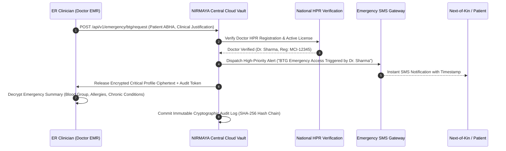

# Federated Database Systems, Edge-Node Architecture & The Solo Doctor Infrastructure Model

## 1. Executive Summary & The Healthcare Centralization Dilemma

Healthcare data architectures worldwide face an existential tension between **centralization** and **decentralization**:
- **The Centralization Trap:** Storing national or enterprise health records in a single monolithic cloud database creates an irresistible honeypot for cyber adversaries, introduces catastrophic single-point-of-failure vulnerabilities, and directly violates data sovereignty and privacy mandates (such as the Indian **Digital Personal Data Protection Act, 2023 (DPDP Act)**, **DISHA**, and **HIPAA**). Hospitals and clinics are legally forbidden or commercially unwilling to surrender raw patient databases to third-party central clouds.
- **The Decentralization Imperative:** Conversely, completely isolated hospital data silos prevent longitudinal patient care, cause lethal diagnostic blindspots in emergency rooms, and force patients to physically transport paper folders and CD-ROMs between doctors.

The architectural solution to this dilemma is the **Federated Database & Edge-Node Network**.

However, a naive federated model assumes every healthcare provider operates a dedicated on-premise server or IT department. **In reality, over 85% of healthcare in India is delivered by solo practitioners, 2-doctor family clinics, and small nursing homes with no database or server.**

This technical document outlines the principles of database federation in healthcare, analyzes what works versus what fails catastrophically, details the **3-Tier Spectrum Architecture** (solving the "No-Database" solo doctor dilemma via a **Local-First Encrypted SQLite + Managed Cloud Tenant** model), and records the architectural decisions resolved through formal design evaluation (`/grill-me`).

---

## 2. What is a Federated Database System (FDBS)?

A **Federated Database System (FDBS)** is an architecture that integrates multiple autonomous, disparate database systems into a single virtual federated system without physically centralizing or copying all records into one monolithic repository.

```
                    ┌──────────────────────────────────────────────┐
                    │       VIRTUAL FEDERATION INTERFACE           │
                    │   (Unified Query & Interoperability Layer)   │
                    └──────┬───────────────┬──────────────┬────────┘
                           │               │              │
           ┌───────────────┘               │              └──────────────┐
           ▼                               ▼                             ▼
┌──────────────────────┐       ┌──────────────────────┐       ┌──────────────────────┐
│  HOSPITAL A NODE     │       │  HOSPITAL B NODE     │       │  SOLO DOCTOR CLOUD   │
│  Autonomous Database │       │  Autonomous Database │       │  Managed Tenant DB   │
│  (PostgreSQL on-prem)│       │  (Legacy Oracle HIS) │       │  (SQLite Sync/RLS)   │
└──────────────────────┘       └──────────────────────┘       └──────────────────────┘
```

### Core Characteristics of Federation:
1. **Local Autonomy:** Each constituent healthcare entity retains complete control over its local data, schemas, storage engine, physical security, and operational workflows. Local operations continue seamlessly even if external network links fail.
2. **Physical Distribution:** Clinical records physically reside where care was delivered—within the hospital's local security perimeter or the doctor's local device.
3. **Engine Heterogeneity:** Constituent nodes do not need to share the same underlying database software; Hospital A can run PostgreSQL, Hospital B can run Oracle, and Solo Doctor C can run an encrypted SQLite embedded database.
4. **Virtual Transparency:** An authorized querying entity (such as a specialist or the patient's PHR application) accesses the network through a standardized interface as though querying a unified record, with the federation layer resolving physical data retrieval dynamically.

---

## 3. What is WRONG: Anti-Patterns of Raw Database-Level Federation

When software teams attempt to implement "federated databases" in healthcare using traditional relational database clustering or direct SQL federation, they invariably encounter critical architectural failures:

```
[ANTI-PATTERN: Direct Cross-Hospital SQL Federation]

Hospital A (PostgreSQL) ─── Port 5432 over Public WAN ───► Hospital B (PostgreSQL)
   ❌ Massive Firewall Vulnerability (Exposing database ports)
   ❌ Distributed 2-Phase Commit (2PC) Deadlocks during WAN lag
   ❌ Tightly Coupled Schemas (One migration breaks all hospital queries)
   ❌ Bypasses Patient Consent & Clinical RBAC at SQL layer
   ❌ Impossible for Solo Doctors (They have no server or static IP)
```

### Anti-Pattern 1: Direct SQL Links (dblink, `postgres_fdw`, Linked Servers) over WAN
- **The Defect:** Opening raw database ports (e.g., PostgreSQL port 5432, MySQL port 3306) across the public internet through hospital enterprise firewalls is an unforgivable security vulnerability. It exposes internal database engines directly to automated exploit scanning and ransomware vectors.
- **The Impact:** Hospital network security teams will immediately block such connections.

### Anti-Pattern 2: Distributed 2-Phase Commit (2PC) Transactions
- **The Defect:** Attempting to maintain ACID transactional guarantees across disparate hospitals via distributed commits means that if Hospital B's fiber connection drops or suffers high packet loss while Hospital A is executing a transaction, database locks remain held indefinitely.
- **The Impact:** Cascading connection pool exhaustion, application freezes, and complete outage of local hospital operations.

### Anti-Pattern 3: Tight Schema Coupling & Migration Fragility
- **The Defect:** In a database-level federation, queries rely on exact table definitions (`patients`, `encounters`, `prescriptions`). If Hospital A upgrades its internal schema or alters a column name, all cross-database queries from other hospitals fail instantly.
- **The Impact:** Prevents individual hospitals from independently evolving or upgrading their internal clinical software.

### Anti-Pattern 4: Circumvention of Patient Consent & Clinical Governance
- **The Defect:** Standard SQL query engines (`SELECT * FROM encounters WHERE patient_id = ...`) have no native understanding of clinical consent contracts, temporal validity windows, emergency "Break-the-Glass" access modes, or purpose-of-use constraints (`CAREMGT` vs `PUBHLTH`).
- **The Impact:** Direct violation of Section 6 of the Indian DPDP Act 2023 and HIPAA Minimum Necessary rules, exposing operators to severe regulatory penalties.

---

## 4. What is RIGHT: The Modern Healthcare Federation Gold Standard

Rather than federating at the **Database Storage Layer**, modern enterprise healthcare federates at the **API & Cryptographic Interoperability Layer**. This is the architectural foundation of the **Ayushman Bharat Digital Mission (ABDM)**, **HL7 FHIR Release 4**, and NIRMAYA.

```
[GOLD STANDARD: Consent-Bound API Federation & Edge Nodes]

1. Central Cloud stores ONLY metadata & identity tokens (0 bytes of clinical records)
2. Discovery uses standardized ABHA handles (<username>@abdm)
3. Retrieval is unlocked strictly via digitally signed Consent Artefacts
4. Data travels as Ephemeral Encrypted FHIR Streams (ECDH Curve25519 + AES-256-GCM)
5. Hospital Edge Nodes operate independently and buffer local clinical workflows
```

### Pillar 1: Contract Abstraction via HL7 FHIR R4
Instead of sharing database tables, systems expose standardized, vendor-neutral HL7 FHIR R4 REST resources (`Patient`, `Encounter`, `Condition`, `Observation`, `MedicationRequest`, `DiagnosticReport`). Internal database schemas can be completely arbitrary; the edge adapter maps internal representations to canonical FHIR JSON.

### Pillar 2: Dynamic Identity Resolution & Care Context Discovery
Patient identity is federated via national 14-digit ABHA Numbers and verifiable ABHA addresses (`<username>@abdm`). When a patient presents at Hospital B, the system queries the ABDM Gateway (`/v0.5/care-contexts/discover`) using deterministic identifiers or fuzzy demographic matching (Levenshtein distance), returning lightweight token references (Care Contexts) without moving any clinical records.

### Pillar 3: Consent Artefact Governance (ABDM M3)
Clinical data cannot be requested or transferred without an **Electronic Consent Artefact (ECA)** digitally signed by an authorized Consent Manager (CM). The consent artefact specifies:
- Explicit permitted health information types (`hiTypes` e.g., `OPConsultation`, `Prescription`).
- Strict clinical date ranges (`permission.dateRange`).
- Hard auto-expunge deadlines (`permission.dataEraseAt`).

### Pillar 4: Ephemeral Forward-Secret Cryptography
Data is never transferred in cleartext. The requesting Health Information User (HIU) and the responding Health Information Provider (HIP) perform an **ephemeral Diffie-Hellman Key Exchange (ECDH Curve25519 / X25519)** to derive a dynamic shared secret via HKDF-SHA256. The FHIR bundle is encrypted with **AES-256-GCM** with a 128-bit authentication tag, streamed directly across HTTPS, and decrypted strictly in memory by the recipient.

---

## 5. The Real-World Dilemma: The "No-Database" Solo Doctor Problem

### 5.1 The Harsh Reality of Clinical Practice in India
While corporate hospital chains (Apollo, Fortis, Max) maintain enterprise IT departments, server rooms, and dedicated databases, **over 85% of healthcare in India is delivered by solo practitioners and small family clinics**.
- A solo pediatrician or GP does not have a server, a database administrator, a static public IP address, or an SSL server.
- They operate with a single laptop, an iPad, or a smartphone.
- When the doctor finishes OPD at 8:00 PM, **they close their laptop and go home**.
- **The Core Problem:** If an emergency room doctor in another city needs that patient's records at midnight, the solo doctor's laptop is powered down in a dark clinic. Furthermore, forcing a solo doctor to install and maintain Docker or PostgreSQL results in an immediate 90%+ onboarding drop-off.

### 5.2 The 3-Tier Multi-Tenancy Architecture
NIRMAYA solves this by implementing a **3-Tier Spectrum Architecture**:

```
[Tier 1: Solo Doctors & Small Clinics (85%)] ──► Local-First SQLite + Managed Cloud Tenant (0 IT overhead)
[Tier 2: Mid-Sized Clinics & Nursing Homes] ──► Turnkey Docker Edge Appliance (Local PC / mini-server)
[Tier 3: Large Hospital Networks]           ──► Legacy Database Adapter / Sidecar (Connects to existing Oracle/HIS)
```

| Infrastructure Tier | Target Institution | Local Deployment | Cloud Footprint | ABDM Gateway Bridge |
| :--- | :--- | :--- | :--- | :--- |
| **Tier 1: Solo Doctor / Micro-Clinic** | Solo GPs, Pediatricians, Dental clinics (85% of market) | Lightweight PWA / Desktop App with embedded encrypted SQLite | Managed Multi-Tenant partition on NIRMAYA Cloud (PostgreSQL RLS) | NIRMAYA Cloud acts as 24/7 ABDM Gateway Bridge on doctor's behalf |
| **Tier 2: Mid-Sized Clinic / Nursing Home** | 10–50 bed nursing homes, multi-specialty polyclinics | Dual-Mode Docker Compose appliance (`docker-compose.edge.yml`) | Minimal metadata & emergency backup only | Local edge appliance handles direct ABDM mTLS webhooks |
| **Tier 3: Large Hospital Network** | Corporate hospitals (100+ beds) with existing HIS | Read-only Gateway Sidecar (`postgres_fdw` / SQL Views) | Zero clinical data in cloud (100% on-premise) | Dedicated hospital enterprise ABDM gateway node |

---

## 6. The Local-First, Cloud-Backed Architecture for Solo Doctors

For Tier 1 solo doctors, NIRMAYA combines an **Embedded Encrypted SQLite Client (Option 3)** with a **Managed Cloud Workspace with Row-Level Security (Option 1)**:

```
   ┌─────────────────────────────────────────────────────────────┐
   │               DOCTOR'S LAPTOP / TABLET (LOCAL)              │
   │  - NIRMAYA Desktop / PWA Client                             │
   │  - Embedded Local SQLite Database (Encrypted)               │
   │  - Instant 0ms local response time                          │
   │  - 100% functional even during clinic power/internet cuts   │
   └──────────────────────────────┬──────────────────────────────┘
                                  │
                                  │ Append-Only Event Stream Sync
                                  │ (Encrypted HTTPS / WebSockets)
                                  ▼
   ┌─────────────────────────────────────────────────────────────┐
   │             NIRMAYA MANAGED CLOUD (POSTGRESQL RLS)          │
   │  - Dedicated Tenant Isolation (`tenant_id = clinic_123`)    │
   │  - Automated Cloud Backups (Zero risk of lost clinic data)   │
   │  - Acts as the Doctor's 24/7 ABDM Gateway Bridge:           │
   │      * Answers national ABHA discovery queries              │
   │      * Handles consent notifications (/v0.5/consents/notify)│
   │      * Streams encrypted FHIR bundles to other hospitals    │
   └─────────────────────────────────────────────────────────────┘
```

### 6.1 Synchronization Mechanism: Append-Only Clinical Event Log
Medical records are legally and ethically immutable. Doctors do not overwrite historical consultations; they append addenda or status amendments.

NIRMAYA implements an **Append-Only Clinical Event Log**:
1. **Event Capture:** Every action (recording blood pressure, adding a clinical condition, issuing an e-prescription, updating a SOAP note) is committed locally in SQLite as an immutable, cryptographically signed event with a UUIDv7 and timestamp:
   ```json
   {
     "eventId": "018f3a9e-821b-7a11-a890-001a4a123456",
     "tenantId": "clinic_dr_sharma",
     "patientId": "NIR-P-10023",
     "eventType": "MEDICATION_PRESCRIBED",
     "payload": {
       "drugCode": "RX-5421",
       "drugName": "Amoxicillin 500mg",
       "dosage": "1 capsule 3x daily",
       "durationDays": 5
     },
     "signedAt": "2026-10-30T10:15:00.000Z",
     "doctorSignature": "SHA256withECDSA/MEQCID..."
   }
   ```
2. **Deterministic Conflict Elimination:** Because clinical events are strictly additive, concurrent updates never conflict or overwrite each other. Merging local events into the cloud PostgreSQL database is a clean append operation.
3. **Flaky Network Resilience:** If clinic Wi-Fi drops every 5 minutes, the sync daemon resumes from the last acknowledged `eventIndex`, guaranteeing zero duplicate entries and zero dropped prescriptions.

### 6.2 Dual-Registration ABDM Bridge Model
To eliminate government bureaucratic friction while maintaining national accreditation:
- **Instant 2-Minute Onboarding:** When a solo doctor signs up, they are immediately provisioned under NIRMAYA’s master national bridge (`NIRMAYA_HIP_ID = "IN0410000123"`). They can generate ABHA cards, receive patient tokens, and issue e-prescriptions on day 1 with **zero government paperwork**.
- **Official HFR Binding:** If the clinic possesses or later obtains an official Government **Health Facility Registry (HFR)** ID from the National Health Authority (NHA), they can link their HFR ID in clinic settings. NIRMAYA Cloud seamlessly associates incoming ABDM requests with their official facility badge.

---

## 7. The 2-Tier Data Storage Topology & Emergency Break-The-Glass (BTG)

Across both hospital edge nodes and solo doctor cloud tenants, clinical data adheres to a **Hybrid 2-Tier Storage Topology**:

```
                 ┌────────────────────────────────────────────────────────┐
                 │          NIRMAYA CENTRAL CLOUD ORCHESTRATOR           │
                 │  (ABDM Gateway, HIE-CM Consent Manager, ABHA Registry) │
                 └──────┬─────────────────────────┬───────────────────────┘
                        │                         │
    Metadata & Consent  │                         │  Metadata & Consent
    Webhooks (/v0.5)    │                         │  Webhooks (/v0.5)
                        ▼                         ▼
        ┌────────────────────────┐       ┌────────────────────────┐
        │ HOSPITAL A EDGE NODE   │       │ SOLO DOCTOR CLOUD      │
        │ (Dual-Mode On-Premise) │       │ (Managed RLS Tenant)   │
        │                        │       │                        │
        │ ┌────────────────────┐ │       │ ┌────────────────────┐ │
        │ │ Local PostgreSQL   │ │       │ │ Cloud Tenant DB    │ │
        │ │ (95% Clinical Data)│ │       │ │ (95% Clinical Data)│ │
        │ └────────────────────┘ │       │ └────────────────────┘ │
        └───────────┬────────────┘       └───────────▲────────────┘
                    │                                │
                    └────── Ephemeral Encrypted ─────┘
                            FHIR Data Stream
                        (ECDH Curve25519 + AES-GCM)
```

### 7.1 Tier 1: Zero-Replication On-Demand Clinical Pull (95% of Data)
- **Data Location:** 100% on-premise at hospital edge nodes, or within isolated tenant partitions (`tenant_id`) for solo doctors.
- **Central Cloud Footprint:** **Zero bytes** of clinical encounters, SOAP notes, prescriptions, or laboratory panels in the global catalog. The central orchestrator only stores identity pointers (ABHA number, ABHA handle, and Care Context Reference tokens e.g. `ENC-2026-0042`).
- **Transfer Mechanism:** Records stream exclusively when unlocked by a patient's mobile Consent Artefact via ephemeral ECDH Curve25519 + AES-256-GCM encryption.

### 7.2 Tier 2: Zero-Knowledge Emergency Health Profile ("Break-the-Glass" Cloud Shadow)
- **Scope:** Life-critical summary (Blood Group, High-Risk Allergies, Chronic Conditions e.g. Diabetes/Asthma, Emergency Contacts, Active Implanted Devices).
- **Encryption:** Client-side Zero-Knowledge AES-256-GCM encryption. The central cloud stores only opaque ciphertext; database administrators and cloud engineers have **no access** to plaintext or decryption keys.
- **Break-the-Glass (BTG) Protocol:**



1. **Clinician Identity Assertion:** The doctor authenticates using their official Healthcare Professional Registry (HPR) identity (`@hpr.abdm`) and digital signature certificate.
2. **Mandatory Justification:** Requires clinical rationale (e.g., `EMERGENCY_TRAUMA_UNCONSCIOUS`).
3. **Immediate Out-of-Band Notification:** High-priority SMS alerts fire immediately to the patient's registered mobile and emergency contacts.
4. **Ciphertext Release & Audit Chain:** Emergency summary ciphertext is released and committed to an immutable SHA-256 cryptographic audit chain.

---

## 8. Record of Design Decisions (`/grill-me` Comprehensive Archive)

All foundational architectural decisions resolved across the `/grill-me` design interview sessions:

| Decision Area | Design Question | Selected Architecture | Key Architectural Rationale |
| :--- | :--- | :--- | :--- |
| **Federation Layer** | Which architectural layer of federation should NIRMAYA adopt? | **Hybrid: API-Level FHIR Federation + Edge-Node Hospital Vaults** | Combines 100% hospital data sovereignty (DPDP Act compliance) with national ABDM M3 consent interoperability; completely avoids the security risks of opening raw database ports across the WAN. |
| **Data Storage Topology** | How should records be synchronized between hospital nodes and cloud? | **Hybrid: Zero-Replication On-Demand Pull + Opt-In Zero-Knowledge Emergency Backup** | 95% of clinical charts stay strictly on-premise; 5% life-critical data (allergies, blood group) is backed up as zero-knowledge ciphertext to save lives in emergency trauma. |
| **Edge Node Packaging** | How should hospital edge nodes be deployed and integrated? | **Dual-Mode Edge Appliance (Standalone Stack + Legacy FDW Adapter)** | Standalone clinics get a turnkey Docker EMR; large tertiary hospitals can integrate their existing Oracle/MySQL databases non-invasively via read-only foreign data adapters. |
| **Emergency Cryptography** | How should emergency decryption keys be managed? | **ABDM "Break-the-Glass" (BTG) + Patient Master Key** | Balances patient privacy with clinical urgency. Verified doctors can override in ICU emergencies with mandatory HPR logging and instant SMS alerts to next-of-kin. |
| **Solo Doctor Hosting** | How should NIRMAYA serve solo doctors without a server or database? | **Hybrid: Encrypted Local SQLite (PWA) + Managed Cloud Tenant (PostgreSQL RLS)** | Eliminates 100% of IT friction for solo doctors (works offline on laptop with 0ms latency), while NIRMAYA Cloud acts as their 24/7 ABDM Gateway Bridge. |
| **Data Synchronization** | How should local doctor devices sync with NIRMAYA Cloud? | **Append-Only Clinical Event Log** | Medical records are additive; event-sourcing eliminates sync conflicts entirely, operates reliably over intermittent clinic Wi-Fi, and provides a tamper-evident audit log. |
| **National ABDM Registration** | How should solo doctors connect to the national gateway? | **Dual-Registration ABDM Bridge Model** | Solo doctors get instant 2-minute onboarding under NIRMAYA's master bridge; accredited clinics can bind their official Government HFR ID anytime. |

---

## 9. Master Roadmap Scheduling

This architecture is scheduled across the remaining 80-day development roadmap:

```
Month 3: ABDM Core (Weeks 9-12)
  ├── Week 11 (Days 51-55) [CURRENT]: ABDM M3 Consent, ECDH Key Exchange, Encrypted FHIR Pipeline
  └── Week 12 (Days 56-60): FHIR R4 Bundle Validation & National Sandbox Certification (v0.3.0)

Month 4: Production Hardening, Edge Packaging & Monograph (Weeks 13-16)
  ├── Week 13 (Days 61-65): Zero-Knowledge Break-The-Glass (BTG) Emergency Vault & Real-Time Sync
  ├── Week 14 (Days 66-70): OWASP ASVS Level 2 Security Hardening & Penetration Testing
  ├── Week 15 (Days 71-75): Dual-Mode Edge Appliance, Local-First SQLite PWA & FDW Legacy Bridge
  └── Week 16 (Days 76-80): Academic Thesis Monograph & Master Production Release v1.0.0
```

- **Week 11 (Days 51–55, Current):** Cryptographic core of federation (Consent Ingestion, Diffie-Hellman Key Exchange, AES-GCM Encrypted FHIR Streaming, HIU Ingest).
- **Week 13 (Days 61–65):** Break-The-Glass (BTG) Emergency Profile schemas, Argon2id key derivation, and automated emergency contact SMS dispatch.
- **Week 15 (Days 71–75):** Production Dual-Mode Edge Node Appliance packaging (`docker-compose.edge.yml`), Local-First SQLite PWA client sync engine, and PostgreSQL Foreign Data Wrapper adapters for legacy hospital databases.
- **Week 16 (Days 76–80):** 80-Day Academic Thesis Monograph documenting the Federated Health Network and Solo Doctor Multi-Tenant Architecture for Release **`v1.0.0`**.
