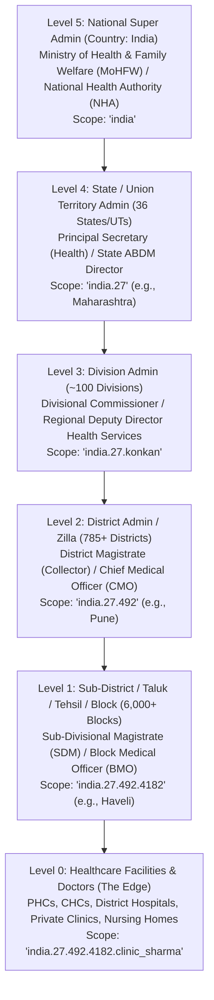
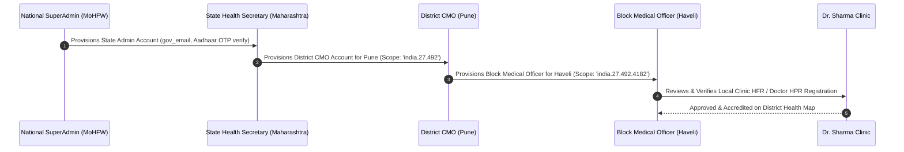

# India 6-Tier Administrative Health Governance Hierarchy & LGD Multi-Tenancy

## 1. Executive Summary & Administrative Context

India’s healthcare system is constitutionally a State subject, yet unified digitally under the **National Health Authority (NHA)** and the **Ministry of Health and Family Welfare (MoHFW)** through the **Ayushman Bharat Digital Mission (ABDM)**.

To govern a nation of 1.4 billion citizens, healthcare administration follows a 6-tier sovereign chain of command spanning Union, State, Divisional, District, and Sub-District levels down to individual healthcare facilities and practitioners:

```
[Level 5: Country / National SuperAdmin (MoHFW / NHA)]
   └── [Level 4: State / Union Territory (Health Secretary / State ABDM Director)]
          └── [Level 3: Administrative Division (Divisional Commissioner / RDDHS)]
                 └── [Level 2: District / Zilla (DM / Collector / Chief Medical Officer - CMO)]
                        └── [Level 1: Sub-District / Taluk / Tehsil / Block (BMO / THO)]
                               └── [Level 0: Healthcare Facilities & Solo Doctors (The Edge)]
```

This standard defines how NIRMAYA models India's administrative geography using **Ministry of Panchayati Raj / MeitY Local Government Directory (LGD) codes**, implements **PostgreSQL `ltree` hierarchical indexing for sub-2ms territorial queries**, enforces a **Dual-Plane privacy air-gap (DPDP Act 2023 compliant)**, and automates **Chain-of-Command administrative provisioning**.

---

## 2. The 6-Tier Administrative Hierarchy



### Administrative Scope & Authority by Level:

| Level | Administrative Unit | Typical Government Designations | Operational Scope & Authority |
| :--- | :--- | :--- | :--- |
| **Level 5** | **Country (India)** | National Health Authority (NHA), MoHFW, DGHS | **Pan-India Macro Governance:** National health indices, inter-state disease tracking (IDSP), nationwide ABHA adoption rates, strategic medical reserve allocation. |
| **Level 4** | **State / Union Territory** | Principal Secretary (Health), State Mission Director (NHM), State ABDM Director | **Statewide Healthcare Leadership:** State healthcare budget allocations, state doctor-to-population ratios, hospital bed capacity, medical college accreditations. |
| **Level 3** | **Administrative Division** | Divisional Commissioner, Regional Deputy Director of Health Services (RDDHS) | **Regional Coordination:** Coordinates 4–8 contiguous districts; balances regional ICU/oxygen/blood bank distribution during regional health emergencies. |
| **Level 2** | **District (Zilla)** | District Magistrate (Collector / DM), Chief Medical Officer (CMO), DHO | **District Command Center:** Master roster of every registered hospital and clinic in the district; live outbreak monitoring (e.g. dengue spikes in specific tehsils); clinical license audits. |
| **Level 1** | **Sub-District (Taluk / Tehsil / Block)** | Sub-Divisional Magistrate (SDM), Block Medical Officer (BMO), Taluk Health Officer (THO) | **Block-Level Operations:** Supervision of Primary Health Centers (PHCs), Community Health Centers (CHCs), and private clinics; maternal health and immunization tracking. |
| **Level 0** | **Facility / Local Practice** | Doctors, Physicians, Pediatricians, Lab Pathologists | **Direct Clinical Care:** Writing SOAP notes, ordering lab tests, issuing e-prescriptions, managing OPD queues, and generating ABHA care contexts. |

---

## 3. Core Operational Powers & Dual-Plane Privacy Separation

### 3.1 The Dual-Plane Architecture
To balance administrative oversight with medical privacy, NIRMAYA enforces an architectural air-gap between the **Administrative Plane** and the **Clinical Data Plane**:

```
┌────────────────────────────────────────────────────────────────────────┐
│                   ADMINISTRATIVE & GOVERNANCE PLANE                    │
│  - Doctor License Verification (HPR Registry Integration)              │
│  - Hospital Facility Accreditations (HFR Facility Audits)             │
│  - Real-time Hospital Bed & ICU Occupancy Tracking                     │
│  - Critical Drug Inventory & Emergency Oxygen Logistics                │
│  - Epidemiological Outbreak Heatmaps (Anonymized k-Anonymity >= 10)    │
│  - Cross-District Resource Rebalancing During Epidemics                │
└───────────────────────────────────┬────────────────────────────────────┘
                                    │
                                    │ ❌ STRICT ARCHITECTURAL AIR-GAP
                                    │ (Zero Direct Access without Consent)
                                    ▼
┌────────────────────────────────────────────────────────────────────────┐
│                    CLINICAL DATA PLANE (CONFIDENTIAL)                  │
│  - Individual Patient SOAP Notes, Vitals & Clinical Diagnoses          │
│  - Psychiatric Notes, Genetic Reports, HIV / Oncology Lab Values       │
│  - Electronic Prescriptions & Medication Dispenses                     │
│  - Protected by Patient Mobile Consent Artefact (/v0.5/consents/notify)│
└────────────────────────────────────────────────────────────────────────┘
```

1. **What Admins CAN Supervise:**
   - Provider licensing, credentialing, and suspension of fraudulent practitioners.
   - Public health heatmaps: *"54 confirmed Dengue cases reported in Block Haveli over past 7 days"*.
   - Hospital capacity: *"84% of ICU ventilators in Pune District currently occupied"*.
2. **What Admins CANNOT Access:**
   - Private clinical records, diagnosis notes, or individual patient charts are completely inaccessible to administrators. Access requires a patient-approved ABDM Consent Artefact.

---

## 4. PostgreSQL Database Modeling: LGD Schema with `ltree`

### 4.1 Database Table: `administrative_units`
```sql
CREATE EXTENSION IF NOT EXISTS ltree;

CREATE TYPE admin_level_enum AS ENUM (
    'COUNTRY', 
    'STATE', 
    'DIVISION', 
    'DISTRICT', 
    'SUB_DISTRICT'
);

CREATE TABLE administrative_units (
    id UUID PRIMARY KEY DEFAULT gen_random_uuid(),
    name VARCHAR(150) NOT NULL,
    unit_level admin_level_enum NOT NULL,
    lgd_code VARCHAR(20) UNIQUE,                   -- Official Govt LGD Code (e.g. "492" for Pune)
    path ltree NOT NULL,                           -- Hierarchical path: 'india.27.492.4182'
    parent_id UUID REFERENCES administrative_units(id) ON DELETE RESTRICT,
    is_active BOOLEAN DEFAULT TRUE,
    created_at TIMESTAMPTZ DEFAULT NOW(),
    updated_at TIMESTAMPTZ DEFAULT NOW()
);

-- Ultra-fast GIST index for querying entire sub-trees in < 2ms
CREATE INDEX idx_admin_units_path_gist ON administrative_units USING GIST (path);
CREATE INDEX idx_admin_units_level ON administrative_units(unit_level);
```

### 4.2 Database Table: `administrative_officers`
```sql
CREATE TYPE govt_designation_enum AS ENUM (
    'NATIONAL_DIRECTOR',
    'STATE_SECRETARY',
    'DIVISIONAL_COMMISSIONER',
    'DISTRICT_MAGISTRATE',
    'CHIEF_MEDICAL_OFFICER',
    'BLOCK_MEDICAL_OFFICER'
);

CREATE TABLE administrative_officers (
    id UUID PRIMARY KEY DEFAULT gen_random_uuid(),
    user_id UUID NOT NULL REFERENCES users(id) ON DELETE CASCADE,
    designation govt_designation_enum NOT NULL,
    administrative_unit_id UUID NOT NULL REFERENCES administrative_units(id),
    jurisdiction_path ltree NOT NULL,              -- e.g. 'india.27.492'
    gov_email VARCHAR(255) NOT NULL,               -- e.g. cmo.pune@gov.in / @nic.in
    aadhaar_verified BOOLEAN DEFAULT TRUE,
    appointed_by UUID REFERENCES administrative_officers(id),
    is_active BOOLEAN DEFAULT TRUE,
    appointed_at TIMESTAMPTZ DEFAULT NOW()
);

CREATE INDEX idx_admin_officers_jurisdiction ON administrative_officers USING GIST (jurisdiction_path);
```

### 4.3 Sub-2ms Hierarchical Scoped Queries
When the Chief Medical Officer of Pune logs in, their `jurisdiction_path` is `'india.27.492'`.

1. **Find all hospitals and clinics in their district & all child tehsils:**
   ```sql
   SELECT * FROM facilities 
   WHERE admin_path <@ 'india.27.492';
   ```
2. **Aggregate all dengue cases across the district in the past 14 days:**
   ```sql
   SELECT au.name AS sub_district_name, COUNT(c.id) AS case_count
   FROM clinical_conditions c
   JOIN facilities f ON c.facility_id = f.id
   JOIN administrative_units au ON f.sub_district_id = au.id
   WHERE f.admin_path <@ 'india.27.492'
     AND c.code_value = '38362002' -- SNOMED code for Dengue
     AND c.recorded_date >= NOW() - INTERVAL '14 days'
   GROUP BY au.name
   ORDER BY case_count DESC;
   ```

---

## 5. Administrative Provisioning: Chain-of-Command Delegation



- **Top-Down Authentication:** Each level provisions and authenticates its direct subordinate tier.
- **Transfer Handling:** When an officer is transferred, their immediate supervisor updates the appointment record, immediately revoking access from the old officer and granting it to the incoming officer.
- **MFA Enforcement:** Mandatory login via official government email domain (`@gov.in` / `@nic.in`) backed by Aadhaar biometric OTP.

---

## 6. Record of Design Decisions (`/grill-me` Comprehensive Archive)

All foundational architectural decisions resolved across the `/grill-me` design interview sessions for this administrative hierarchy:

| Decision Area | Design Question | Selected Architecture | Key Architectural Rationale |
| :--- | :--- | :--- | :--- |
| **Operational Scope** | What powers should administrators have at each level? | **Full-Spectrum Healthcare Governance** | Combines Regulatory Licensing (HPR doctor validation & HFR clinic accreditations), Epidemiological Surveillance (outbreak heatmaps), and Resource Telemetry (ICU beds, oxygen reserves). |
| **Privacy Boundary** | How should patient clinical privacy be protected against admin overreach? | **Dual-Plane Separation** | Full oversight over healthcare infrastructure and anonymized public health heatmaps, with an absolute air-gap blocking administrators from browsing individual patient medical charts (100% DPDP Act 2023 compliant). |
| **Territorial Modeling** | How should the geographic hierarchy be indexed in the database? | **Official Govt LGD Codes + PostgreSQL `ltree`** | Standardized to Ministry of Panchayati Raj Local Government Directory codes (e.g. `india.27.492.4182`), enabling sub-2ms sub-tree roll-ups and direct compatibility with CoWIN/ABDM. |
| **Administrative Provisioning** | How should government accounts be created and authenticated? | **Chain-of-Command Delegation with Aadhaar MFA** | Reflects Indian civil service hierarchy (National provisions States $\to$ States provision Districts $\to$ Districts provision Blocks). Secured via `@gov.in` / `@nic.in` email and Aadhaar OTP. |
| **Roadmap Pacing** | Where does this hierarchy fit in the 80-day master plan? | **Week 14 Integration (Days 66–70)** | Engineered alongside Enterprise RBAC, Zero-Trust Architecture, and ASVS Level 2 compliance in Week 14. |

